# Flow: who does what, and where humans decide

Swimlane view of the default (Balanced) flow from [spec.md](../spec.md) §8–9. Each lane is one actor; arrows that cross lanes are hand-offs. Diamonds are the active checkpoints (G1, G3, G6). Agents never approve — every decision sits in a human lane.

```mermaid
flowchart LR
  subgraph PO["👤 Product Owner"]
    P1["Creates initiative<br/>(goal + repository)"]
    P2{{"G1: approves spec"}}
    P3["Accepts or rejects<br/>declared assumptions"]
    P4{{"G6: approves release<br/>(if holding the hat)"}}
  end

  subgraph PA["🤖 Product Agent"]
    PA1["Drafts spec and stories"]
    PA2["Writes down assumptions"]
  end

  subgraph AA["🤖 Architect Agent"]
    AA1["Drafts design + ADRs"]
  end

  subgraph AR["👤 Architect"]
    A2{{"G1: approves design"}}
  end

  subgraph EA["🤖 Engineer Agents"]
    EA1["Build tasks in parallel<br/>sandboxes, run verification"]
    EA2["Open pull requests<br/>(only on a pass)"]
  end

  subgraph PE["👤 Peer Engineer"]
    E2{{"G3: reviews each PR<br/>(auto-merge for pre-approved types)"}}
  end

  subgraph DA["🤖 DevOps Agent"]
    D1["Prepares release"]
  end

  subgraph RA["👤 Release Approver"]
    R1{{"G6: approves production<br/>(hard stop, every mode)"}}
  end

  subgraph BA["🤖 Bug Agent"]
    B1["Reproduces and fixes<br/>a reported bug"]
  end

  P1 --> PA1 --> AA1
  AA1 --> P2
  AA1 --> A2
  P2 --> EA1
  A2 --> EA1
  EA1 --> EA2
  EA2 --> E2 --> D1 --> R1 --> DONE(["Pipeline deploys<br/>(not an agent)"])
  PA2 -. "visible, accepted later" .-> P3
  P3 -. "scope change re-opens G1" .-> P2
  DONE -. "feedback / bug report" .-> B1
  B1 --> EA2
```

## Reading the diagram

- **Solid arrows** are the happy path; **dashed arrows** are the loops (assumptions, bugs, scope changes).
- **G1** blocks until both the Product Owner (spec) and the Architect (design) approve.
- **G3** is per-PR: a peer reviews, or the PR merges automatically when it is a pre-approved change type and CI is green. Triggered PRs always go to a human.
- **G6** is a hard stop in every autonomy mode — production is never automatic.
- Optional checkpoints (G4 verification, G5 security) are omitted here; they activate per Initiative or on triggers and route to QA or Security.
- Autopilot mode relaxes G1 and G3 (approve-or-object windows, auto-merge) but never G6.
