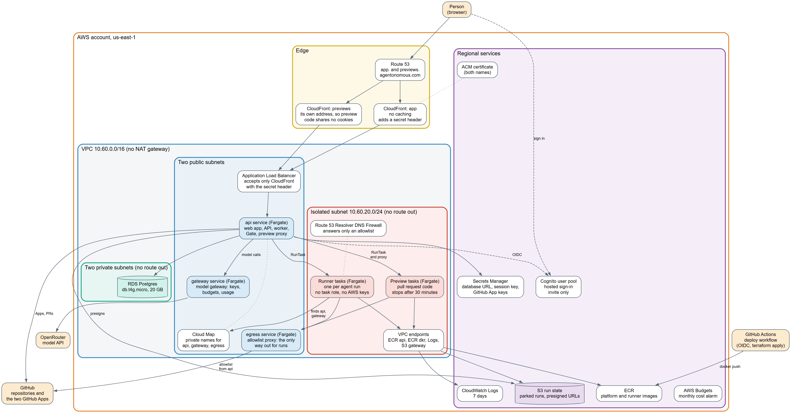

# AWS architecture



Source: [architecture.dot](architecture.dot) (Graphviz), drawn from the Terraform in this folder. [architecture.svg](architecture.svg) is the same picture as a vector.

## How to read it

- **Edge.** A person reaches `app.agentonomous.com` through Route 53 and CloudFront. Previews are served from a second CloudFront address, `previews.agentonomous.com`, so unreviewed pull request code shares no cookies with the platform. The load balancer accepts only CloudFront, and only with a secret header.
- **Public subnets.** Three always-on Fargate services: `api` (web app, API, worker, Gate, preview proxy), `gateway` (the model gateway) and `egress` (the allowlist proxy). They have public IPs and no NAT gateway, which saves about $33 a month.
- **Private subnets.** RDS Postgres, with no route out.
- **Isolated subnet.** Agent runs and previews are one-off Fargate tasks with no route to the internet, no task role and no AWS keys. They reach the api and gateway by private names (Cloud Map), the internet only through the egress proxy, and images, logs and their saved state through VPC endpoints. A DNS firewall answers only an allowlist.
- **Outside the VPC.** Cognito (invite-only sign-in), Secrets Manager, ECR, the S3 bucket for parked run state, CloudWatch Logs and an AWS Budgets alarm.
- **Outside AWS.** GitHub (repositories and the two GitHub Apps), OpenRouter (models), and GitHub Actions, which deploys with an OIDC role.

Idle cost is about $3.30 a day (see "Idle cost" in [../../mvp-contract.md](../../mvp-contract.md)).

## Redraw

```powershell
# any Graphviz: dot -Tsvg architecture.dot -o architecture.svg
```
