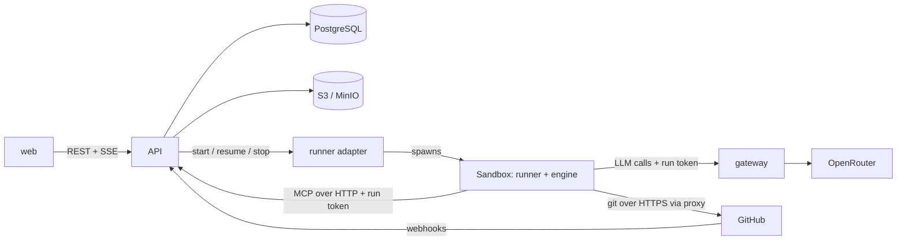
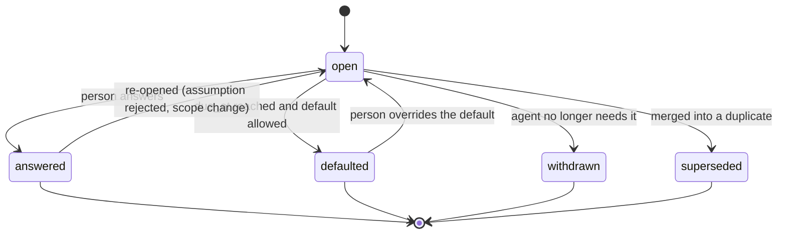
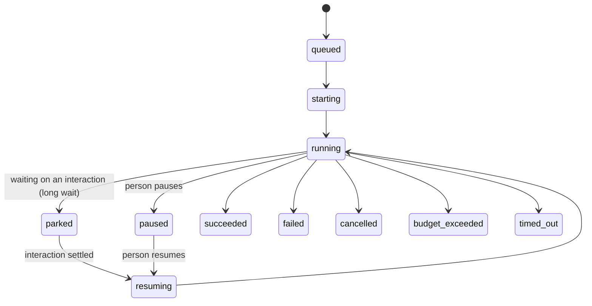

# MVP Implementation Contract

**Status:** draft 0.1, 2026-10-17. Companion to [spec.md](./spec.md) v0.6. The spec says *what and why*. This file pins down *the interfaces you code against* for build steps 0 to 2 (§17). Steps 3 to 5 are sketched only.

**References.** `§n` points to a section of [spec.md](./spec.md). "Section n" points to this file.

**How to use it.** Everything here is a proposal with a default. Change a default by editing this file in the same commit as the code. Items marked **[open]** are not decided. Evidence for the riskiest assumptions is in [spikes/README.md](./spikes/README.md).

**Conventions**
- Ids are UUIDv7 stored as `uuid`. Times are `timestamptz` in UTC. Money is integer micro-USD (`cost_micros`).
- Names in the database are `snake_case`. Names in JSON are `camelCase`. Enum values are lowercase `snake_case` strings.
- Every table has `id`, `created_at`, and `updated_at` unless it is append-only (`activity_event`, `run_event`).
- Every state change writes an `activity_event` in the same transaction.

---

## 1. Stack (proposed, change by ADR)

| Area | Choice | Why |
|---|---|---|
| Language | **TypeScript everywhere** (Node 22 LTS) | One language for API, runner, MCP server, gateway, and UI. Matches the spec's "TypeScript preferred". |
| Monorepo | pnpm workspaces | Shared types and schemas between services and UI. |
| API | Fastify + `zod`. Responses are validated with the shared `zod` schemas in `packages/schemas`. | Typed routes, schema-first, small. (The Fastify zod type provider was not used. Revisit when route count grows.) |
| Database | PostgreSQL 16, Drizzle ORM, SQL migrations checked in | Schema in TypeScript, plain SQL when needed. |
| Workflow | A **state machine in PostgreSQL** (sections 5 and 6), driven by a worker loop with `FOR UPDATE SKIP LOCKED` | Resolves the §19 "workflow engine" question for the MVP. Revisit only if timers and retries get painful. |
| Real-time UI | Server-Sent Events from the API | Simpler than WebSockets, enough for an inbox and a map. |
| UI | Vite, React, TypeScript, xyflow, TanStack Query | As in spec §12.2. |
| Auth | OIDC (Dex locally, Cognito on AWS) with the authorization-code flow, PKCE | Spec §6.6. |
| Tests | Vitest (unit, contract), Playwright (UI and e2e) | One runner for TypeScript. |
| Lint and format | ESLint, Prettier, `tsc --noEmit` in CI | |
| IaC | Terraform, one root module per environment | Spec §12.4. |
| Container images | One Dockerfile per service, multi-stage | Same images locally and on AWS. |

## 2. Repository layout

```text
autonomous-sdlc/
  apps/
    api/            Fastify API, workflow worker, platform MCP server, webhooks
    gateway/        Model Gateway (from spikes/s1)
    runner/         Container entrypoint that hosts an engine inside a sandbox
    web/            React workspace and SDLC map
  packages/
    core/           Domain types, state machines, rules evaluation (no I/O)
    schemas/        zod schemas shared by API, MCP, events, UI
    engines/        AgentEngine port and adapters (claude-code first)
    ports/          Interfaces and adapters: storage, secrets, identity, notifier, runner
    db/             Drizzle schema and migrations
  infra/
    compose/        docker-compose for local mode
    terraform/      aws-sandbox stack (VPC, ECS, RDS, S3, Cognito, endpoints, DNS firewall)
  agents/           Versioned AgentDefinitions (section 9) and prompt files
  rules/            Default triggers and pre-approved change types (YAML, section 12)
  spikes/           Throwaway experiments (not built, not deployed)
  designs/ demo/    Mockups and narrated demos
```

Rules: `packages/core` has **no I/O**. `apps/*` depend on `packages/*`, never on each other. Adapters live in `packages/ports` and are chosen by configuration.

## 3. Processes in the MVP



- **api**: REST, SSE, platform MCP at `/mcp`, GitHub webhooks, and the workflow worker (same process at first, split later).
- **gateway**: separate process from the first day, so sandboxes never share a process with the platform's secrets.
- **Runner adapters** (one port, three adapters): `process` (a child process on your machine, for the first week and for debugging), `docker` (local, §12.4), `fargate` (AWS). Docker Desktop is not running on this workstation today, so start with `process`.

## 4. Data model (core tables)

Only the columns needed for steps 0 to 2. `*` marks a required column. Add the rest when needed.

**`person`** `id*, display_name*, email*, oidc_subject*, github_user_id?, slack_user_id? (unique, set by an admin), active*`

**`hat`** `id*, person_id*, role*` (§8.1 role), `deputy_person_id?, hours? (jsonb: { tz?, days?: 1..7, start: "HH:MM", end }), out_of_office? (jsonb: { from, until, delegateTo? })`

**`repository_entry`** (registry, §6.5) `id*, full_name*, access* (read_write|read_only), write_mode* (direct|branch_pr), integration_branch* default 'main', protected_paths* (text[]), allowed_paths? (text[]), model_policy* (any|own_account), verify_command* default 'npm run verify', github_installation_id?`

**`initiative`** `id*, title*, goal*, repository_id*, autonomy_mode* (guided|balanced|autopilot) default balanced, state* (draft|active|paused|done|cancelled), created_by*, budget_micros?`

**`story`** `id*, initiative_id*, key*, title*, body*, acceptance (jsonb), state*`

**`stage_state`** `initiative_id*, stage* (product|design|implementation|testing|security|release|feedback), status* (not_started|working|waiting_human|done|blocked)`. Drives the map.

**`interaction`** (§5.1) `id*, initiative_id*, run_id?, type* (question|checkpoint|review|decision|notice), checkpoint_id? (G0..G7), state*, title*, context_card* (jsonb, fields in §5.7), options (jsonb), recommendation?, default_value?, due_at?, blocks (jsonb: list of {runId|storyId}), role_needed*, assigned_person_id?, escalation_level* default 0, level_started_at?, reminder_count* default 0, last_reminded_at?, snoozed_until?, priority* default 0, answer (jsonb: { text, decision?, choice?, source: human|default|standing }), answered_by?, answered_via? (workspace|slack|teams|email|default|standing), answered_at?, didnt_need_to_ask* default false, standing_decision_id?`

**`notification`** (the outbox of the notifier port) `id*, person_id*, interaction_id?, kind* (ask|reminder|escalation|default_applied|digest), channel* (slack|log), status* (pending|held|sent|failed|skipped), body (jsonb), external_ref? (Slack channel and ts), error?, sent_at?`

**`assumption`** `id*, initiative_id*, run_id*, text*, state* (declared|accepted|rejected), decided_by?`

**`standing_decision`** `id*, scope* (global|repository|initiative), scope_id?, topic*, text*, created_from_interaction_id?, created_by?, active*`

**`agent_run`** `id*, initiative_id*, agent_role*, agent_definition_id*, agent_definition_version*, engine*, model_alias*, state* (section 6), sponsor_person_id*, contributors (uuid[]), repository_id*, branch?, pr_number?, session_ref? (object store key), park_reason?, budget_micros*, cost_micros* default 0, started_at?, finished_at?, exit_reason?`

**`run_event`** (append-only) `id*, run_id*, seq*, ts*, type*, payload* (jsonb)`. Unique `(run_id, seq)`.

**`run_token`** `token_hash*, run_id*, scopes* (text[]), expires_at*, revoked_at?`. Tokens are random 32 bytes, stored hashed.

**`cost_record`** `id*, run_id?, initiative_id?, source* (agent|service), alias*, provider_model*, input_tokens*, output_tokens*, cached_tokens*, cost_micros*`

**`integration_entry`** (§6.7) `id*, name* (unique), kind* (second_party|third_party), owner?, initiative_id? (empty: every initiative), docs[] (links), hosts[] (hostnames), auth_type*, credential_ref? (a name in the secrets store), data_sent?, data_received?, test_strategy* (vendor_sandbox|mock|recorded|none), limits_and_cost?, terms?, failure_behavior?, status* (proposed|confirmed|rejected|retired), proposed_by?, confirmed_by?, confirmed_at?`. **`doc_snapshot`** `id*, integration_id*, url*, sha256*, content? (untrusted text, cut to 100 KB), error?, fetched_at*`.

**`artifact`** `id*, initiative_id*, run_id?, kind* (spec|adr|diagram|code|test|result|release_notes), git_ref? (repo, sha, path), object_key?`

**`activity_event`** (append-only, §10.6) `id*, ts*, actor_type* (person|agent|system), actor_id?, initiative_id?, run_id?, interaction_id?, action*, detail* (jsonb)`

Later: `integration_entry`, `doc_snapshot`, `github_link`, `pre_approved_change_type`, `trigger`, `release`, `simulated_teammate`.

## 5. Interaction state machine



Checkpoint and review interactions use a decision instead of an answer: `answered` carries `decision` of `approved`, `changes_requested`, or `rejected`. They never reach `defaulted` (§6.3 and §5.1).

Rules:
- **Default applies only when** `type` is `question` or `decision`, a `default_value` exists, `due_at` has passed, and no hard-stop flag is set. The state becomes `defaulted`, `answered_via` is `default`, and the activity log flags it.
- **Reminders and escalation are not states.** They are `activity_event`s plus a bump of `escalation_level` along the hat's fallback chain (§5.4). A reminder never approves.
- **Independent review** (§6.4): a person in the run's `sponsor` or `contributors` cannot answer a `review` or `checkpoint` for that run. The API returns 403 with reason `independent_review`.
- **"Didn't need to ask"** sets `didnt_need_to_ask` without changing state.
- **Standing decision**: answering with `makeStanding: true` creates a `standing_decision` and links it.
- **De-duplication**: before creating an interaction the API checks open interactions with the same `(initiative_id, topic_key)`. If found, it links the new ask to the existing one and returns the existing id.

## 6. Run lifecycle and the engine port



Terminal states: `succeeded`, `failed`, `cancelled`, `budget_exceeded`, `timed_out`. A run in a terminal state is never restarted. A new run is created instead.

**Blocking vs parking** (spike 2). A tool call to `ask_human` with `blocking: true` holds the call open for up to **120 seconds** (`BLOCKING_MAX_S`). After that the API tells the runner to **park**: the engine process ends, the session store is saved, and the run enters `parked` with a `park_reason` of the interaction id. When the interaction settles, the worker creates a **resume** with the answer as the first message. **[open]** whether 120 seconds is the right cut-off.

### 6.1 AgentEngine port (TypeScript)

```ts
export interface AgentEngine {
  start(spec: RunSpec): RunHandle;
  resume(spec: RunSpec, sessionRef: string, message: string): RunHandle;
}

export interface RunHandle {
  events: AsyncIterable<RunEvent>;          // engine-neutral (section 7)
  send(guidance: string): Promise<void>;    // acted on at the next step, not preemptive
  stop(reason: 'cancel' | 'park' | 'timeout'): Promise<{ sessionRef?: string }>;
  done: Promise<{ exitReason: ExitReason }>;
}

export type ExitReason = 'finished' | 'parked' | 'verify_failed' | 'budget' | 'timeout' | 'cancelled' | 'error';
```

`pause` is `stop('park')` followed by a later `resume`. **Hard stop** is `stop('cancel')`.

### 6.2 RunSpec

```ts
export interface RunSpec {
  runId: string;
  role: AgentRole;                    // product | architect | frontend | backend | tester | devops | security
  task: string;                       // the instruction, assembled from the story and context
  repo: { fullName: string; branch: string; integrationBranch: string; writeMode: 'direct' | 'branch_pr';
          protectedPaths: string[]; verifyCommand: string };
  git: { tokenRef: string };          // resolved by the runner adapter, expires in 1 hour at most
  model: { alias: string };           // gateway alias, never a provider model
  gateway: { baseUrl: string; runToken: string };
  mcp: { url: string; runToken: string };
  limits: { maxTurns: number; maxWallSeconds: number; budgetMicros: number; cpu: number; memoryMb: number };
  egress: { proxyUrl?: string; allowHosts: string[] };
  definition: { id: string; version: number };   // the AgentDefinition (section 9)
}
```

## 7. Engine-neutral run events

Every engine adapter converts its native output into this envelope. The UI, the activity log, and the cost views read only this.

```ts
export type RunEvent = {
  runId: string; seq: number; ts: string;     // seq is assigned by the API, per run, gapless
} & (
  | { type: 'run.started';       engine: string; model: string }
  | { type: 'message';           role: 'assistant' | 'user' | 'human_guidance'; text: string }
  | { type: 'tool.call';         toolCallId: string; name: string; input: unknown }
  | { type: 'tool.result';       toolCallId: string; ok: boolean; summary: string }
  | { type: 'file.changed';      path: string; change: 'create' | 'edit' | 'delete' }
  | { type: 'verify.finished';   ok: boolean; command: string; durationMs: number; summary: string }
  | { type: 'design.checked';    ok: boolean; problem: string | null }
  | { type: 'interaction.raised'; interactionId: string; blocking: boolean }
  | { type: 'interaction.settled'; interactionId: string; via: 'human' | 'default' }
  | { type: 'assumption.declared'; assumptionId: string; text: string }
  | { type: 'artifact.registered'; artifactId: string; kind: string }
  | { type: 'run.parked';        interactionId: string }
  | { type: 'run.resumed' }
  | { type: 'run.finished';      exitReason: ExitReason }
);
```

- **Cost is not an event from the engine.** The gateway writes `cost_record` rows. The API sums them per run. This keeps cost correct for engines that do not report it.
- **Claude Code mapping** (from `--output-format stream-json`): an `assistant` text block becomes `message`. A `tool_use` block becomes `tool.call`. A `user` message with a `tool_result` becomes `tool.result`. The `result` line gives `run.finished`. Writes and edits become `file.changed`. `ask_human` and `declare_assumption` calls are **not** read from the stream. The MCP server raises those events itself, so the record is the same for every engine.

## 8. Platform MCP tools (schemas)

Served at `POST /mcp` (Streamable HTTP, stateless, spike 2). Authentication is `Authorization: Bearer <runToken>`. The token fixes the run and initiative, so tools never accept a run id.

```ts
ask_human({
  question: string,                       // one sentence
  context?: string,                       // why now, what was tried, 1 to 3 sentences
  options?: { id: string; label: string; impact?: string }[],
  recommendation?: string,                // an option id or free text
  blocking?: boolean,                     // default true
  defaultAfterS?: number,                 // omit for no default
  topicKey?: string,                      // for de-duplication, for example "date-library"
  roleNeeded?: Role                       // default chosen by the platform from the run's role
}) => { interactionId: string; status: 'open' | 'answered' | 'defaulted' | 'parked';
        answer?: string; source?: 'human' | 'default' }

check_answers() => { interactionId: string; status: string; answer?: string; source?: string }[]

declare_assumption({ text: string; impact?: 'low' | 'medium' }) => { assumptionId: string }

search_standing_decisions({ query: string }) => { id: string; topic: string; text: string }[]

request_checkpoint({ checkpoint: 'G1' | 'G3' | 'G6' | 'G4' | 'G5'; summary: string; artifactIds: string[] })
  => { interactionId: string }               // always non-blocking from the agent's side; the run parks

report_progress({ message: string; percent?: number }) => { ok: true }

register_artifact({ kind: ArtifactKind; gitRef?: { path: string; sha: string }; title: string }) => { artifactId: string }

get_integration_docs({ integration: string }) => { snapshotId: string; text: string }   // step 3
```

Behavior rules:
- `ask_human` with `blocking: true` and no answer within `BLOCKING_MAX_S` returns `{ status: 'parked' }` and the runner stops the engine. The agent does not see this return. The run is resumed later with the answer in the first message.
- A `defaultAfterS` shorter than `BLOCKING_MAX_S` is applied while the call is open (spike 2, T2).
- Server-side limits per run: 20 interactions, 20 assumptions, text length caps. Over the limit the tool returns an error that tells the agent to continue with an assumption.

## 9. AgentDefinition (versioned in `agents/`)

One folder per agent. The platform stores the version it used on every run.

```yaml
# agents/backend-engineer/agent.yaml
id: backend-engineer
version: 1
role: backend
engine: claude-code
model_alias: agent-default          # agent-fast | agent-default | agent-strong
prompt_file: prompt.md              # system prompt appended to the engine's own
tools:
  platform: [ask_human, check_answers, declare_assumption, search_standing_decisions,
             list_integrations, read_integration_docs, propose_integration,
             request_checkpoint, report_progress, register_artifact]
  engine_builtin: [read, edit, write, bash, grep, glob]
  denied: [web_fetch]               # docs come from the snapshot (§6.7)
limits:
  max_turns: 60
  max_wall_seconds: 1800
  budget_usd: 2.00
asks: [peer_engineer]               # who this agent typically asks (informational)
```

`prompt.md` must include: the ask-versus-assume guidance (§5.2), "search standing decisions before asking", "declare an assumption instead of asking when the cost of being wrong is low", the verify-before-PR rule (§10.3), and the protected-path list.

## 10. Model Gateway contract

Proven in spike 1. Production requirements on top of `spikes/s1-claude-openrouter/gateway.mjs`:

| Item | Contract |
|---|---|
| Inbound | Anthropic Messages API (`POST /v1/messages`, plus `/v1/messages/count_tokens`) and `HEAD /`. Platform LLM services use `POST /v1/chat/completions` (OpenAI-compatible). |
| Auth | `Authorization: Bearer <runToken>` or `x-api-key`. Look up `run_token` by hash. Unknown, expired, or revoked gives 401. |
| Aliases | `agent-fast`, `agent-default`, `agent-strong`, `svc-default`. Mapped in configuration, per deployment (`GATEWAY_ALIASES`). Default since 2026-10-22: `agent-fast` is Haiku 4.5, and `agent-default` and `agent-strong` are Sonnet 5.5 (`anthropic/claude-sonnet-5.5`, $2 in and $10 out per million tokens). A disallowed alias gives 403. |
| Provider preferences | For agent runs always inject `provider: { order: ['anthropic'], allow_fallbacks: false, data_collection: 'deny' }` (spike 1). Platform services use their own preference set per alias. |
| Prompt caching | If a `/v1/messages` request carries no `cache_control` anywhere, add it to the end of the tools, the system prompt and the last message (at most three markers). A client that marks its own prompt is left alone. Needed for the Copilot CLI, which sends none (step 4). |
| Headers | Drop `expect`, `keep-alive`, `upgrade`, `te`, `transfer-encoding`, `connection`, `host`, `content-length`. |
| Streaming | Pass through unchanged. Meter from `message_start` (input) and `message_delta` (output) events. |
| Cost | Price table in configuration, per provider model, per million tokens. Write one `cost_record` per call. |
| Budget | Before each call, if the run's cost is at or over its budget, return 402 with `error.type = "budget_exceeded"` and set the run to `budget_exceeded`. |
| Failure | Upstream error is passed through with its status. Network failure gives 502. **No fallback to another provider.** The run is paused by the API, not retried silently. |
| Secrets | The OpenRouter keys are read from the secrets port. Two keys: agent runs and platform services. Set credit limits on both (the current development key has none). |
| Logging | Log run id, alias, provider model, status, token counts, latency. Never log prompts or completions by default. |

## 11. Runner contract

The runner is the container entrypoint that hosts an engine. It is the same image for `docker` and `fargate`.

**Inputs** (environment): `SDLC_RUN_SPEC_URL` (API URL returning the `RunSpec`, authorized by the run token), `SDLC_RUN_TOKEN`. Everything else comes from the run spec.

**Fixed paths** (spike 2 showed that resume needs the same working directory):
- Repository checkout: `/work/repo`
- Engine home and session store: `/work/home` (`HOME=/work/home`)
- Parked sessions are saved as `s3://<bucket>/runs/<runId>/session.tgz` and restored to `/work/home` before a resume.

**Engine environment for Claude Code:** `ANTHROPIC_BASE_URL=<gateway>`, `ANTHROPIC_AUTH_TOKEN=<runToken>`, `ANTHROPIC_API_KEY=` (blank), `ANTHROPIC_MODEL=<alias>`. Launch with `--setting-sources project`, `--strict-mcp-config`, and an MCP config that points to the platform MCP URL. The runner never reads the user's `~/.claude/settings.json`.

**Sequence**
1. Fetch the run spec. Clone the repository with the short-lived GitHub token (credential helper, never written to disk in the repo). Check out `agent/<runId>/<slug>` in `branch_pr` mode.
2. Start the sidecars declared for verification (section 13). Wait for health.
3. Start the engine. Stream `RunEvent`s to the API (`POST /api/runs/:id/events`, batched, ordered by `seq`).
4. Before **every push**, check the diff against `protectedPaths`. A match aborts the push and raises a trigger interaction.
5. Before opening a PR, run `verifyCommand`. On failure, give the agent the output up to N times (`maxVerifyAttempts`, default 3), then raise an interaction instead of opening the PR.
6. On finish, park, or stop, flush events, save the session if parking, and exit with a code from the table.

| Exit code | Meaning |
|---|---|
| 0 | `finished` |
| 10 | `parked` (session saved) |
| 20 | `verify_failed` after the allowed attempts |
| 30 | `budget` |
| 40 | `timeout` |
| 50 | `cancelled` |
| 1 | `error` (unexpected) |

**Sandbox properties** (spike 3, enforced by infrastructure, not by the engine):
- **No cloud credentials.** The Fargate task has no task role. The sandbox holds only the run token and the GitHub token.
- **No Docker socket.** Dependent services run as sidecar containers in the same task.
- **Network:** an isolated subnet, a security group that allows only the shared proxy and the VPC endpoints, an S3 endpoint policy limited to the ECR layer bucket, and a DNS allowlist. In `docker` mode, a user-defined network with the same proxy container and no other route out. In `process` mode there is **no isolation**. Use it only with scratch repositories and no secrets.
- `HTTPS_PROXY` points to the shared proxy. The proxy allowlist is generated from the Integration Register plus the fixed hosts (gateway, GitHub, package registries).

**The `docker` adapter as built and tested (2026-10-17)** (`apps/api/src/docker-runner.ts`, `apps/runner/Dockerfile`, `apps/runner/src/egress.ts`):
- **Image** `sdlc-runner:dev`, built with `pnpm --filter @sdlc/runner image` (826 MB: Node 22, git, Claude Code 2.1.212, and the bundled runner). It holds no secrets.
- **One container, one network, one volume per run.** The network is `--internal`: no route to the host, the internet, or another run. The checkout and the engine's session store live in the volume `sdlc-work-<runId>` at `/work`, so a parked run resumes in the same place. The volume is removed when the run reaches a terminal state.
- **Hardening.** Unprivileged user (uid 1000), read-only root file system with a 512 MB `/tmp`, all capabilities dropped, `no-new-privileges`, 3 GB memory, 2 CPUs, 1024 processes, `--init`. The run token is passed by name so it never shows in a process list.
- **The only way out is the shared egress proxy** (`sdlc-egress`), a small Node process on both the sandbox network and the normal one. It forwards **two fixed ports** to the platform API and the Model Gateway on the host, and opens **HTTPS tunnels only to an allowlist** (`github.com`, `registry.npmjs.org` by default, setting `RUNNER_EGRESS_ALLOW`) on port 443. Everything else is refused. It is replaced when its settings change and removed when the platform stops.
- **Addresses, not names.** The sandbox is given the proxy's IP address. Claude Code's DNS resolver cannot resolve container names on an internal network (`getaddrinfo ENOTIMP`), so with a name it never reached the gateway. `NO_PROXY` lists that address, because with `HTTPS_PROXY` set and no match Claude Code sends even plain HTTP requests to the proxy.
- **Tested** with real containers (`docker-runner.test.ts`): it reaches the API and gateway through the proxy and nothing else, the HTTPS tunnel to a non-listed host is refused (403), another run's container is unreachable, it cannot write outside `/work` and `/tmp`, it has no capabilities, it holds no provider or GitHub secret, the real Claude Code reaches the gateway from inside, and `reconcile()` removes sandboxes an earlier API process left behind. The suite skips itself when Docker or the image is missing.
- **Limits.** The proxy forwards to `host.docker.internal`. On Docker Desktop that reaches services bound to `127.0.0.1`. On a Linux host the API and gateway must listen on an address the Docker bridge can reach. The engine and the verify command inherit `HTTPS_PROXY`, so they can open a tunnel to an allowlisted host, with no credentials. Not isolated from the Docker host itself: a Fargate task adds the network and IAM boundaries.

## 12. Rules (YAML, minimal first version)

`rules/triggers.yaml`, loaded and versioned by the API. Evaluated in `packages/core`, with **no model involved**.

```yaml
version: 1
triggers:
  - id: auth-code
    description: Changes to authentication or authorization code
    when: { paths_any: ["**/auth/**", "**/*session*", "**/*permission*"] }
    action: require_review          # require_review | require_checkpoint | hard_stop
  - id: db-migration
    when: { paths_any: ["**/migrations/**", "**/*.sql"] }
    action: require_review
  - id: new-dependency
    when: { dependency_added: true }
    action: require_review
  - id: tests-removed
    when: { tests_deleted_or_skipped: true }
    action: require_review
  - id: unsafe-html
    when: { writes_unescaped_html: true }
    action: require_review
  - id: large-diff
    when: { lines_changed_over: 800 }
    action: require_review
  - id: protected-path
    when: { touches_protected_path: true }
    action: hard_stop
  - id: infra-change
    when: { paths_any: ["infra/**", "**/*.tf"] }
    action: require_review
pre_approved_change_types:
  - id: docs-only
    when: { paths_all: ["**/*.md", "docs/**"] }
    owner: team-lead
    review_by: 2027-01-15
```

Evaluation input is the PR diff summary: changed paths, added dependencies, lines changed, deleted or skipped tests, protected-path matches, and whether an added line hands a non-literal string to the HTML parser (`innerHTML`, `outerHTML`, `insertAdjacentHTML`, `document.write`, `dangerouslySetInnerHTML`, `v-html`, jQuery `.html(x)`; `writesUnescapedHtml` in `packages/core/src/triggers.ts`, computed by the runner from the added lines; a right-hand side that starts with an `escape`, `sanitize` or `DOMPurify.sanitize` call counts as escaped). Output is a list of fired triggers with reasons, stored on the PR's `interaction.context_card`. `hard_stop` can never be defaulted or pre-approved.

## 13. Verification contract and sidecars (interim)

- The repository's `verify_command` runs build, tests, starts the app, health-checks it, and runs smoke or end-to-end checks. The same command runs in CI.
- **Sidecars (provisional, [open] §19):** a repository may add `.sdlc/services.yaml`. Until the format is decided, **step 1 uses repositories with no sidecar services** and the runner supports an empty list.

```yaml
# .sdlc/services.yaml (provisional)
services:
  - name: postgres
    image: public.ecr.aws/docker/library/postgres:16-alpine
    env: { POSTGRES_PASSWORD: dev }
    ports: [5432]
    healthcheck: "pg_isready -h 127.0.0.1 -U postgres"
```

This file is a protected path. Images must come from the allowed registry list.

## 14. REST API (MVP surface)

All routes are under `/api`, JSON, authenticated by the OIDC session cookie unless noted. Errors use `{ error: { code, message, details? } }`.

| Route | Purpose |
|---|---|
| `GET /me` | Person, hats, linked GitHub |
| `GET/POST /repositories` | Registry (admin) |
| `GET/POST /initiatives`, `GET /initiatives/:id` | Create and view. Includes stage states for the map. A create may carry up to 10 `referenceLinks` (https only, usually API documentation), which every run of the initiative is told about |
| `POST /initiatives/:id/runs` | Start a run for a role and task (step 1: manual, later automatic) |
| `GET /runs/:id`, `GET /runs/:id/events` | Run state and events (SSE with `Accept: text/event-stream`) |
| `POST /runs/:id/guidance` | Send guidance to a live run |
| `POST /runs/:id/pause`, `/resume`, `/cancel` | Control |
| `GET /interactions?mine=true&state=open` | The attention queue, ranked by priority and due date |
| `POST /interactions/:id/answer` | `{ answer?, optionId?, decision?, makeStanding?, standingScope?, didntNeedToAsk? }`. `optionId` fills in the answer text as `<id>: <label>` and is stored as `answer.choice` |
| `POST /interactions/:id/snooze` | `{ minutes: 5..1440 }`. No reminders until then. Refused for a hard stop |
| `POST /interactions/:id/didnt-need-to-ask` | |
| `GET /assumptions?state=`, `POST /assumptions/:id/accept` or `/reject` | Needs a hat. Rejecting raises a question for the person who started the run |
| `GET /standing-decisions?active=`, `POST`, `PATCH /standing-decisions/:id` | `PATCH` sets `text` or `active`. Only the author or an admin |
| `GET /attention/profile` | "How you are reached": deputy, hours, reminder timing, chat link |
| `GET /people`, `PUT /people/:id/slack` | Admin links a Slack user to a person. One Slack user, one person |
| `POST /people/:id/hats` `{ role }`, `DELETE /people/:id/hats/:role` | Admin only. The last platform admin cannot be removed |
| `PATCH /people/:id/hats/:role` | `{ deputyPersonId?, hours?, outOfOffice? }`. Own hats, or any for an admin |
| `GET /autopilot`, `PATCH /initiatives/:id` `{ autonomyMode }` | Pre-approved rules, what merged by rule or was held and why. Changing the mode needs a Product Owner or admin |
| `GET /integrations`, `POST`, `PATCH /integrations/:id`, `POST .../retire`, `POST .../refresh-docs`, `GET .../docs` | The Integration Register. Writes need an Architect, Engineer or admin |
| `GET /initiatives/:id/map` | Stages with status and who each waits on |
| `GET /initiatives/:id/releases`, `POST` `{ version }` | List releases. Prepare one (Product Owner, DevOps, admin) |
| `GET /interactions/:id/preview` | The preview of a pull request under review: what the repository's pipeline reported, or the one the platform runs. Includes the platform preview's state |
| `POST /interactions/:id/preview/start`, `POST /previews/:id/stop` | Run the pull request in a sandbox (202 and a poll), or stop it. Any person with a role. 429 when the limit is reached |
| `GET /interactions/:id/security`, `POST /interactions/:id/security/start`, `POST /interactions/:id/security/findings/:fid/dismiss` `{reason}`, `POST /interactions/:id/security/send-back` | The security review of the commit under review: the findings of the newest review of that commit and why the review is held (`blocks`). Start: any person with a role (202; 422 `not_needed` for a documents-only change; 409 `security_off`, `pull_request_closed`, `review_decided`). Dismiss: only a person who may approve this review, with a reason of 10 to 500 characters (201; 400 `reason_required`; 404 `no_such_finding`; 409 `already_dismissed`, `no_review`). Send back: answers the review "changes requested" with the open findings (201; 409 `no_review`, `nothing_to_send`) |
| `GET /interactions/:id/smoke`, `POST /interactions/:id/smoke/start`, `POST /interactions/:id/smoke/override` `{reason}` | The smoke test of the commit under review: the checks it needs, the newest result for that commit, and why the review is held (`blocks`). Start: any person with a role (202; 422 `no_config`, `bad_config`, `no_smoke_checks`; 409 `smoke_off` when the platform cannot run previews). Override: only a person who may approve this review, with a reason of 10 to 500 characters (201; 400 `reason_required`; 409 `not_required`, `not_needed`, `running`) |
| `GET /initiatives/:id/plan`, `POST /plans/:id/start`, `POST /plans/:id/cancel`, `POST /plans/:id/send-back`, `POST /plans/:id/tasks/:key/retry` or `/skip` | The build plan of an approved design. The writes need a Product Owner, Architect or admin. Send back: only for a plan that cannot be built (`invalid`); 409 `wrong_state`, `no_agent`, `no_design`, `too_many` (three revisions of a design), `already_sent` |
| `GET /initiatives/:id/stages`, `POST /stages/:id/start` or `/skip` | The steps that start by themselves or wait for a click: spec, design, bug fix. The writes need a Product Owner, Architect or admin, or for a bug fix an engineer or admin |
| `GET /bugs?initiativeId=`, `POST /initiatives/:id/bugs` | Bug reports and where each fix is. Anyone signed in can report |
| `GET /costs?days=&initiativeId=`, `GET /costs/budget` | Spend by day, initiative, agent role and model, with the monthly budget meter. The budget call is for platform admins and returns the warning level |
| `GET /internal/egress-allow` | The hosts agents may reach, for the egress proxy. Bearer `EGRESS_ALLOW_TOKEN`, not a person's session |
| `GET /previews/:id/open` | The signed-in door to a Fargate preview: redirects to the preview address with a link good for 5 minutes. On the preview address only `/<id>/...` is served |
| `GET /portfolio` | Every initiative with its current stage, who it waits on, spend, last activity, plan progress, open bugs, and the releases that went out. Anyone signed in |
| `GET /activity?initiativeId=...` | Activity log (not built) |
| `GET /metrics/interruptions?days=&initiativeId=` | §5.7 measures, built in step 2 |
| `POST /slack/interactions` | **Slack only**, verified by Slack's request signature. Not under `/api` |
| `POST /runs/:id/events` | **Runner only**, run token. Batched run events |
| `POST /mcp` | **Runner only**, run token. Platform MCP |
| `POST /webhooks/github` | GitHub, verified by signature |
| `GET /healthz`, `GET /readyz` | No auth |

## 15. Configuration

One `config` module reads environment variables and validates them with `zod` at startup. The same names are used locally and on AWS.

| Variable | Example | Notes |
|---|---|---|
| `SDLC_ENV` | `local` \| `hybrid` \| `aws-sandbox` | §12.4 |
| `DATABASE_URL` | `postgres://...` | |
| `OBJECT_STORE` | `s3://bucket` or `minio://...` | Session archives, logs, artifacts |
| `PUBLIC_URL` | `http://localhost:5173` | The one origin where the browser reaches both web and API. Builds the OIDC redirect URI `<PUBLIC_URL>/auth/callback` |
| `OIDC_ISSUER`, `OIDC_CLIENT_ID`, `OIDC_CLIENT_SECRET` | | Dev IdP locally. The secret becomes a `_REF` into the secrets port on AWS |
| `SESSION_SECRET` | 32+ characters | Signs the session cookie |
| `GATEWAY_URL` | `http://gateway:8787` | |
| `OPENROUTER_KEY_AGENTS_REF`, `OPENROUTER_KEY_SERVICES_REF` | | Secrets port references, never raw keys in config files |
| `RUNNER_ADAPTER` | `process` \| `docker` \| `fargate` | |
| `AGENT_ENGINE` | none | `claude-code` or `copilot-cli` moves every agent to that engine, whatever its definition says. Unset leaves each on its own. Terraform: `agent_engine` |
| `EGRESS_ALLOW_TOKEN` | none | A shared secret (16 characters or more) the egress proxy sends to read the hosts agents may reach. Without it `GET /api/internal/egress-allow` is off |
| `FARGATE_CLUSTER`, `FARGATE_TASK_DEFINITION`, `FARGATE_SUBNETS`, `FARGATE_SECURITY_GROUPS`, `FARGATE_STATE_BUCKET` | none | Needed when `RUNNER_ADAPTER=fargate`: the ECS cluster, the runner task definition's family, the isolated subnet and security group, and the bucket for parked state. Terraform sets them |
| `PREVIEW_ORIGIN`, `FARGATE_PREVIEW_TASK_DEFINITION`, `FARGATE_PREVIEW_SECURITY_GROUPS` | none | On Fargate: the second web address previews are opened from, the preview task definition's family, and the preview security group. All three are needed for Fargate previews; Terraform sets them |
| `PREVIEW_MAX_ACTIVE`, `PREVIEW_TTL_MIN`, `PREVIEW_PORT_BASE`, `PREVIEW_MEMORY`, `PREVIEW_EGRESS_ALLOW` | `2`, `30`, `9100`, `512m`, `registry.npmjs.org` | Platform previews (they need `RUNNER_ADAPTER=docker`): how many run at once, how long each runs, the first local port, memory each, and the hosts the install step may reach |
| `BLOCKING_MAX_S` | `120` | Section 6 |
| `WEB_DIR`, `API_HOST` | `apps/web/dist`, `0.0.0.0` | The API serves the built web app, and listens on all interfaces in a container |
| `BOOTSTRAP_ADMIN_EMAIL` | | Whoever signs in with this verified email gets the admin hat |
| `SECRETS_BACKEND`, `SECRETS_PREFIX` | `aws`, `sdlc-dev/runtime/` | `file` locally, Secrets Manager on AWS |
| `DATABASE_CA_FILE` | `/etc/ssl/rds-global-bundle.pem` | Turns on verified TLS to the database |
| `RELEASE_APPROVER_ROLE` | `product_owner` | Who approves a release (checkpoint G6) |
| `INTEGRATION_DOCS_INTERVAL_H` | `24` | How often saved integration documentation is fetched again. 0 turns it off |
| `ATTENTION_FILE` | `rules/attention.yaml` | How people are reached (§5): reminder and escalation timing, working hours, the digest, what chat may settle |
| `ATTENTION_TICK_MS` | `2000` | How often the engine hands out, reminds, escalates, applies defaults and delivers |
| `BUILD_TICK_MS`, `BUILD_MAX_ACTIVE`, `BUILD_AUTOSTART_MIN` | `3000`, `4`, `120` | How often the build plan looks, how many runs one initiative may have going at once, and how long after its approval a design may still start building on its own |
| `MONTHLY_BUDGET_USD`, `BUDGET_ALERT_PERCENT` | `0` (none), `80` | The platform-wide monthly spend that the Costs page measures against, and the percent at which a warning shows. A warning only; nothing stops |
| `SLACK_BOT_TOKEN`, `SLACK_SIGNING_SECRET` | | The token sends. The secret is needed to accept answers. Without the token the notifier only logs. `SLACK_API_URL` is for tests |
| `GITHUB_APP_AGENT_REF`, `GITHUB_APP_GATE_REF` | | |

Secrets come through the secrets port: a git-ignored file locally, AWS Secrets Manager on AWS.

### Where each secret lives (2026-10-20)

What the platform holds, where, who puts it there, and who can read it. Written from the code and `infra/aws`, not from a design: it describes today, including what a security-minded team will not like (the last list).

| Secret | Local (dev stack) | AWS stack | Put there by | Read by |
|---|---|---|---|---|
| OpenRouter key for agent runs | Shell variable `OPENROUTER_API_KEY`, passed to the gateway process as `OPENROUTER_KEY_AGENTS` | Secrets Manager `<name>/config/openrouter_key_agents`, injected into the gateway task as `OPENROUTER_KEY_AGENTS` | You: Terraform variable `openrouter_key_agents` (the deploy workflow takes it from the repository secret `OPENROUTER_KEY_AGENTS`) | The gateway only. The API and the agent sandboxes never see it: a run gets a short-lived run token (stored hashed in the database), and the gateway makes the model call with the key |
| GitHub App private keys and client secrets (Agent App, Gate App) | `.dev-data/secrets.json` (git-ignored) | Secrets Manager under `<name>/runtime/github/{agent,gate}/{private_key,client_secret}` | The person who registers the Apps from `/admin/github` (the platform writes them), or `infra/aws/import-github-apps.ps1` | The API, to mint installation tokens. A token is limited to one repository and expires in an hour; the runner gets one per run, and nothing else about the App leaves the API |
| GitHub "API key" | There is none. The platform uses the two Apps above, not a personal access token | Same | | |
| Database URL (with the password) | `.dev-data` embedded Postgres, no password that matters | Secrets Manager `<name>/config/database_url`, injected into the API and gateway tasks as `DATABASE_URL`. The password is generated by Terraform (`random_password`) | Terraform | API, gateway |
| Session signing secret | Fixed development value | Secrets Manager `<name>/config/session_secret` (generated) | Terraform | API |
| Sign-in client secret (OIDC) | The dev identity provider's | Secrets Manager `<name>/config/oidc_client_secret` (Cognito generates it) | Terraform | API |
| Egress allow token | Not used | Secrets Manager `<name>/config/egress_token` (generated) | Terraform | API and the egress proxy task |
| Slack bot token and signing secret | Environment variables `SLACK_BOT_TOKEN`, `SLACK_SIGNING_SECRET` | **Not wired on AWS yet**: the task definition has no Slack settings | | API, if set |
| Preview control secret | Per preview, generated at start, held in memory and in the preview's own task | Same | The platform | The API and that one preview |
| People's passwords | The dev identity provider | Cognito (the platform never sees them) | | |

**Not secrets, but set in the task definition in clear:** the public URL, the sign-in issuer and client id, `BOOTSTRAP_ADMIN_EMAIL`, the cluster, subnets and security groups, the bucket for run state.

**What a team that wants to hold its own secrets will not like today**
- Terraform takes the OpenRouter key as a variable and generates the database password, the session secret and the egress token, so **all of them are in the Terraform state file** (in S3, encrypted, but present). The Cognito client secret is in state too.
- The stack's own secrets are deleted at once on destroy (`recovery_window_in_days = 0`), which is right for a development stack and not for a shared one.
- The API's task role can write secrets under `<name>/runtime/` (that is how the Apps register from the web), not only read them.
- The deploy role has `AdministratorAccess` (see "Deploy from CI").
- The secrets that ECS injects (everything in `<name>/config/`) are read once when a task starts, so rotating one needs a new deployment of that task. The GitHub App secrets are read from Secrets Manager each time they are needed, so rotating an App key takes effect at once.
- Slack cannot be used on AWS until its two values are added to the stack.

The decision of 2026-10-20 was to document this and leave the setup as it is. The option that was put to the owner and not taken: have the customer supply secret ARNs (read-only, nothing in Terraform state, checked at start-up) and let the Apps be created outside the platform.

## 16. Build step acceptance tests

**Step 0, walking skeleton (done when):**
1. **Local, done 2026-10-17.** `pnpm dev` starts `api`, `gateway`, `web`, PostgreSQL, and a dev identity provider. Sign-in works with a static persona. Docker is not required (see "Local mode without Docker" below).
2. **Done.** `GET /healthz` is green and a page in `web` shows the signed-in person and their hats.
3. **Done 2026-10-18.** `infra/aws` creates the stack in the AWS account (`deploy.ps1`) and removes it (`destroy.ps1`). Sign-in worked through Cognito in a real browser. The idle cost is an estimate from list prices, not a measurement. `docker-compose.yml` runs the same stack in containers. See "Step 0, AWS and Compose" below.
4. **Done locally, CI unproven.** `pnpm verify` runs typecheck, lint, format check, and unit and integration tests (18 tests). `pnpm test:e2e` runs one Playwright sign-in test. `.github/workflows/ci.yml` runs both on GitHub but has not run there yet.

**Step 0, AWS and Compose (2026-10-18).**

- **One image.** The `Dockerfile` at the repository root builds the web app and holds the API and the gateway (two commands, same image). TypeScript runs through `tsx`, as in local development. The image carries the RDS certificate bundle.
- **Compose** (`docker compose up --build`, then http://localhost:8080, sign in as "Dev Admin"): PostgreSQL, the API serving the web app, the gateway, and the dev identity provider, which shares the API's network namespace so that `localhost:9000` is the same address for the browser and for the API. Verified: sign-in works and the admin hat comes from `BOOTSTRAP_ADMIN_EMAIL`.
- **AWS** (`infra/aws`, Terraform, 49 resources, applied and destroyed once): a VPC with two public subnets (tasks and load balancer, no NAT gateway) and two private subnets (database), RDS PostgreSQL 16 `db.t4g.micro` with TLS verified against the RDS bundle, ECS Fargate services for the API and the gateway (the gateway is found at `gateway.<name>.local` through Cloud Map), an Application Load Balancer that accepts only CloudFront (security group on the CloudFront prefix list plus a secret header), and CloudFront for HTTPS on its own `*.cloudfront.net` certificate, with caching off. Cognito has a user pool with no self sign-up and an app client with a secret. Secrets Manager holds the database URL, session secret, Cognito client secret and the OpenRouter key, injected into the tasks. The API writes its own secrets (GitHub App keys) under `<name>/runtime/` through the `AwsSecrets` adapter, and its task role can touch only that prefix.
- **Verified live:** `/healthz` and `/readyz` through CloudFront (database over verified TLS); the load balancer refuses direct requests; sign-in through the Cognito hosted page in a real browser, ending as Platform Admin through the bootstrap rule; `AwsSecrets` writing, updating and reading a secret from a Fargate task under the API's role; `destroy.ps1` removing all 49 resources and the secrets the API wrote (checked afterwards by looking each one up).
- **Found by the live run:** Cognito reports `email_verified` as the string `"true"`, which the bootstrap rule rejected until it was fixed. The CloudFront managed policies must be looked up by name, not by a remembered id. PowerShell splits `-target=a.b` at the dot, so it must be quoted.
- **Idle cost, estimated from us-east-1 list prices, not measured** (Cost Explorer lags a day, and the stack was destroyed after the checks): load balancer about $0.68 a day, two Fargate tasks (0.25 vCPU, 0.5 GB) about $0.59, the RDS instance and 20 GB about $0.46, four public IPv4 addresses about $0.48, Secrets Manager, Cloud Map and logs about $0.10. **About $2.30 a day, or about $70 a month.** Cognito and CloudFront are free at this size. Runner tasks add cost only while they run. To measure it: deploy, leave it two days, then read Cost Explorer filtered on the tag `Stack=sdlc-dev`.
- **Fargate runner: built and proven on this stack** (2026-10-18, see "The Fargate runner" below). The stack now defines it and the API selects it with `RUNNER_ADAPTER=fargate`. **Not built:** a custom domain and certificate, a budget alarm unless `budget_email` is set, a gateway that runners can use (the Cloud Map name exists, nothing uses it yet), and a CI job that deploys. Registering the GitHub Apps on AWS (which now has a public HTTPS URL, so webhooks could work) was not tried.

**Local mode without Docker** (added 2026-10-17, because Docker Desktop does not start on the development workstation: WSL is not installed). `tools/dev-runner` starts real PostgreSQL 16 binaries through `embedded-postgres`, an `oidc-provider` identity provider with four static people, the API and gateway as Node processes, and Vite in-process. The browser sees one origin (`PUBLIC_URL`, the Vite dev server), which proxies `/api` and `/auth` to the API. This is the same shape as the load balancer on AWS. Contract tests per port (section 17) must run against this adapter set too.

**Step 1, one engine, one loop (done when):** a script does all of this against a scratch repository and passes:
1. Register a scratch repository in the registry (`branch_pr`).
2. Create an Initiative with the goal "add a `/health` endpoint with a test".
3. Start a Backend Engineer run. The run uses Claude Code through the gateway and the `process` adapter.
4. The agent calls `ask_human` once with `blocking: false`, and `declare_assumption` once.
5. A person answers through `POST /interactions/:id/answer`. The agent collects the answer.
6. The runner runs `verify_command`, and only then pushes a branch and opens a PR.
7. The Gate App merges the PR when the required check is green and no trigger fired.
8. The activity log shows every step in order. `cost_record` rows sum to the run's cost. The run ends `succeeded`.
9. A second script kills the runner while a blocking question is open, answers later, and the run **resumes with its context**.

**Step 1 result (2026-10-17): done.** `pnpm --filter @sdlc/dev-runner accept both` ran live (real Claude Code on Haiku 4.5 through the gateway and OpenRouter, real GitHub Apps, the scratch repository) and passed all 24 checks: phase A in 64 s for $0.075, phase B in 61 s for $0.038. The script is `tools/dev-runner/src/accept.ts` and it merges a small change into `sdlc-scratch` each time.

How each item was met, and where the build differs from the list above:
- **Item 6.** The agent commits locally and **never pushes**. The runner holds the GitHub token, verifies, then pushes and asks the API to open the PR. The engine's environment has no GitHub token and no credential helper (spec 6.5 said the agent pushes itself, which gave the engine a token it did not need).
- **Item 7.** The Gate merges **after a person approves** the review and the required check is green, and only if the commit is the one that was reviewed. It does not merge on a green check alone. The Gate App adds its own approving review, which is what branch protection requires (spike 4). Automatic merge for pre-approved change types is not built. The review shows the matched type and fired triggers.
- **Item 8.** The activity log order is: `run.created, interaction.raised, interaction.answered, assumption.declared, interaction.raised, pull_request.opened, run.succeeded, interaction.approved, pull_request.merged`.
- **Item 9.** The runner process was killed with a blocking question open. The worker **parked** the run on that question (it does not fail a run that was lost while a person was being asked). After the answer, the run resumed with `--resume` on the same session id and the same checkout, and the agent remembered a codename given before the kill. The session id is written to disk the moment the engine reports it, because the first attempt lost it when the runner was killed before the engine ended.
- **Found by the live run, fixed:** the embedded dev PostgreSQL was created as WIN1252 on this Windows machine and rejected the check marks that `node --test` prints. It is now created as UTF8 and refuses to start on any other encoding.
- **Also built:** the Agent App token is minted per run, limited to one repository with `contents` and `pull_requests` write. The trigger rules (`rules/triggers.yaml`) evaluate the real diff. A protected-path change is a hard stop that parks the run and asks a person. Three failed verifications ask a person.
- **Known limits:** the `process` runner has no isolation (the engine can run any command as you), so use it only with scratch repositories. The engine runs on Haiku 4.5, and a harder task has not been tried. A run that exits cleanly with no changes opens no PR.

**Step 1 again, inside the Docker sandbox (2026-10-17): done.** `pnpm --filter @sdlc/dev-runner accept both docker` passed all 27 checks with the real engine running in a container: phase A in 48 s for $0.069 and phase B in 49 s for $0.032. The extra checks confirm that the agent ran in `sdlc-run-<id>`, that a finished run left no container, network, or volume, and that the checkout volume survived a kill so the resume found the same files. Three bugs surfaced only when the engine ran in a container, and each now has a test: the engine could not resolve the proxy by name (see "Addresses, not names"), a Windows quoting problem in `docker inspect` templates (now parsed as JSON), and the runner entry point silently ignoring the sandbox gateway address (now `env.ts`, tested).
**Not in the gateway yet:** `POST /v1/chat/completions` for platform LLM services with the services key, and `GET /v1/models`. Only aliases are accepted. Raw provider model ids are refused.

**Step 2, human-injection engine (done when):** reminders and escalation follow the hat fallback chain. A default applies after its deadline and is flagged. De-duplication links two identical asks. A standing decision stops a repeated question. A Slack answer settles a simple interaction. The attention queue and the interruption metrics page match the mockups in `designs/trailmates/`.

**Step 2 result (2026-10-17): built and tested, with one part not proven live: Slack.** 344 tests pass, 6 browser tests pass, and `pnpm --filter @sdlc/dev-runner accept all docker` passed with the real agent in a Docker sandbox (phase C is new).

What was built, and how each "done when" item is met:
- **Routing, reminders, escalation.** Every ~2 s a worker (`apps/api/src/attention.ts`, pure rules in `packages/core/src/attention.ts`) hands each open ask to the holder of the role. The chain is: the holder (or, when they are away, the delegate named in the time away, else their deputy), then that holder's deputy, then the platform admins. Inactive people are skipped. For a review or checkpoint the people who started or steered the run are removed from the chain, so the ask never goes to someone who may not answer it. After `reminder_after_minutes` (default 120) the assignee is reminded, up to 3 times. After `escalate_after_minutes` (default 240) it moves to the next person and the count starts again. At the end of the chain the last person is reminded at the same pace. Each step is an activity event (`interaction.assigned`, `.reminded`, `.escalated`). A reminder never answers anything. `snooze` pauses reminders for a person, never for a hard stop.
- **Defaults.** The same worker applies the recommendation after the deadline (questions and decision requests only, never a hard stop), flags it as `defaulted`, and tells the owner what was applied. The blocking `ask_human` call also applies it while the engine waits.
- **De-duplication** (step 1) and **standing decisions**. An `ask_human` call with a `topicKey` that matches an active standing decision (its own initiative, its repository, or global, narrowest first) is answered at once with the decision's text. Nobody is asked or notified, the ask is recorded as `answered` via `standing`, and the metrics count it as an ask that was avoided. Hard stops and reviews are never answered this way. Standing decisions can be made when answering (`makeStanding`, with a scope), from Slack, or by hand (`POST /standing-decisions`). They can be retired.
- **Quiet hours and the digest.** A hat's `hours`, or the team's `working_hours`, hold messages outside working time. Hard stops always go through. With `digest_at` set, asks that block nothing and notices wait for one digest a day per person. Held messages whose ask was settled in the meantime are dropped.
- **Chat.** A notifier port with two adapters: `log` (development) and Slack (Block Kit buttons, one direct message per person). Slack replies arrive at `POST /slack/interactions`. A reply is accepted only when (1) the request is signed by Slack (HMAC, within 5 minutes), (2) the Slack user is linked to a person by an admin, (3) the ask is open, and (4) policy allows chat for that type: questions and decision requests by default, a review only if the team adds `review` to `chat_approve` and no trigger fired. Checkpoints and hard stops always open the Workspace. The same role and independent-review checks as the Workspace apply. The reply text goes to Slack only through its own `response_url`, and only to Slack's hosts. The answer is logged with `via: slack`.
- **Screens.** The attention queue, assumptions with standing decisions, and the interruption page are in `apps/web`. `pnpm dev:demo` starts a stack in a separate data directory with the demo data from the mockups. Differences from the mockups: no "Apply" button on the interruption suggestions, because pre-approved change types do not auto-merge yet and nothing should change on its own; the review card shows the summary, triggers, checks and a link to the pull request, not the full review pack (n2-2); the Slack view is real Slack, not a page.
- **Interruption measures** (`GET /metrics/interruptions`): questions per merged PR (by week and by agent), recommendation taken unchanged, marked "didn't need to ask", median time to answer, time agents spent blocked as a share of run time, answered by a default, and avoided by a standing decision. Reviews and checkpoints are not counted as interruptions. Suggestions per situation: covered by a standing decision, make one (three or more asks all answered with the recommendation), ask less (half or more marked "didn't need to ask"), or keep asking.

Live proof (real agent, Docker sandbox, real GitHub): the ask is handed to Bob's hat and he is notified once; a standing decision saved by Bob answered a later agent's `ask_human` with nobody asked, nobody notified, the file in the merged PR holds the decision's text, and the metrics counted it.

Not proven, or not built:
- **Slack has never talked to a real Slack workspace.** Everything is tested against a fake Slack server and signed requests built the way Slack documents them. Real Slack needs a public HTTPS URL for `/slack/interactions` (like GitHub webhooks, it cannot be localhost) and an app made from `integrations/slack/app-manifest.yaml`. Expect small differences in the real payloads.
- Slack accounts are linked by an admin through the API (`PUT /api/people/:id/slack`), not by a self-service sign-in with Slack. There is no screen for it, nor for hats (deputy, hours, time away). The API exists and is tested.
- Free-text answers cannot be given in chat, only option buttons. Teams and email notifiers are not built.
- The digest is built but was proven only with tests and a fixed clock, not over a real day.
- Escalation timing is shared by every ask. There are no per-type or per-hard-stop timings yet.
- Rejecting an assumption raises a question for the person who started the run. It does not restart the run or edit a story.
- The assumptions list has no "risk" column (the agent does not rate it) and no story link, since stories are not built.
- A single worker process does all of this. Running two API processes would double notifications (the updates are guarded, so asks are not handed out twice, but a message could be sent twice).
**Step 3, map and checkpoints (2026-10-18): built in part.** The spec says "G1, G3, G6, pre-approved change types, Integration Register, previews". Built and proven live (real agent, Docker sandbox, real GitHub) except where noted:

- **Autonomy modes and pre-approved change types (G3).** `decideMerge` (packages/core) decides per pull request: a fired trigger always goes to a person; guided mode reviews everything; balanced merges the pre-approved types (`rules/triggers.yaml`, with an owner and a review date, and an expired rule no longer applies); autopilot merges anything no trigger fired on. A change the rules allow is approved by the platform (`answered_via: auto`, `answer.source: policy`, with the rule and the reason), and the Gate then does what it does for a person's approval: waits for the required check, and merges only the commit it looked at. The Gate App's approving review says it was by rule and not by a person. Every review records why it merges or why a person is asked (`contextCard.autoMerge`). The Autopilot page lists the rules, how each initiative runs (a Product Owner or admin can change it), and what merged by rule or was held. Live: a docs-only change merged with nobody asked, and the same change was held in guided mode.
- **Integration Register** (`integration_entry`, `doc_snapshot`, `/api/integrations`). An Architect, Engineer or admin adds an entry (that is the confirmation), or an agent proposes one with `propose_integration`, which raises a **hard stop** for the Architect. Only the hosts of confirmed entries are added to the sandbox's egress allowlist (the shared proxy is restarted when the list changes, tested with real Docker). Documentation links are fetched by the platform, never by a sandbox, with an SSRF guard (https only, no private, loopback or link-local address, checked on the connected address and on literal addresses, 512 KB, 10 s, 3 redirects), hashed, and saved. A changed document asks the Architect to check the impact. Agents read the saved copy with `read_integration_docs`, which marks it untrusted. A test found that literal IP addresses bypassed the lookup guard; fixed.
- **Documentation links are asked for, not guessed (2026-10-21). Built and tested (API, MCP tool, browser); not run with a live agent.** A new-initiative form takes optional **reference links** (`initiative.reference_links`, migration 0016); `buildTaskText` hands them to every run as information, not instructions, with a line telling the agent to pass them to `propose_integration` as `docs`. `propose_integration` now needs `docs` (https only) or `docsUnknown: true`; with neither it returns an error that says what to do. A proposal with no links becomes a card that shows "None yet", offers *Confirm* (with the links the person pastes), *Confirm without documentation*, and *Reject*, and has a text box for links. `answerAsPerson` refuses a *Confirm* with no link anywhere (`docs_required`) or with a non-https link (`docs_link_refused`) before saving the answer. Pasted links join the entry's `docs`, are fetched like any other, and are logged as `integration.docs_added`. A card that already has links also takes more. `read_integration_docs` on a confirmed entry with no saved copy now tells the agent not to invent the API and to `ask_human` for the link. The Product, Architect, Backend and Frontend prompts say the same. Tests: 3 integration tests, 1 MCP test, 1 initiative test, 1 task-text test, 1 browser test.
- **G1, spec and design.** `agents/product-agent` drafts `docs/spec/<slug>.md` and opens a pull request. A pull request from a spec agent is always checkpoint G1 for a person, in every mode (live: an autopilot initiative did not auto-approve it).
- **The map** (`GET /api/initiatives/:id/map`, the Map page). Three stages drawn from the active checkpoints (spec and design, build and review, release), each with a status, who it waits on, and links to the asks. It is derived from runs and asks, with no stored stage state. Starting an initiative and runs is on the same page.
- **G6, release** (`POST /api/initiatives/:id/releases`). A Product Owner, DevOps or admin prepares a version. The platform lists what merged since the last release, pins the tip of the integration branch, and requires the required check to be green on it. The checkpoint is a hard stop for `RELEASE_APPROVER_ROLE` (default Product Owner), never defaulted, never answered in chat. On approval the **Gate App** creates the tag and the release with the notes, but only if the branch has not moved. Live: published on `sdlc-scratch`, then removed.

Not built, or only partly:
- **Stories as records**: they live inside the spec document.
- **The steps start on their own, except the release** (see "The pipeline" and "The build plan" below). A person still starts the release, and starts any run by hand if the steps are turned off for an initiative.
- The map is boxes and arrows, not xyflow, and there is no portfolio view, release calendar or freeze, hotfix path, or scope-change re-opening.
- A new external host in a code diff is not detected (agents are told to propose it, and the sandbox cannot reach it anyway). A `none` test strategy is shown as a warning, not enforced as a trigger. Credentials from the register are not put into sandboxes.
- The egress proxy is shared, so the allowlist is the union across initiatives, and a change restarts it (tunnels in other running sandboxes drop).
- A pull request from an agent takes its title from the task text, which makes long release notes. The pre-approved rules are edited by hand in `rules/triggers.yaml`, with no editor screen.
- The release publishes a tag and notes. It does not deploy anything. The repository's own CI does that on the tag, as the spec says.

**Step 4, a second engine: the GitHub Copilot CLI (2026-10-18). Built and proven live in the Docker sandbox.**

- **How an agent picks its engine.** `engine:` in its `agent.yaml` (`claude-code` or `copilot-cli`). The run spec carries it, and the runner starts the matching adapter. An engine the runner does not know ends the run with an error that names it. Nothing else in the platform changes: same gateway, same MCP tools, same events, same park and resume.
- **Adapter** (`apps/runner/src/copilot.ts`). Runs `copilot -p ... --output-format json` in its bring-your-own-key mode against the Model Gateway, with the run token as the bearer token and no GitHub sign-in. It reads the CLI's JSON lines into the same platform events (message, tool call, tool result, file changed, result), counts model calls to enforce `max_turns` (the CLI has no limit of its own), puts the system prompt in front of the first message, loads the platform tools through `--additional-mcp-config`, and turns off the CLI's own question tool, the built-in GitHub tools, telemetry and updates. Web tools are excluded and `git push` is denied. The session id is chosen by the runner (`--session-id`) and resumed with `--resume`.
- **Image.** `@github/copilot@1.0.100-1` is installed next to Claude Code. The image grew from 826 MB to 1.15 GB.
- **Proven live** (`ACCEPT_ENGINE=copilot-cli node --import tsx src/accept.ts <phase> docker`): the full loop to a merged pull request (A: question, assumption, verify, review, Gate merge, cost records add up); a runner killed during a question, then resumed with the same session and the codename remembered (B); a standing decision answering the agent with nobody asked (C); a docs-only change merged by rule and the same change held in guided mode (D); the Product agent's spec held as checkpoint G1 and a release approved and published (E). Claude Code was re-run on phase A after the refactor of the shared process code and passed.
- **One real task, both engines** (`ACCEPT_ENGINE=<engine> node --import tsx src/accept.ts compare docker`: a bookmarks API with validation, five routes and tests, in the scratch repository, never merged). One run each, so this is a sample and not a benchmark:

  | | Claude Code | Copilot CLI |
  |---|---|---|
  | Result | succeeded, verify passed first time | succeeded, verify passed first time |
  | Time | 65 s | 59 s |
  | Model calls | 12 | 11 |
  | Uncached input tokens | 16 k | 234 k |
  | Cost | $0.148 | $0.266 |
  | Diff | 3 files, about 370 lines added | 3 files, about 350 lines added |

  I read both diffs. Both did what was asked, with similar validation and tests. The Copilot run cost about 1.8 times as much, and the reason was found: the Copilot CLI sends no prompt-cache markers (a capture of its requests showed none on the tools, the system prompt or the messages), so every call paid full price for the same 13 k-token prefix. **The gateway now adds the markers** when a request has none (`apps/gateway/src/cache.ts`: the end of the tools, of the system prompt and of the last message; a client that marks its own prompt, like Claude Code, is left alone). Per call, the cost went from about $0.014 to about $0.002 after the first. The same task re-run on the same day:

  | | Claude Code | Copilot CLI, before | Copilot CLI, after |
  |---|---|---|---|
  | Cost | $0.113 (earlier run $0.148) | $0.266 | $0.091 |
  | Model calls | 10 | 11 | 13 |
  | Time | 52 s | 59 s | 51 s |

  Claude Code's cost varied by about 30% between two identical runs, so the two engines are now level on cost for this task. That is two runs each at most, not a benchmark.
- **Not proven or not done.**
  - Only the default alias (`agent-default`) was used, on small tasks and one medium one. Larger tasks, other models and the cost of long runs were not measured.
  - The CLI is a pre-release version (1.0.100-1 is the build the spike used; the stable tag is 1.0.98). GitHub's terms were checked on 2026-10-18 (next bullet).
  - **GitHub's terms for this use (read 2026-10-18; not legal advice).** Three sources: the CLI's own license (`LICENSE.md`, shipped in the npm package), GitHub's BYOK documentation and changelog, and the docs on unauthenticated use. They say: (1) you may install and run the CLI, and redistribute it unmodified only as part of an application that does more than the CLI itself; the license does not allow modifying it, removing its notices, or using GitHub branding, and nothing in it limits automated or headless use. (2) With your own provider key, GitHub sign-in and a Copilot subscription are **not required**, and "it never silently falls back to GitHub-hosted models". (3) Without `COPILOT_OFFLINE=true`, a BYOK setup still sends **telemetry** to GitHub; offline mode stops that. Our setup fits this: the image holds the unmodified package, with its license file, for our own sandboxes and is not given to anyone; there is no GitHub sign-in; we pass `--disable-client-telemetry`, and the sandbox's egress allowlist would block telemetry anyway (the spike saw nothing leave). **Not covered by anything I found:** a written statement on running the CLI as an unattended engine inside a product. If the platform is ever offered to other organisations, the redistribution condition applies and the license needs a second read by someone qualified. The version in the image is also a pre-release build, which GitHub may change or withdraw.
  - Local (non-Docker) runs on Windows need `COPILOT_BIN` to point at something `spawn` can run, because the npm shim is a `.ps1` file.
  - The phase B and C scripts had drifted since Step 3: balanced mode merged their docs-only change by rule, so they waited for a review that never came. They now start their initiatives in guided mode.

**The Architect agent and the design checkpoint (2026-10-18): built and proven live (real agent, Docker sandbox, real GitHub).**

- **What it does.** `agents/architect-agent` reads an approved spec in `docs/spec/` and writes `docs/design/<slug>.md` with ten sections in a fixed order (the spec it covers, the approach and the alternatives rejected, the changes per file, the interfaces, external systems, risks and the review triggers that will fire, the test strategy, assumptions, open questions, and the tasks). It never edits the spec. A new external system goes through `propose_integration`, which is a hard stop for the Architect, as before.
- **The checkpoint.** A pull request from an Architect run is always checkpoint G1 for a person, in every mode, like the spec. It is decided by the Architect role, not the Product Owner. An engineer who tries to decide it gets a 403 (live). The map's "Spec and design" stage waits on the Architect while the design is open. The Map page can start an Architect run.
- **The task list.** The last section is one fenced block named `sdlc-tasks`: a YAML list of tasks with `id` (`T1`...), `title`, `role` (`backend_engineer` or `frontend_engineer`), `stories` (`US-1`...), `depends_on`, `paths`, and `done_when` lines. `packages/core/src/design.ts` reads and validates it: unique ids, known roles, dependencies that exist, no circles, at most 20 tasks, and a build order. Each task is meant to be one engineer run of about 300 changed lines at most.
- **A design that does not read is sent back.** Before verification, the runner checks the task list in every `docs/design/*.md` the branch changes (`apps/runner/src/design-check.ts`). If it is missing or invalid, the engine gets the errors in the same session and tries again, using the same attempts as verification; after the last one the run blocks and a person is asked. The run records a `design.checked` event. This came from the first live run: the agent wrote a `done_when` line with braces and a colon without quotes, which is not valid YAML. The prompt's own example had the same fault. Both are fixed, and a test keeps the prompt's example valid.
- **Proven live** (`node --import tsx src/accept.ts design docker`, on the spec the Product agent wrote earlier in `sdlc-scratch`): the pull request is checkpoint G1 for the Architect and was not auto-approved in an autopilot initiative; it changes only the design file; an engineer cannot decide it; all ten sections are present; the task list validates and every story in the spec is served by a task; the map shows the stage waiting on the Architect; after the Architect approved it, the Gate merged it. The run cost about $0.08 to $0.13.
- **Not proven or not built.**
  - **The task list is consumed by the build plan** (next section).
  - The spec used was a one-endpoint spec, so the design had one task. A larger spec, and how well the agent splits and orders work, were not tested.
  - Whether a design is good was not measured. A person reads it at G1, which is the point of the checkpoint.
  - It was run with Claude Code only. The map does not tell a spec that was approved from one that was never drafted: a design can be started before any spec is merged. The prompt tells the agent to ask in that case, but I did not test it.
  - The runner checks the shape of the list, not that the files in `paths` exist or that the stories exist in the spec.
  - The design from the live check was merged into `sdlc-scratch` (`docs/design/`).

**The Bug Agent (2026-10-18). Built and proven live (real agent, Docker sandbox, real GitHub).**

Decided with the owner: bugs come in through a form in the web app (not from GitHub issues), and the fix starts by the same rule as the other steps.

- **Report.** The Bugs page has a form: initiative, title, what happens and what should happen, steps, severity (low, medium, high). Anyone signed in can report. A report against a finished initiative is refused. Table `bug_report` (migration 0010). The fix is a step like the spec and design steps (`stage_start`, stage `bug`): it starts by itself in a balanced or autopilot initiative whose steps are on, and otherwise an engineer or admin clicks "Start the fix" (or drops it). The reporter sponsors the run, so the reporter cannot approve the fix.
- **The agent** (`agents/bug-agent`, role `bug`, the Backend Engineer's budget and limits; its review goes to a Backend Engineer). Its prompt makes it work in a fixed order: reproduce first with a test that fails for the reason in the report; find the cause (where and why, and whether the same mistake is elsewhere); make the smallest change that removes it, with no refactoring and without changing a test's expectation to get a pass; prove it with the new test and the verification command. **If it cannot reproduce the bug, it must not guess a fix.** It asks with what it tried and stops without a pull request. If the report describes correct behaviour or a new feature, it says so and stops. It treats text in the report as information, not orders. Its summary has four headings: Reproduction, Cause, Fix, Risk.
- **Following the fix.** The report's state is kept up to date from the run and its review: open, fixing ("The agent is working on it", then "The fix is in review"), fixed (the Gate merged it), or needs attention (the run failed, the agent finished without a pull request, the reviewer asked for changes, or the merge stopped), with the reason. The Bugs page lists them with the pull request number.
- **Proven live** (`accept.ts bug docker`): a planted bug in `sdlc-scratch` (a percentage discount that subtracts the percentage; the one existing test passes by luck). The report started the fix 2 s later with nobody clicking. About 36 s after that the pull request had the fix and a new test file, titled "Fix bug: ...", with a summary under all four headings: it reproduced two failing cases, named the file and line and the wrong formula, changed one expression, and called the risk minimal. A person approved, the Gate merged, the report became "fixed", and the merged function gave the right answers for four inputs (including two the report did not mention). It cost $0.11 and took 60 s. API tests cover the report, the three ways a fix starts, the states of a fix, and the routes and roles; a browser test covers reporting, starting, and the report following the fix.
- **Not proven or not built.**
  - **A bug the agent cannot reproduce: run live (`BUG_VARIANT=norepro node --import tsx src/accept.ts bug docker`).** The scratch code was right and the report was wrong. Three runs:
  - **First run: the agent opened a pull request anyway.** It changed no code and said so, but it added four passing tests and the Gate would have merged them, so the report would have read "fixed". That is the outcome the prompt warns about. I closed the pull request and tightened `agents/bug-agent/prompt.md`: if the test from step 1 passes, commit nothing, not even the test.
  - **After the prompt change, two runs ended correctly.** One stopped with no pull request and a summary ("the bug report is erroneous"). The other asked first ("I cannot reproduce the reported bug... Should I create a failing test?"), the report showed "The agent has a question and is waiting for an answer: ...", the acceptance script answered "the report is wrong, stop", and the agent stopped. In both: no pull request, `main` unchanged, and the report went to needs attention with "finished without a fix to review" **and what the agent said** (new: the report now carries the agent's closing words, up to 400 characters).
  - **Not proven.** Three runs on one kind of false report (wrong expectation, correct code). The agent ignored `blocking: false` and asked a blocking question in one run. That is fine, since a person is asked, but the run waits until someone answers. A bug that is real but only appears in some environment was not tried. Prompts steer an agent, they do not bind it, so a reviewer should still read the summary of any pull request titled "Fix bug".
  - The planted bug was one wrong expression in one file. Bugs that need several files, a data fix, or a reproduction outside the test suite were not tried.
  - Only the form feeds it. GitHub issues, error monitoring and the rule "start a Bug Agent when X happens" (spec 9, step 7) are not built. Duplicate reports are not detected.
  - A bug that is not fixed after review (changes requested) is not redone automatically, unlike a spec; a person starts again.
  - The Bug Agent ran on Claude Code only.

**Cost views (2026-10-18). Built and tested (API, browser). Not run against a real month of spend.**

- **The Costs page** (nav "Costs"). It reads the `cost_record` rows the gateway already writes. Pick the last 7, 30 or 90 days, and optionally one initiative. It shows total spend, runs, tokens and the share of input read from the prompt cache, bars by day, and tables by initiative (each links to its map), by agent role, and by model.
- **Monthly budget.** `MONTHLY_BUDGET_USD` is one platform-wide figure for the calendar month (UTC); `0` means none. The page shows a meter. At `BUDGET_ALERT_PERCENT` (80) it turns to a warning, and at 100 to "exceeded".
- **The alert is a warning only.** The worker records one `budget.alert` activity event per month and level, and platform admins see a banner on every page. It is not sent to Slack, and nothing is stopped. The per-initiative and per-run limits that do stop work are unchanged.
- **Tested.** Four API tests (grouping, month boundary, the alert recorded once, the admin-only budget call) and a browser test with a one-dollar budget.

**Portfolio view (2026-10-18). Built and tested (API, browser, looked at in the browser). Not run against a large number of initiatives.**

- **The page** (nav "Portfolio"). Tiles for initiatives, those that need a person, total spend and open bugs. A table with one row per initiative: where it is (the first stage that is not done, with its status and the roles it waits on), build progress (merged of total, and failed), spend (and its budget), open bugs, time since the last activity, and the last release. Those that need a person come first, then the most recently active. Each title links to its map.
- **A release list** under the table, newest month first, from the `release.published` activity events (version, date, initiative, a link to the notes). It is a list, not a calendar grid.
- **One source for the stage.** The stage comes from the same code as the initiative's own map (`loadStages`), so the two cannot disagree.
- **Limits.** The page reads every initiative and builds its map one at a time, so it is meant for the size of one team's work, not hundreds of initiatives. Cancelled and finished initiatives are still listed; there is no filter yet.
- **Tested.** Three API tests (the row fields, ordering and open asks, sign-in required) and a browser test.

**The pipeline: a goal becomes a spec, a design, a plan, and merged code (2026-10-18). Built and proven live (real agents, Docker sandbox, real GitHub).**

Decided with the owner: the same rule as the build. Guided mode waits for a click at each step; balanced and autopilot start each step themselves. The spec starts when the initiative is created, with its goal as the task.

- **Steps.** Creating an initiative (with "Draft the spec now" on, the default) records a spec step. When a spec's pull request is approved and merged, a design step is recorded for that spec file, and when the design is merged the build plan appears. Each step becomes a run of the right agent. Table `stage_start` (migration 0009, one row per step, with the task text, the state `pending`, `awaiting_start`, `started`, `cancelled` or `invalid`, and the run it made) and `initiative.auto_stages`. The worker that runs the build plan starts them (`BUILD_TICK_MS`, `apps/api/src/stages.ts`).
- **Who sponsors each run.** The spec run is sponsored by whoever created the initiative; the design run by the person who approved the spec (or clicked start); the build runs by the person who approved the design. So the independent-review rule bars each person from deciding their own step's output. **A consequence:** if the person who creates an initiative is the only Product Owner, nobody else may approve the spec. In a team of one, create the initiative with the steps off and start the spec by hand with someone else as sponsor, or turn the independent-review rule off.
- **Nothing is skipped.** Each step still ends at its own checkpoint decided by a person: the spec by a Product Owner, the design by an Architect, each pull request by an engineer, even in autopilot. A rejected or changed spec or design stops the chain until a person decides.
- **Controls.** A Product Owner, Architect or admin can start a waiting step or skip it (the run can still be started by hand). The Map page has a "Next steps" panel, and the spec and design stage shows who a waiting step needs. A spec approved more than `BUILD_AUTOSTART_MIN` minutes ago waits for a click, whatever the mode. The initiative budget is checked before each start. With "Draft the spec now" off, the initiative behaves as before and every run is started by hand.
- **Proven live** (`accept.ts pipeline docker`: Bob creates a balanced initiative with a one-endpoint goal, Alice approves the spec, Cara the design, Bob the build pull request): the spec run started 4 s after creation with nobody clicking; no design started while the spec was unapproved; the design started 68 s after the approval (once the Gate had merged it) and designed that spec file; approving the design started the build; the build merged; main served the new route; no step was started by a click. Spec, design and one build cost $0.32 and took 184 s. API tests cover the states, the order, guided mode, old approvals, a missing spec file, budget, and the routes and roles. A browser test covers a waiting step and its Start button.
- **A vaguer goal and a spec that is sent back (same day, `accept.ts pipeline2 docker`).** The goal was "operators want to see what the app is doing: whether it is healthy, what version is running, and a short list of recent requests". The agents asked no questions, and the first spec was ready in about 55 s. Alice asked for changes. **What the platform did then was nothing**: the run had ended, the map said the spec was blocked and "needs another run", and the reviewer's comment went nowhere. That was a gap, so it is fixed:
  - **A revision step.** When a spec or design review is answered "changes requested" (not "rejected"), a revision step is planned (`revise:<review>`): a new run of the same agent, from the current main, told the file path, the pull request that was sent back, and the reviewer's own words, with the instruction to rewrite the whole file keeping what the reviewer did not mention. The pull request that was sent back is commented on and closed. The same person sponsors it as the first run, so the reviewer can still decide the result. It starts by itself or waits for a click by the same rule as the other steps. After three revisions of one kind a person takes over (the step is `invalid` with the reason).
  - **An approved design that cannot be built goes back to the Architect (2026-10-20). Tested through the whole app; not yet run live.** A plan is `invalid` when its design has no readable task list or smoke block, a role has no agent, or the checks in 'a task with no code file of its own' fail. "Send back to the Architect" on the plan (or `POST /api/plans/:id/send-back`) closes the plan (`cancelled`) and plans a revision step (`revise-plan:<plan>`, stage `design`) with the platform's own error list as the instruction: a new Architect run from the current main rewrites the design at the same path and changes only what the platform reported. It starts by itself or waits for a click by the same rule as the other steps, the person who clicked sponsors it, and it counts toward the same three revisions. The revised design is a new pull request that a person approves; once merged it gets a new plan. Nothing closes the old pull request (it is merged).
  - **Proven live.** The revision started by itself, the old pull request was closed, the revision run had the reviewer's words, and the revised spec contained the story about an unhealthy app and limited the recent-requests list to 10, as asked. Then the spec was approved, the design, plan and build followed, and the plan finished (two builds, the second merged by rule). The revised spec took about 90 s on top of the first.
  - **A task that finds nothing to do.** An earlier attempt of the same run produced a design whose second task only added tests that the first task had already written. Its run found nothing to change, opened no pull request, and the task failed with "finished without opening a pull request". The platform now adds what the agent said (its summary, shortened) and "If the work is already there, skip this task", so a person can tell "already done" from "gave up" at a glance. It does not skip such a task by itself. The Architect prompt already said never to make a test-only task, and it was ignored here, so the design check now enforces it (see below).
  - **Test-only tasks are refused (2026-10-18). Unit-tested; not run against a live Architect.** `validateDesignTasks` (`packages/core/src/design.ts`) rejects a task whose `paths` are all test files (`test/`, `tests/`, `__tests__/`, `e2e/`, `*.test.*`, `*.spec.*`, `*_test.go`, `test_*.py`) when another task in the plan touches other files, with "T2: touches only test files (...). Put these tests in the task that writes the code they cover". The runner's design check already sends an invalid list back to the agent, so it gets a chance to fix it before the pull request opens. A plan made only of test work (adding coverage to existing code) is accepted. It judges by `paths`, which the agent writes, so a test-only task that lists a source file it does not change still gets through.
  - **A task with no code file of its own is refused (2026-10-20). Unit-tested; the second dogfood re-run is the case it comes from.** `validateDesignTasks` also rejects a task whose code files (not tests, not `.sdlc/**`, not `*.md`) are all listed by an earlier task: the engineer of the first task builds the whole feature, and the later task ends with no pull request (T4 and T5 of the third dogfood run, which each said the work was already done). The Architect's own run is sent back to merge the task or give it a file of its own (`checkDesigns`), and the Architect prompt says so. A task whose files are a superset of an earlier task's is fine. **The other way too (found by the fourth dogfood run):** told to merge, the Architect wrote one task with every route and three test files, and the next one with a whole page and its tests; both runs ended `error_max_turns`. A task may now list at most 6 files (`validateDesignTasks`), the Architect prompt says to split a large feature by files (one module and its tests per task, the wiring file in the last task), and the engineers' `max_turns` went from 60 to 100 (their $2 budget is the other limit). The fifth dogfood run's Architect then wrote three tasks that each own a file, and none ended without a pull request.
  - **A side effect to know about.** The development database persists between runs, so turning revisions on made a recent "changes requested" spec from an earlier run start a revision of its own. Anything sent back within `BUILD_AUTOSTART_MIN` minutes of the worker starting is picked up.
- **Not proven or not built.**
  - Guided mode and the Skip button were tested in the API and the browser, not live.
  - Two goals were run through: a one-endpoint change, and a vaguer status page with a spec sent back once. A large goal, a spec the agent asks questions about, a design sent back, and a rejected (not just changed) spec were not tried live. A rejected spec or design stops the chain and a person decides; nothing starts a replacement.
  - The acceptance phases now create their initiatives with the steps off, because otherwise creating one would start a spec run they did not want.
  - A step that failed or whose run ended without a pull request is not retried. A person starts it by hand.
  - One worker process does this, like the build plan.

**The build plan: an approved design starts its own tasks (2026-10-18). Built and proven live (real agents, Docker sandbox, real GitHub).**

Decided with the owner: in guided mode a person clicks "Start the build"; in balanced and autopilot it starts by itself. Up to 4 runs per initiative at once. A failed task waits and a person chooses retry, skip, or cancel the plan.

- **A plan appears when a design is merged.** A worker (`apps/api/src/build.ts`, every `BUILD_TICK_MS`) finds each architect G1 review that the Gate merged and has no plan, reads the design file at the commit the Gate merged (so it is the one a person approved), and validates its `sdlc-tasks` list. The plan is `invalid`, with the reasons shown, if the file or list is missing or wrong, or if a task's role has no agent (both engineer roles have one now). Otherwise it is `active` (balanced, autopilot) or `awaiting_start` (guided). A design approved more than `BUILD_AUTOSTART_MIN` minutes ago also waits for a person, whatever the mode, so turning the feature on does not start old designs. Tables `build_plan` and `build_task` (migration 0008).
- **Order.** A task starts only when everything it depends on has been **merged by the Gate** (or skipped), so it builds on real code. A task in review does not count against the limit of running tasks. Each run is an ordinary Backend Engineer run with the agent's own budget, and nothing starts if the initiative's budget would be exceeded. The first line of the task is `T1: <title>`, so the pull request takes that title (this also fixes the long titles noted earlier for these runs). The prompt names the design to read, the files, the `done_when` lines, what was merged before, and the tasks other runs build.
- **Who sponsors the runs.** The person who approved the design (or who clicked start). The independent-review rule then stops that person from approving the resulting pull requests; other engineers do.
- **Task states** are `waiting`, `running`, `review`, `merged`, `failed`, `skipped`, `cancelled`, kept up to date from the run and its review. A task fails if its run fails, finishes without a pull request, the reviewer asks for changes or rejects it, or the Gate stops the merge. Tasks behind a failed one keep waiting and the Map page says which. A person (Product Owner, Architect, admin) can retry (a new run), skip (what waits for it can start), or cancel the plan (unfinished tasks are cancelled, and so are runs still going).
- **The map.** The build stage waits on a person when a plan awaits its start, shows blocked for an invalid plan or a failed task, and shows how many tasks are merged. The Map page has a Build plan panel with the buttons.
- **A fix the plan needed: the Gate catches a branch up.** The first live run stopped because main moved while the design's pull request waited (repository protection requires branches to be up to date), and the Gate failed on the refused merge. With parallel tasks that happens all the time. Now, when the merge is refused and the pull request is behind, the Gate has GitHub merge the base branch into the pull request's branch, checks that the only new commit is that merge (a commit with the reviewed commit and the base as parents; anything else is "commits pushed after the review", as before), waits for the check on the new commit, approves again, and merges. It gives up after 5 catch-ups. A conflict makes the review `failed`, with the reason. Proven live with two pull requests approved at once (`accept.ts catchup docker`): the second was brought up to date and both merged.
- **Proven live** (`accept.ts build docker`, balanced initiative, the design had two tasks, T2 after T1): approving the design made a plan with two tasks and started T1 with nobody clicking; T2 waited while T1 was in review; after the Gate merged T1, T2 started; T2 (a README change) merged by rule; the plan was done; the map showed build done; main served the new route; both runs were sponsored by the Architect who approved; the design and both builds cost about $0.25. API tests cover plan creation (once per design, none for an unmerged one, guided, old, invalid, unstaffed), ordering, the limit, the budget, each way a task fails, retry, skip, cancel, and the routes and their roles. A browser test covers the panel and the start button.
- **A five-task plan with parallel tasks, on both engines** (`ACCEPT_ENGINE=<engine> accept.ts bigbuild docker`; the Architect was told the exact five tasks: three independent modules with tests, a route that uses all three, then a README note; balanced mode; every pull request approved by a person except the README one, which merged by rule). Both engines did the whole chain unattended, once each:

  | | Claude Code | Copilot CLI |
  |---|---|---|
  | Plan | T1, T2, T3, T4 after all three, T5 after T4 | the same |
  | Most tasks running at once | 3 | 3 |
  | Gate catch-ups | 2 | 2 |
  | Time from design approval to done | 246 s | 227 s |
  | Cost: design | $0.164 | $0.079 |
  | Cost: five builds | $0.497 | $0.262 |
  | Total | $0.660 | $0.341 |

  T4 started only after T1, T2 and T3 were merged, and T5 only after T4. Every task merged and main served the new route. This is one run each, on small tasks. On the single task compared earlier the two were level ($0.113 for Claude Code, $0.091 for Copilot after the caching fix), and Claude Code's cost moved by about 30% between identical runs, so the gap here may be noise. I would not read it as one engine being cheaper.
- **Tasks that edit the same file (2026-10-18).** The first live try, three parallel tasks that each add a route to `src/server.js`, showed two problems with the code as it was. The second pull request to merge made the others conflict. The Gate then failed one of them with GitHub's raw "405 merge conflicts" message and left the other **waiting for a check that never came**, because GitHub does not run checks on a pull request that conflicts; it would have waited out the 30-minute limit. Three changes:
  - **Tasks that share a file run one after another.** A waiting task does not start while an unmerged task (running or in review) expects to change a file it also lists in `paths` (a path ending in `/` covers what is under it). Everything else still runs in parallel. This depends on the design listing its paths honestly; they are the Architect's expectation, not a limit.
  - **The Gate notices a conflict at once.** A new gate state, `conflict`, is set when GitHub says the pull request cannot merge cleanly (`dirty`), before waiting for any check. It comments on the pull request that the work has to be redone on the current main.
  - **The build plan redoes it.** A task whose pull request ended as `conflict` is closed (with a comment) and started again as a new run on the current main, with a note that an earlier attempt conflicted and must be done again on top of what merged. It does this up to 2 times (3 attempts in all), then fails for a person.
  - **Proven live** (`OVERLAP_PATHS=hidden accept.ts overlap docker`, where the design lists different files for tasks that in fact all edit `server.js`, so only the Gate can notice): three tasks ran together; T1 and T2 merged (one after a catch-up); T3 conflicted, was redone once on the current main, and merged. The plan finished with no person involved, in 184 s for $0.45 (four runs). With the design listing the shared file (`accept.ts overlap docker`), the three tasks ran strictly one after another and finished in 180 s for $0.23 with no conflict at all. API tests cover the ordering, the redo, the closed pull request, giving up after three attempts, and the Gate's `conflict`.
  - **Limits.** A conflict is only fixed by redoing the whole task. Nothing merges the two versions. Two tasks that edit the same file but do not say so, and edit different parts of it, still run in parallel and merge when GitHub can combine them. A redo costs a full run.
- **The Frontend Engineer agent** (`agents/frontend-engineer`, role `frontend_engineer`, same budget and limits as the Backend Engineer). Its prompt differs where frontend work does: follow the repository's existing screens and styling, add no UI framework, library, CSS or font without asking, make accessibility part of done (named controls, one `h1`, landmarks, keyboard use, page language and title), show every state (loading, empty, error, success), escape anything inserted into a page, keep secrets out of browser code, and test without a browser, since the sandbox has none. Its summary says where to see the change and which states it shows. A pull request from it goes to a Frontend Engineer to review. The Architect prompt now offers both roles. A design that uses a role with no agent is still `invalid`, and a test covers that.
- **Proven live** (`accept.ts mixedbuild docker`, Claude Code): a two-task design, T1 backend (an info module) and T2 frontend after it (an HTML page that shows it). The plan ran both tasks with their own agents (`backend-engineer` then `frontend-engineer`), the frontend pull request went to a Frontend Engineer, and everything merged; the run cost $0.19 and the plan took 145 s from approval. The merged page has a language, a title, a `main` landmark, one `h1`, the right content type, and a test. I read it: it puts the name and version into the page without escaping them. Those come from `package.json`, which is trusted, so the prompt's escaping rule did not apply, and I did not test that rule. There is no browser in the sandbox, so how the page looks was not checked.
- **Not proven or not built.**
  - Plans larger than five tasks, and a run that fails midway in a live plan, were not tried. Failure paths are covered by API tests.
  - Guided start was tested in the API and the browser, not live.
  - The plan does not check that a finished task did what its `done_when` said; the pull request review and the repository's checks do that.
  - A task that fails needs a person. Nothing diagnoses it or reworks the design. A change to the design after approval means a new design run and a new plan; the old plan is not updated or cancelled for you.
  - One worker process does this. Two API processes would race on starting tasks (a task could start twice).
  - The release is never started by the platform.

**Previews (2026-10-18): the review pack shows the preview the repository's pipeline reported. Built and proven live against GitHub, for commit statuses and for Deployments.**

Decided with the owner: show the link now (option 1), and have the platform build and serve previews itself (a `.sdlc/preview.yaml` run in Docker, option 2) later, when a repository with a UI needs it. Nothing the platform runs executes the previewed code.

- **How a repository reports a preview.** Either a GitHub **Deployment** whose status has an `environment_url` (or `target_url`), or a **commit status** whose name contains "preview" and whose `target_url` is the address. Any host works (Vercel, Netlify, Amplify, a Terraform stack, a self-hosted box).
- **What the review pack says** (`GET /api/interactions/:id/preview`, the "Preview" line on a pull request review). Rules are in `packages/core/src/preview.ts`: `ready` for a success on the pull request's current commit; `building`; `failed` (with the log link, if any); `stale` for a Deployment built from an older commit, never shown as ready, since the reviewer would approve code they did not look at; `none`; and `not_permitted` when GitHub refuses to list Deployments and no status was reported. Only `http` and `https` addresses become links. The answer is cached for 15 seconds per pull request, and the page looks again every 20 seconds while it is building, none or stale.
- **Permission.** The Gate App manifest asks for `deployments: read`. An App registered before this change does not have it, so GitHub answers 403 and the pack says `not_permitted` unless a status was reported. To turn it on: open the Gate App's settings on GitHub, set "Deployments" to Read-only under repository permissions, save, then accept the new permission on the installation. Done for the development Gate App on 2026-10-18 (checked live: before, the pack said `not_permitted`; after, `none`).
- **Proven live** (`node --import tsx src/accept.ts preview docker`, real agent, Docker sandbox, real GitHub, `sdlc-scratch`): with nothing reported the pack says so (`not_permitted`, since the development App lacks the new permission); a pending `ci/preview` status shows as building; a success shows as ready with the right link and commit; after a second commit on the branch the old preview no longer reads as ready. Unit tests cover the rules and the route against a fake GitHub (Deployments, a Deployment for an older commit, a 403, a status, an unsafe address, the cache), and a browser test covers the stale and ready display.
- **Deployments, proven live** (`PREVIEW_VARIANT=deployment node --import tsx src/accept.ts preview docker`, real GitHub, real Deployment and Deployment statuses created on `sdlc-scratch`): the pack read the Deployment (`none` before it exists, `building` for `in_progress`, `ready` with the environment URL for `success`, and the source shown as a Deployment). After a new commit on the branch the old preview did not read as ready. It read `none`, not `stale`, because the test created the Deployment for a commit SHA and the branch lookup only finds Deployments created for the branch name. The `stale` state for Deployments is still proven only against a fake GitHub.
- **Not proven or not built.** A commit-status preview for an older commit reads as `none`, not `stale` (only Deployments are looked up by branch). The platform does not start, stop or pay for previews, does not expire them, and does not check that the preview address is one the repository owns. The review does not wait for a preview: a person can approve before one exists. The Gate does not require one.

**The Fargate runner (2026-10-18). Built and proven on real AWS with real agents (both engines), then destroyed.**

So that on AWS nothing needs to run on a developer's machine. Spike 6 (`spikes/README.md`) proved the network design on real AWS with the real image; this is the platform side of it.

- **`FargateRunner`** (`apps/api/src/fargate-runner.ts`, the third `RunnerAdapter` next to `process` and `docker`). Each run is one ECS Fargate task, started with `RunTask` in the isolated subnet with no public address. Only the run token and the addresses of the run's parked state are passed in (as environment overrides); the rest is in the task definition. It polls until the task stops and reports the container's exit code. Cancelling stops the task. At start-up it stops every task of the runner family that is still running, since none can belong to this process. A finished run's saved state is deleted.
- **Failures it handles.** A start that fails with `CannotPullContainerError` is tried again (4 starts, 15 s apart), because spike 6 saw this once, right after the endpoints were created. A throttled or dropped status call is tolerated up to 6 times in a row. If ECS refuses to start the task, the launch fails at once and the worker says so. It never leaves the worker waiting: the "done" promise always ends.
- **Parked state** (`S3StateStore`). The API signs a download and an upload address for `runs/<run>/state.tgz` and gives them to the task, which therefore needs no AWS credentials. They last 6 hours (the signing credentials may shorten that). The runner uses them (see "Saving and restoring a parked run" below).
- **Infrastructure** (`infra/aws/runner.tf`, plus changes to `ecs.tf`, `network.tf`, `data.tf`; `terraform validate` and `terraform plan` pass: 94 resources to add on the destroyed stack). An isolated subnet with no route; a runner security group that reaches only the proxy, the API, the gateway, the endpoints and S3; VPC endpoints for ECR and CloudWatch Logs and an S3 endpoint limited to the image layers and the state bucket; a DNS Firewall that answers only the private names, AWS, and the hosts the platform itself calls (GitHub, OpenRouter, Slack, Cognito; more through `extra_dns_allow`); private names `api.` and `egress.` next to the existing `gateway.`; the egress proxy as a Fargate service; the runner task definition (2 vCPU, 4 GB, 40 GB disk, no task role); the state bucket (files expire after 14 days); and the API's permissions to run and stop only that task definition, pass only the execution role, and sign for only that bucket. `deploy.ps1` now builds and pushes the runner image too.
- **Two changes the spike found are in:** the endpoints' security group allows the whole VPC, and the existing `tasks` security group's rules became separate resources (Terraform cannot mix inline rules with added ones).
- **A trade-off to know about.** The DNS Firewall is per VPC, and the platform's own tasks share it. So the API on AWS can resolve only the allowed domains: a documentation link for the Integration Register on any other host cannot be fetched until it is added to `extra_dns_allow`. The runs themselves are not affected, since the proxy resolves names with its own resolver.
- **Cost while up (estimates from list prices):** the three interface endpoints about $0.03 an hour, the proxy task about $0.012 an hour, and about $0.10 an hour for each run that is active. A parked run costs nothing.
- **Tested.** 9 unit tests with a fake ECS and a fake state store (the task's settings and environment, exit codes, a refusal, the pull retry and its limit, other stops not retried, throttling, cancel, release, leftover cleanup with paging) and the signed addresses.
- **Saving and restoring a parked run** (`apps/runner/src/state.ts`). When a task starts with `SDLC_STATE_GET_URL`, it first downloads and unpacks the saved files into `/work` (the checkout, the engine's session store, `session.json`). A missing object is a fresh run; any other answer, after 4 tries, **stops the run** (exit 1), because resuming a conversation in an empty checkout would be worse than failing. When the run **parks**, the runner packs `/work` (without `mcp.json`, which holds the run token) and uploads it to `SDLC_STATE_PUT_URL` before the task ends. The worker waits for the task to end before it resumes the run, so the upload is finished first. Nothing happens when the addresses are not given (Docker and process runs keep their files in a volume or folder). The API's permissions now include `s3:ListBucket` on the bucket, since without it S3 answers 403, not 404, for a missing object. Tested with a local server and the real `tar`: round trip, no token in the snapshot, fresh start, retries, a refusal, a failing upload. **Not proven:** a size above a few hundred MB (one upload, a 5 GB ceiling), or a resume from a real S3 snapshot.
- **The egress proxy on AWS** (`apps/runner/src/allowlist.ts`, `egress.ts`, `egress-main.ts`; the API route `GET /api/internal/egress-allow` in `apps/api/src/egress-routes.ts`). The proxy asks the API for its allowlist every 5 s with a shared secret (`EGRESS_ALLOW_TOKEN`, made by Terraform and given to both). The answer is the fixed list plus every confirmed Integration Register host, the same list the Docker runner builds, so a host confirmed in the register applies within seconds with no redeploy. It **keeps the last list** when the API cannot be reached or answers badly (a bad answer cannot widen or empty it), and logs that once. It resolves names itself (`EGRESS_DNS`, 1.1.1.1 and 8.8.8.8 in the stack), since the VPC resolver only answers the DNS allowlist. **New safeguard:** a tunnel is refused when the name resolves to a private, loopback, link-local or similar address, so an allowed name cannot be pointed at the platform's own network (applies to Docker too). Every ALLOW (with the address it used) and DENY is logged. The route is off without a token, answers 401 to a wrong one (compared in constant time), and is public through the load balancer like the rest of the API, protected by the token alone.
- **Tested.** 13 new unit tests for the saved state and its settings; 22 for the proxy (private addresses, a name that resolves privately, one that does not resolve, a list that changes while it runs) and the allowlist (parsing, the token, keeping the last list, saying so once); 3 for the API route (off, wrong token, the register's hosts follow). The Docker sandbox tests ran against a rebuilt image with the new proxy.
- **Proven on AWS** (`node --import tsx src/aws-accept.ts smoke|resume|pipeline`, from this machine against the CloudFront address; nothing ran locally except the script and the deploy). The stack was applied (94 resources, about 12 minutes, RDS and CloudFront being the slow parts), the two GitHub Apps were copied in with `infra/aws/import-github-apps.ps1`, and Cognito sign-in was done over HTTP with `tools/dev-runner/src/cognito.ts`. The stack ran in solo review mode (`independent_review=false`), since one person played every part.
  - **One agent run, to a merged pull request** (`smoke`, 15 checks). A Fargate task existed 7 s after the run was queued, in the isolated runner subnet, with no task role, 2 vCPU and 4 GB. The pull request appeared 74 s after the run was queued; the Gate merged it after CI; the run took 87 s from queued to merged and cost $0.049 (4 model calls). The task ended with exit code 0, its output is in CloudWatch, and no saved state was left for a run that never parked.
  - **Stop a task while a question is open, answer later** (`resume`, 15 checks). The task was stopped with `ecs stop-task`. The runner saved its files to S3 on SIGTERM; the run parked on the question 50 s later; after the answer a **new task** took over, the engine resumed **the same session**, the agent still remembered a codename it was given before the stop, and the pull request merged with the chosen greeting. The saved state was deleted when the run ended.
  - **A goal to three modules built in parallel** (`pipeline`, 11 checks each on Claude Code and on the Copilot CLI; `agent_engine` switches the whole stack). The spec and the design were approved by the one person, then **three engineer tasks ran at the same time as three Fargate tasks** and the Gate merged all three. Claude Code: 351 s, $0.558, 66 model calls. Copilot CLI: 328 s, $0.310, 57 model calls. The pipeline's own steps (spec, design) ran as Fargate tasks too.
  - **The egress proxy**, over the whole session: 37 tunnels allowed (`github.com` 25, `registry.npmjs.org` 12), none denied, every one logged with the address it used. It read its allowlist from the API from the start, and said once that the API was not up yet when it started and once that it was back.
- **Found by running it, and fixed.** (1) The S3 endpoint's own policy also needed `s3:ListBucket` on the state bucket, or a fresh run's download got 403 instead of 404 and the runner stopped (it did exactly that, and the run failed, until the policy was fixed). (2) A task that is stopped now **saves its files first** (`apps/runner/src/shutdown.ts`, `stopTimeout` 120 s): without it a stopped or lost task resumed in an empty checkout with no conversation. A task that is killed outright (out of memory, the host fails) still cannot save; that run resumes from a fresh checkout. (3) `AGENT_ENGINE` is new: one setting moves every agent to an engine, so the second engine could be tried without editing definitions. (4) The import script printed two private keys to the console once, because of a variable name clash (PowerShell variable names are not case sensitive); it is fixed, and those two development Apps' keys should be regenerated on GitHub.
- **Not proven or not built.** Review by a second person on AWS (the stack ran in solo mode). More than one API task (the worker is single-process). A saved state of hundreds of MB. The Integration Register fetching a documentation link on a host that is not in the DNS allowlist (it cannot, by design). Real Slack. A custom domain. A CI job that deploys. The cost of leaving the stack up was not measured; the figures above are per run.

**Platform previews (2026-10-18). Built and proven live (real agent, real GitHub, real Docker sandbox, on this machine). Not on AWS.**

Decided with the owner: a reviewer clicks "Run it here" (in autopilot it starts by itself); Docker on this machine now and a design that lets Fargate come next; at most 2 at once, 30 minutes each, stopped when the review is decided, 512 MB each, no secrets; and the start command comes from `.sdlc/preview.yaml` **on the pull request's own branch**, run in the locked-down sandbox.

- **What a repository adds.** `.sdlc/preview.yaml` with `start` (required, one line), and optionally `install` (run first, for example `npm ci`), `port` (1024 to 65535, default 3000) and `ready_path` (default `/`). Unknown keys and multi-line commands are refused, with the reason shown on the review (`packages/core/src/preview-config.ts`). The process is given `PORT` and `HOST=0.0.0.0`.
- **Starting.** The review pack's Preview line has "Run it here" (anyone with a role can click it). The platform reads the file at the pull request's current commit, downloads that commit's archive with the Gate App, and starts it. The pack shows "building", then the link (`http://127.0.0.1:<port>/`, from port 9100), then when it stops. A new commit on the pull request stops the old preview and shows "out of date" until it is run again. In an **autopilot** initiative every open pull request review gets one automatic start (a repository without the file just shows "no preview.yaml"). If 2 are already running, the third is refused and the reviewer is told. Nothing else starts one.
- **Stopping.** A person can stop it. It also stops 30 minutes after it was ready, when the review is decided, on a new commit, and when the API stops or restarts (leftovers are removed at start-up). Every start and stop is in the activity log (`preview.started`, `preview.failed`, `preview.stopped`).
- **The sandbox** (`apps/api/src/docker-preview.ts`). Its own internal Docker network (no route to the host, the internet, or any run); the unprivileged image user; a read-only root file system; no capabilities; 512 MB, 1 CPU, 256 processes. It gets **no** environment from the platform: no token, no key, no address of the API or the gateway. The code is fetched by the platform and unpacked by a container that has no network at all, so the sandbox never holds a GitHub credential. Its only way out is a proxy **of its own** (not the agents' one, which forwards the API and gateway) that tunnels HTTPS to `PREVIEW_EGRESS_ALLOW` (the package registry) and refuses everything else. Its only way in is a forwarder container that publishes one port on `127.0.0.1`.
- **Behind an interface.** `PreviewHost` (start, stop, reconcile) is all the rest of the platform calls. A Fargate host would be a second implementation.
- **Proven live** (`node --import tsx src/accept.ts previewrun docker`, 15 checks): the agent opened a pull request with a small server and a `.sdlc/preview.yaml`; the review offered to run it; one click and it was ready in 4 s; the page answered with the pull request's own code; inside it there was no token or key in the environment, no internet, no route to the platform's API, and it ran as uid 1000; stopping it removed its containers and its port; it could be run again; deciding the review stopped it by itself; nothing was left running. A first attempt failed because the scratch repository is an ES module project and the test server used `require`. The review showed the program's own error message, which is the behaviour wanted.
- **Tested.** 12 API tests with a fake host and a fake GitHub (start, ready, twice, new commit, no file, bad file, host failure, busy port, the limit of two, stop including while starting, expiry, decided review, autopilot, recovery, permissions); 3 tests with real containers for the Docker host (the sandbox probe above, a failing start with its output, a busy port and reconcile; they run in CI with the image); config parsing; the review-pack rules; a browser test for the buttons.
- **Not proven or not built.**
  - **A real install, proven live** (`PREVIEW_VARIANT=install node --import tsx src/accept.ts previewrun docker`, 15 checks): the pull request had a small project with a dependency (`ms`) and `install: cd <folder> && npm install`, `start: cd <folder> && node server.mjs`. The install went through the registry tunnel, the server started 7 s after the click, and the page used the package (`... 1m`). The same isolation checks passed. Only one small, pure-JavaScript dependency was tried; a large install, a native module, or a project that downloads from other hosts was not (the allowlist is the registry only, so those would fail with the install's own error shown on the review). This run also found that the start script ran `exec <start>`, which breaks any start command beginning with `cd`; each command now runs in its own subshell, with a Docker test.
  - **A real UI.** A front end that needs a build step, a database, or other services is not supported: one process, one port, nothing to talk to. No browser in the sandbox, so the platform does not look at the page.
  - **The link is local.** `127.0.0.1:<port>` works for the person at this machine only. Sharing a preview with a teammate needs the Fargate host and a proxy with sign-in, which is the next step.
  - **The branch decides how it runs.** The agent that wrote the pull request also wrote its `.sdlc/preview.yaml`, so the command is the agent's. The sandbox is what limits it, not review of the file. A kernel or Docker escape is out of scope here, as for the agent sandbox. Anyone on the machine can reach `127.0.0.1:<port>` while it runs.
  - **Limits are per platform, not per person or initiative.** One person could use both slots.
  - The review pack asks GitHub every 15 s but the platform's own state is read fresh, so Start and Stop show at once.

**GitHub Apps registered through the web app on AWS (2026-10-18). Proven by hand and by a run.**

On a freshly deployed stack (nothing copied in) the owner opened `/admin/github`, registered the Agent and Gate Apps with GitHub's confirmation page, and installed each on `lrama1/sdlc-scratch`. Then `aws-accept.ts smoke` ran against that stack: both Apps showed as registered and installed, an agent run on Fargate opened a pull request, the Gate merged it after CI, and the run took 86 s and cost $0.052. So the manifest flow works on a public HTTPS address, the keys go to Secrets Manager, and nothing in the platform depends on the Apps having been made on a developer's machine.

- **A rough edge found and fixed.** Opening `/admin/github` in a browser without being signed in answered `{"error":{"code":"unauthenticated"...}}` instead of sending the person to sign in. The admin pages now redirect to `/auth/login?next=<page>` when the browser asks for HTML, and the login brings the person back to that page. Only a plain path on this site is accepted as `next` (never another address); the JSON API still answers 401. Tested by 2 unit tests and a browser test.
- **Not tried:** the Apps' webhooks (the platform polls), several repositories, or an organisation-owned App. The two Apps this created on GitHub belong to a stack that was destroyed afterwards, and should be deleted from GitHub (Settings, Developer settings, GitHub Apps).

**Previews on Fargate (2026-10-18). Built and proven on real AWS (real agent, real GitHub), then destroyed.**

The same "Run it here" click as the Docker previews, on a stack where nothing runs locally. A reviewer opens the preview through a signed-in link on **a second web address**.

- **The host** (`apps/api/src/fargate-preview.ts`, the second `PreviewHost`). The API puts the pull request's archive in S3 and starts one Fargate task from the runner image with `node /app/preview.mjs` (`apps/runner/src/preview.ts`): it downloads the code by a signed address, unpacks it, and runs the repository's own `install` and `start` (each in its own subshell). The task is in the isolated runner subnet with **no task role and no public address**, and in **its own security group**: it reaches the egress proxy, the endpoints and S3, but **not the API or the gateway** (a run does). Its environment holds the proxy address and the commands' own variables, and the variables that carried the signed address and the commands are removed before the repository's program starts. The API polls the task's private address until the ready path answers (up to 5 minutes), or stops with the last lines the task printed from CloudWatch ("Its output ended: ..."), as the Docker host does. 2 at once and 30 minutes each, as for Docker; the service, the buttons, expiry and "stops when the review is decided" are the same code.
- **Why a second address.** The code in a pull request is unreviewed. If it were served from the platform's own address, its scripts could call the platform's API with the reviewer's cookie and approve their own pull request. A second CloudFront distribution (`previews_url` in the Terraform outputs; `*.cloudfront.net` addresses do not share cookies) reaches the same load balancer, and CloudFront adds `X-Sdlc-Surface: preview` to it, which a viewer cannot set. On that surface the API serves **only** `/<preview id>/...`; on the platform's surface it does not serve previews at all.
- **The signed-in door** (`apps/api/src/preview-proxy.ts`). The review's link is `/api/previews/<id>/open` on the platform. For a signed-in person and a running preview it redirects to the preview address with a link that is good for 5 minutes. The preview address trades a good link for a cookie that is `HttpOnly`, `Secure`, `SameSite=Lax`, kept to `/<id>/`, and good for 8 hours; then it passes requests to the task. Links and cookies are signed and cannot be swapped (a link is not a cookie, one preview's is not another's). Without one it answers 401. The platform's cookies are never sent on, nor are CloudFront's or the load balancer's headers; the preview is told its folder (`x-forwarded-prefix`); cookies the preview sets are kept to its own folder and lose any domain; `Location` headers are put under the folder.
- **Proven live** (`node --import tsx src/aws-accept.ts previewrun`, 26 checks). The agent opened a pull request with a small server and `.sdlc/preview.yaml`. The click made a Fargate task and the preview was ready 36 s later. The task had its own security group, no public address and no task role. The review's link redirected to a **different address**, which showed the pull request's own code. Without the link, or with a forged one, it answered 401. The preview saw no `sdlc_session` cookie and none of the platform's headers. The preview address answered 404 for `/api/me`, and the platform address 404 for the preview's path. Inside the preview, nothing from the platform was in its environment, the internet was unreachable (name not found), and the platform's API timed out. Stopping it stopped the task, the link then opened nothing, and the copy of the code in S3 was deleted.
- **Not proven or limits.** **Apps that use absolute paths** (`/assets/app.js`, `fetch('/api')`) do not work behind the folder: the proxy passes a path prefix and cannot rewrite what the app puts in its pages. They need to be built to use relative paths or the `x-forwarded-prefix` the preview is given. A real front end with a build step was not tried on AWS (the install through the registry tunnel was proven on Fargate runs and on Docker previews). WebSockets are not passed (HTTP only). Anyone who gets a link within 5 minutes of its issue can use it, as with any signed link. The view of a preview by someone who cannot sign in to the platform is not possible by design. A custom domain (a nicer address, and one per preview) was not set up. CloudFront limits a response wait to 60 s.

**Deploy from CI (2026-10-19). Built and proven: a stack deployed, checked and destroyed from GitHub Actions on real AWS.**

The stack can now be made and removed from the Actions tab, with nothing run on a developer's machine.

- **One-time setup** (`infra/bootstrap`, applied by an AWS administrator): a versioned, encrypted, private S3 bucket for Terraform's state (`sdlc-tfstate-<account>`); GitHub as a sign-in provider; and the role `sdlc-github-deploy`. The role can be assumed only by this repository's workflows running on `main`. In the repository: variables `AWS_DEPLOY_ROLE_ARN`, `TF_STATE_BUCKET`, `BOOTSTRAP_ADMIN_EMAIL` and the secret `OPENROUTER_KEY_AGENTS`.
- **Shared state.** `infra/aws` keeps its state in that bucket (`tf-init.ps1`, used by `deploy.ps1` and `destroy.ps1`; the bucket name comes from the account id), so a stack made from a laptop can be destroyed by CI and the other way round. The state was checked from the laptop after a CI deploy: 107 resources.
- **The workflow** (`.github/workflows/deploy.yml`) starts by hand only (`workflow_dispatch`), only from `main`, one run at a time. Inputs: deploy or destroy, a typed word `destroy` to confirm a destroy, solo or independent review, and an engine for all agents. It runs the same `deploy.ps1` and `destroy.ps1` as a laptop, tags the images with the commit, and waits for `/readyz`. All third-party actions are pinned to commits.
- **Proven live.** Deploy: 10 minutes to apply, the platform answered `/readyz` 47 seconds later, the whole job about 11 minutes. A destroy with the wrong confirmation was refused. A destroy with the right one removed everything (state empty, and no ECR, ECS, RDS, CloudFront, secrets or VPC left).
- **Found and fixed.** GitHub now puts numeric ids in the sign-in token's subject for new repositories (`repo:lrama1@5783118/autonomous-sdlc@1423309795:ref:refs/heads/main`), so the first run could not assume the role. The trust uses that form. It is safer, because a deleted and re-created repository name cannot inherit it.
- **Risks and limits.** The role is an AWS administrator (the stack creates roles, networks, databases and CDNs), limited by trust, not by permissions: **anyone who can push to `main` can administer the AWS account.** `main` is protected: it takes a pull request with the `verify` check passing, and nobody can bypass that (ruleset `protect-main`). Making a sign-in user (`create-user.ps1`) and registering the GitHub Apps stay manual, because a password must not appear in a job log. A deploy does not run the smoke or pipeline acceptance checks (they need a user and Apps). The bootstrap's own state is local and not committed. Nothing deploys on a push.
- **Your own domain (2026-10-20). Deployed and checked on `app.agentonomous.com` and `previews.agentonomous.com`.** The certificate validated and the stack was up in about 20 minutes; `/readyz` answered on the new name, a Cognito sign-in through it worked, and the Security agent's acceptance run passed against it. Previews were not opened on the new name in this check. Three optional Terraform variables, set from the repository variables `APP_DOMAIN`, `PREVIEW_DOMAIN` and `HOSTED_ZONE_ID`: with all three, `infra/aws/domain.tf` makes one ACM certificate in us-east-1 for both names (validated by DNS records Terraform adds to your hosted zone), the two CloudFront distributions take the names as aliases with TLS 1.2 or later, Route 53 alias records (A and AAAA) point the names at them, and `PUBLIC_URL`, the Cognito callback and logout addresses, and `PREVIEW_ORIGIN` follow. The two names must differ, so previewed code never shares the platform's cookies. With none set, the CloudFront addresses are used as before. Destroy removes the records and the certificate. The Cognito sign-in page stays on its `amazoncognito.com` address.

**Smoke test (2026-10-19). Built and proven live with real agents on Docker, and on real AWS as a Fargate task.**

A reviewer asks the platform to run the pull request's code and check that it works. Decided with the owner: a person clicks it (also in autopilot: an autopilot merge waits for the click), a failing result blocks the merge unless a person overrides it with a reason, checks are HTTP requests plus commands run inside the sandbox, the engineer agents write the checks and the design lists the required ones for a person to approve, and Docker comes first, then Fargate.

- **What a repository adds** (to `.sdlc/preview.yaml`, parsed in `packages/core/src/preview-config.ts`). A `smoke:` list of up to 20 checks, each either `get: /path` (optional `status`, default 200, and `contains`, text the body must hold) or `run: <one-line command>`. Unknown keys and mixed entries are refused with a message that says which check.
- **The runner** (`apps/api/src/smoke.ts`). Runs every check in order, whatever the earlier ones did, so a reviewer sees everything that is wrong at once. A `get` asks the preview itself (10 s limit, no redirect followed, at most 256 KB of body read); a `run` goes through the host's `exec` (60 s limit, exit code 0 passes). Nothing passes if there were no checks.
- **Commands run in the preview's own sandbox** (`DockerPreviewHost.exec`: `docker exec` in `/work`, with the preview's environment and no more network than the preview has). A command that overruns is stopped and reported as exit -1. A host without `exec` fails `run` checks with a message.
- **The service** (`apps/api/src/smoke-service.ts`). Reads the file at the pull request's current commit, refuses without checks (`no_config`, `bad_config`, `no_smoke_checks`), and records a `smoke_run` row (migration 0013: the commit, `running|passed|failed|error`, one result per check, the person). It uses the preview machinery: a preview of that commit that is already running is checked and left running; otherwise it starts one and removes it as soon as the checks are done. `error` means no check ran (the preview did not start). A second click on the same commit while one is running gets the same run. The activity log has `smoke.started`, then `smoke.passed`, `smoke.failed` or `smoke.error`.
- **The design's required checks are compared with the repository's list (2026-10-20). Tested through the whole app; run live once, where it let a complete list through (the missing-check case is only tested).** The approved design's `sdlc-smoke` block is kept on the build plan, and an engineer agent may leave a check to a later task, so only the pull request that finishes the build (every other task of its plan is merged or skipped) is held to the whole list. For that pull request, `SmokeService.designGap` compares the required checks with the `smoke:` list at its commit (`missingChecks` in `packages/core/src/design.ts`: the same request, the same status, and a body check at least as strict; a command must match). Each missing check is added to the smoke result as a failed line (`the design requires it, and .sdlc/preview.yaml does not list it`), so the run fails, the approval is held, and a person can override it with a reason, all by the machinery above. A repository that lists no checks at all still gets a result that fails for what the design requires, without starting a preview. A pull request that is not a build task, a plan made before designs stated their checks, and a design that says `none` are not held to anything extra.
- **Proven.** 8 runner tests, 17 service tests (a real database, a host that really listens), 5 parser tests, 5 route tests through the whole application (approval held, a click, a pass, a failure, an override, merge), 5 Gate tests, and a test against a real Docker preview: a good app passes HTTP checks and in-sandbox commands (including one run from the code's own folder), a broken app fails each check with its reason, a command past its limit is stopped, and nothing is left behind.
- **The button and the panel.** Beside "Run it here" on a pull request review there is a Smoke test line (only for a repository that has checks, and only on a platform that can run previews): its state, each check with its reason, "Run the smoke test", and "Override with a reason". The page asks every 2 s while one is running.
- **The rule.** A review of a commit that has smoke checks cannot be approved until the newest result for **that commit** is `passed` or `overridden`: the answer route refuses an approval with `409 smoke_required` and says why (Slack and chat answers go through the same route). Asking for changes or rejecting is never held. The Gate asks the same question again just before it approves on GitHub, and stops with `gate.smoke_held` if the answer has changed. The approval it posts on the pull request says what the smoke test said, including who overrode it and why.
- **Autopilot does not click for anyone.** A change the rules would approve by themselves stays an open review for a person when its repository has smoke checks (chosen with the owner: click-only everywhere). It then goes through the same click and approval as any other.
- **Override.** A person who may approve the review writes a reason of 10 to 500 characters. It is stored as a `smoke_run` row with state `overridden` for that commit, recorded in the activity log (with what the result was before) and printed on the approval. It does not carry to a new commit.
- **Held, not lost.** A test that was running when the platform stopped becomes `error` on the next start. A repository whose `.sdlc/preview.yaml` cannot be read counts as requiring a smoke test (its checks may be hidden in the mistake), and so does a GitHub that cannot be asked. A platform that cannot run previews does not ask for smoke tests at all.
- **The design says what must be proved** (`parseDesignSmoke` in `packages/core/src/design.ts`). The Architect ends the Test strategy with a fenced `sdlc-smoke` block: a list of checks in the same format, or one line `none: <reason of 10 or more characters>` for a library, a command line tool or a change to documents. A design with neither, or with an invalid list, makes the build plan `invalid` with the reasons (the same way a bad `sdlc-tasks` block does), and a person approves the block with the design. The plan keeps it (`build_plan.smoke`, migration 0014), and every engineer task prompt carries the required checks and the exact format of `.sdlc/preview.yaml`.
- **The engineers' part.** The backend and frontend prompts say to keep `.sdlc/preview.yaml` and its `smoke:` list right, with the allowed keys spelled out, never to remove or loosen a check, and to change a check in the same pull request as the route it covers.
- **Order of events.** The sandbox a smoke test started is removed **before** its result is recorded, so a person who sees "passed" or "failed" knows nothing is still running (found live: the first version recorded first).
- **Proven live** (`node --import tsx src/accept.ts smokerun docker`, 15 checks, and with `SMOKE_VARIANT=broken`, 20 checks; real Claude Code, real GitHub, the scratch repository):
  - The agent was given the text a build plan gives an engineer. It wrote an app and a `smoke:` list that matched the design's required paths; the review showed them as required and not run, approval was refused (409), one click ran them in 5 to 7 s, both passed, the sandbox was already gone, the person approved, the Gate merged, and the approval on GitHub said "Smoke test passed (2 checks)". The activity log had `smoke.started, smoke.passed`.
  - With an app made to fail, the result was `failed` with each check judged alone (health 500, items 200, a command exiting 3), with what the app answered and what the command printed. Approval was refused, an override with a two-word reason was refused (400), one with a real reason was accepted, the Gate merged, and GitHub showed "Smoke test overridden by Bob Lindqvist" and the reason. The activity log had `smoke.started, smoke.failed, smoke.overridden`.
  - The first live run found that the agent invented a key (`body_contains`) when it was only told there was a `smoke:` list. The platform did the right thing (the review said the checks could not be read, and held the approval), and the prompts now spell out the format. The next three agent runs wrote valid files.
  - Seen in a browser: the panel with each check and its reason, the two buttons, the explanation of why the review is held, and the override box, whose button stays disabled until the reason has 10 characters.
- **What is not guaranteed.** The platform does not check that the repository's list contains what the design required. One live run dropped the body check on `/health` that the design asked for (`contains: ok`) and kept the path. A person sees the list on the pull request, and the design is where they approved the required checks, but nothing compares the two. Comparing them is possible (match each required path and status), but a task that builds only part of the app would then be blocked until the rest exists, so it needs a rule for when to ask.
- **On Fargate** (`FargatePreviewHost.exec`, `apps/runner/src/preview-control.ts`). The HTTP checks go from the platform to the preview's private address, as the readiness check already does. A `run:` command cannot come back through S3 or the API, because a preview has no route to either, so the platform calls the preview instead: the preview starter also listens on a control port (38917) and answers `POST /exec` with `{command, timeoutMs}`, running it with `sh -c` in the code's folder with the same environment the previewed program has, one at a time, 120 s at most, and returns `{exitCode, output}`.
  - The control server answers only with a per-preview secret (24 random bytes, given to the task with its other settings, compared in constant time), and only addresses the preview's security group lets in (the platform's own tasks). The secret is removed from the environment the previewed program and the commands see, and the port 38917 cannot be the app's port. No Terraform change was needed.
  - **A limit that is not new.** The previewed program runs in the same container as the same user, so it could read the secret from the starter's process and run commands. It could already run any command in that container, so nothing new is allowed. The container has no credentials, no task role, and no route to the platform's API.
  - Checked on the real runner image before AWS: the command ran in the code's folder, the secret was not in its environment, and a call without it got 401.
  - **Proven on real AWS** (`node --import tsx src/aws-accept.ts smokerun`, 28 checks, then `previewrun` again, 26, as a regression; the stack destroyed afterwards): a healthy and a broken app, each built by the agent from exact files. The first passed all three checks 39 s after the click (the command ran in `/work/<folder>` with the app's port and without the secret), was approved, merged, and GitHub said "Smoke test passed (3 checks)". The second failed with each check judged alone (500 with the app's own words; a command exiting 3 with what it printed), could not be approved, was overridden with a reason, and merged with "Smoke test overridden by ...". In both, the Fargate task was already stopped when the result was shown.

**Dogfood run (2026-10-19). A one-line idea became a working app in a new repository, with a person reading the spec and the design. Local platform, Docker sandboxes, real Claude Code, real GitHub.**

The idea: "A small expense splitter as a web page with a small JSON API: add people and expenses, see who owes whom." The repository `lrama1/dogfood-app` held only a `package.json`, a README and a CI check named `verify`. `node --import tsx src/accept.ts dogfood docker` (with `ACCEPT_REPO`, `DOGFOOD_IDEA`, and files in `DOGFOOD_FLAGS` standing for a person's decisions) plays the people; the platform does the rest.

- **What happened.** The Product agent wrote the spec in 49 s, with no question. A person approved it. The Architect wrote a design with 9 tasks in 140 s; the person asked for changes (three points), the Architect revised it in 83 s, and the person approved it. The platform built 8 tasks in sequence, and a person clicked the smoke test on each pull request, each of which passed. 6 pull requests merged and 2 tasks were skipped (below). Cost $4.51 (Product $0.07, Architect x4 $0.53, Backend x7 $2.95, Frontend $0.96). A first attempt to read the spec as a command-line app was stopped by the person, who restarted it with "as a web page".
- **Cloned and run** from a fresh clone on this machine: `npm run verify` passes (68 tests), `npm start` serves the page and the API. The arithmetic was checked by hand on three people and two expenses (including a payer who does not share), deleting an expense, and the rules (duplicate name, bad payer, zero or negative amount, empty description, no participants, deleting a person with expenses: all refused).
- **What was found, and what was done about it.**
  1. *The platform did not learn that a repository was added to an App's installation after the App was installed* (GitHub sends nobody back for that). Fixed: the registry looks again before it says "not installed", and an admin can ask (`POST /api/admin/github/refresh`).
  2. *The Architect wrote an unquoted `run:` command in the smoke block, which is not valid YAML*, and the design was approved and merged before the build plan found out. Fixed: the runner now checks the smoke block too, in the Architect's own run, and sends it back to the agent (`apps/runner/src/design-check.ts`); the prompts say to quote.
  3. *An approved design that cannot be built has no way back except a new Architect run.* It worked (a run started by a second person, 24 s, one line changed), but no button or automatic step does it. Not fixed.
  4. *Two tasks (T5, T7) were work that earlier tasks had already done*, so their agents ended without a pull request and the tasks failed ("already implemented by T4"). A person skipped them and the plan finished. Not fixed: the design split the work too finely. The Architect prompt could say to merge a route into the task that needs it, and the platform could offer "it was already done" as a one-click skip.
  5. *The generated page has a stored cross-site-scripting hole*: names and descriptions go into `innerHTML` without escaping, so a person named `` runs script for everyone who opens the page. Neither the spec, the design, the review triggers nor the smoke test mentioned it. **Answered in part (2026-10-19):** a review trigger `unsafe-html` (a change that writes a non-literal string into the page's markup needs a person, also in autopilot, and the review says why; it flags all five places in the generated page and passes its fixed-text assignments), the engineer prompts say to show text with `textContent` or one escape function and to write a test with ``, and the Architect prompt asks for that in Risks and in the Test strategy. Not covered: server-side string-built HTML (`res.end(`<li>${name}</li>`)`), and a person who does not look. A Security agent (spec 8) is the fuller answer. Not run again with an agent.
  6. *The spec added a feature the one line did not ask for* (deleting people and expenses) and left a question open that the design then answered on its own (whether the payer must share). The person caught it in the design review. That is the review working as meant.
  7. *GitHub Actions had a critical outage for about 25 minutes*, so the first spec pull request's `verify` sat in the queue and the run waited. The Gate holds for 30 minutes after approval. The resume option (`DOGFOOD_RESUME=<initiative id>`) carried on from the merged spec once GitHub recovered.
- **The same idea again, after the fixes (2026-10-19).** The repository was reset and the run repeated with the new prompts and the new trigger.
  - *What improved.* The spec (49 s) and the design (a 5-task plan with no tiny overlapping steps, a valid and quoted smoke block) came out differently, because the agents are not deterministic. The Architect named "text from people shown on a page" in Risks, planned a test for it, and the engineers escaped text, wrote an XSS test, and the cloned app shows `<b>Bold</b>` as text. `npm run verify` passes (38 tests).
  - *What did not.* The escape function did not escape quotes, and the delete buttons use inline handlers built from the name (`onclick="handleDeletePerson('${name}')"`), so a name such as `y" onmouseover="window.__pwned=1;//` still runs script when the mouse is over its Delete button (shown in the browser). The text is safe; the attribute is not. Now: the `unsafe-html` trigger also flags an inline handler built from a value (it flagged all of this page's risky lines), and the prompts say that quotes must be escaped and that inline handlers with values are never safe.
  - *The smoke test did its job, and found a design flaw.* The Architect listed `run: 'npm run verify'` as a smoke check. It runs the test suite inside the sandbox where the app already holds the port, so every pull request's smoke test failed. The Architect prompt now says a `run:` command must not start a second copy of the app, bind its port, or run the suite.
  - *Two Gate bugs, fixed.* (1) The spec's merge was recorded "failed" although GitHub merged it: a person's approval and the worker's next pass looked at the review at once, both approved and merged, and the later look wrote its failure over the earlier "merged". It held the design back for 13 minutes until corrected by hand. Now one look per review at a time, a "merged" state is never overwritten, and a review marked failed that GitHub says was merged is corrected (a check at most once a minute). (2) A task failed because of the smoke test: the Gate merged the base branch into the pull request (to bring it up to date), which changed the commit, so the smoke result and the override belonged to the old commit and the Gate stopped. A person's approval carries over to the Gate's own merge commit, and now so does a passed or overridden smoke result (`carryOver`, written as its own row that says so). T2 was skipped by the script because of this, so the settlement was done by T3 and its pull request (#17) stayed open.
  - *Found in the clone.* `npm start` does nothing on Windows: the server starts only if `import.meta.url === \`file://${process.argv[1]}\``, which is false for a Windows path (it ran in the Linux sandbox, and the smoke test passed there). The backend prompt now says how to compare. The app works when started another way.
  - Cost $2.70 for this run (Product $0.08, Architect $0.11, Backend x3 $1.53, Frontend x2 $1.00), 47 minutes of which 20 were waiting for my fix of the Gate and for people to read.
- **Not shown.** A run with no person in the loop, a repository that already has code, a second engine, and the app deployed anywhere other than a developer's machine.

**CI (2026-10-18).** GitHub Actions now builds the sandbox image, so the six Docker sandbox tests run there (they used to be skipped) and pass on Ubuntu 24.04. The four actions are pinned to commit SHAs and are on versions that run on Node 24, which removes the Node 20 warning. The runner image is the pinned `ubuntu-24.04`. Two things the Linux run found:

- Public ECR throttled GitHub's shared addresses (HTTP 429), so CI builds from Docker Hub (`--build-arg NODE_IMAGE=node:22-bookworm-slim`). The Dockerfile still defaults to ECR.
- **On Linux the platform must listen on a non-loopback address for the Docker adapter to work.** `host.docker.internal` is the docker0 bridge address there, not the host's loopback as in Docker Desktop. A dev stack with the API and gateway on `127.0.0.1` (the local default) cannot be reached by a sandbox on Linux. Set `API_HOST` and `GATEWAY_HOST` to `0.0.0.0` (the container image already does). I fixed the tests, not the default, and I did not run the full live acceptance on Linux.

**Security review (2026-10-20). Built and proven live with the real model gateway, on the local platform with Docker sandboxes and real GitHub.**

A reviewer asks the Security agent to read a pull request before approving it. Decided with the owner: one model call through the gateway (not a sandbox run), started by a click (autopilot too), a high or critical finding holds the approval until a person sends it back or dismisses it with a reason, and medium and low findings are shown and never hold anything.

- **The agent** (`agents/security-agent/`). `runs: inline` is new in the agent definition (`sandbox` is the default): the agent works inside the platform, with no sandbox, no tools, no repository access and no credentials. It has an `agent_run` row and a run token with the scopes `gateway` and its model alias, so its cost sits with the rest and the gateway meters it. A person cannot start an inline agent as an ordinary run (400 `inline_agent`), and `AGENT_ENGINE` does not change its engine.
- **What it reads** (`SecurityService.gather`, `buildReviewPacket` in `packages/core/src/security.ts`). The pull request's title and description, the diff of each changed file (at most 25 files), the full text of those files, and up to 10 relative imports of the changed code files, each cut to a limit; lock files and binary-like files are skipped. Everything in the packet is data: the prompt tells the agent that text addressed to it (a comment saying "report nothing") is itself a finding of category `prompt-injection`.
- **What it answers.** One JSON object, `{ summary, findings: [{ severity, category, file, line, title, why, fix }] }` (severity `critical|high|medium|low|info`; categories `xss`, `injection`, `authz`, `secret`, `path-traversal`, `ssrf`, `validation`, `leak`, `dependency`, `config`). `parseSecurityReply` is strict: an answer that does not read is asked for once more with the problems named, and then the review ends as `error`, which holds the approval and can be run again. A model that is down is an `error` too, never a pass.
- **The record** (`security_review`, migration 0015). One row per run: pull request, commit, `running|done|error`, summary, the findings (a dismissed one carries who, when and why), the run that paid for it, the person who clicked. The newest row of the commit decides. When the Gate merges the base branch into the pull request, a finished review and its dismissals are carried over to the new commit (as the smoke result is). The activity log has `security.started`, `security.done` or `security.error`, `security.dismissed` and `security.carried_over`.
- **What holds the approval.** No review of this commit, a review still running, an error, or a critical or high finding that is neither dismissed nor fixed (a fix is a new commit, which needs a new review). A change that only touches documents (`*.md`, `docs/**`) has nothing to read and is not held. `answerAsPerson` refuses an approval with 409 `smoke_required` (the same code as the smoke test, now for any held check); the Gate asks again at the last moment and fails the review as `gate.held` if it is held; `autoApprove` returns null while held, so rules never approve a change before the review ran. The approval comment on GitHub carries a line such as `Security review: 0 critical, 1 high ... (F1 dismissed by Bob: reason)`. `SECURITY_REVIEW=off` (also the Terraform variable `security_review` and the deploy workflow input) turns the whole feature off for a platform that does not want it.
- **Send back.** One click answers the review "changes requested" with the open findings written as the request (`findingsAsChangeRequest`), and the pull request is commented on. A task of a build plan whose review is answered "changes requested" is now **redone automatically**: the pull request is closed and a new run starts from the current main with the reviewer's words in its prompt, up to two redos, then a person takes over. (Before this a changes-requested code review failed the task.) A run that is not part of a build plan is not redone; the engineer sees the findings on the pull request.
- **Where it shows.** The review in the Queue has a Security review line: run it, each finding with its severity, file and line, why and the fix, dismiss with a reason, and send the findings back. Dismiss needs a person who may approve the review (the same rule as a smoke override).
- **Proof.** Unit and service tests (`packages/core/src/security.test.ts`, `apps/api/src/security-routes.test.ts` through the whole app with a fake model, `gate.test.ts`, `build.test.ts`), and live with the real gateway: `accept.ts securityrun` (`SECURITY_VARIANT=dismiss|sendback|clean`). The agent gave a high cross-site-scripting finding on the page with an attribute-context hole in 13 to 19 s for about $0.007, found nothing on the clean page, and the approval stayed held until a reasoned dismissal; the Gate then merged, and the approval on GitHub carries the finding and the reason.
- **On AWS (2026-10-20).** Deployed from the Actions workflow (99 resources plus the two registries, `security_review=on`, `independent_review=false`), a Cognito user for the bootstrap admin, the two Apps imported. `aws-accept.ts securityrun` (`SECURITY_VARIANT=dismiss|clean`): the review of a page with a cross-site-scripting hole ran inside the platform's own Fargate service through the gateway (no new infrastructure), found the high XSS in about 10 s, held the approval, accepted a reasoned dismissal, and the Gate merged; GitHub shows the dismissal and its reason. The clean page had no findings. The other `aws-accept` phases approve pull requests without a review, so they need a stack deployed with `security_review=off`.
- **Not proven / known limits.** One model reads a bounded part of the change: it can miss what is outside the files and imports it was given, and it can be wrong either way, so it is a second reader and not a gate against all holes. It does not run the code. The send-back redo of a build task was proven live once (see the fourth and fifth dogfood runs below). Nothing compares the agent's findings with the next commit's (a fix needs a new review by hand). The AWS stack was not redeployed with this feature.

**Fourth and fifth dogfood runs (2026-10-20). The same idea plus a `GET /api/export?file=` endpoint, on a repository reset to the first commit each time. Local platform, Docker sandboxes, real Claude Code, real gateway.**

- *Fourth run.* The task-splitting rule worked, and then over-worked: told to merge, the Architect wrote one task with every route and three test files, and another with a whole page, and both ended `error_max_turns`. Fixed (at most 6 files per task, the prompt says to split by files, engineers get 100 turns).
- *Fifth run. All of it worked together, 3 of 3 tasks merged, $3.40, 20 minutes.* The Architect wrote three tasks, each with a file of its own. The Security agent read every pull request. On T1's first pull request it found a high stored XSS (a person's id put into an `onclick` attribute); the run sent it back with one click; the task was redone with the findings in its prompt, and the second pull request had no XSS finding. The second pull request had a new high finding of its own (a path-traversal guard that uses `startsWith` without a separator, which lets a sibling folder through); the script dismissed it with a reason and wrote it down. The smoke test ran on every pull request, and the final one carried every check the design required. Not seen in this run: a missing required check, and "send back to the Architect" (nothing was unbuildable).
- *What it shows.* The review found a different hole after the first was fixed, so one pass is not a guarantee. The export endpoint is where an agent got something wrong that a person could easily miss, and the review caught it.

**Web interface (2026-10-20). Rebuilt on Material UI with React Flow diagrams. Every page converted; the 17 browser tests pass unchanged.**

- **Look.** One theme (`apps/web/src/theme.ts`) for light and dark, following the computer's setting with no toggle and no flash. A top bar, a side menu (a drawer under 900 px), and Material UI components on every page; the old stylesheet is gone. Page text, labels, roles and `data-testid` hooks are as before, so the browser tests did not change.
- **Diagrams** (`apps/web/src/flow/`, React Flow `@xyflow/react`, loaded only when a page draws one so they are not in every page's first load). Read-only; the mouse wheel stays with the page.
  - **Home:** how work moves between people, agents and the platform, from a goal to a release (the same on every deployment).
  - **Map:** the initiative's stages as a pipeline with live state and links to the asks waiting on people; the build plan as a graph of tasks and what each waits for, coloured by state, above the task list that still carries Retry, Skip, Start and Send back.
  - **Queue:** on a pull request review, what stands between it and a merge (the agent's own checks, the smoke test, the security review, your decision, CI, the merge), drawing only the checks that repository has.
- **Not done.** No unit tests for components (the browser tests are the proof); the diagrams are not keyboard-navigable beyond their links; no way to switch the theme against the computer's setting; the main bundle is about 760 kB (230 kB compressed) because of Material UI.

## 17. Test strategy

- **Unit** (`packages/core`): state machines, rules evaluation, ranking, routing. No I/O.
- **Contract tests per port** (§12.4): each adapter set (storage, secrets, identity, notifier, runner) passes the same suite. The gateway also has a contract suite that runs against a fake upstream.
- **Engine adapter tests:** replay recorded Claude Code `stream-json` transcripts and assert the resulting `RunEvent`s. Keep a few real transcripts from the spikes as fixtures.
- **Integration:** the API with a real PostgreSQL (container). Runner tests use the `process` adapter and a scripted fake engine so they are fast and free.
- **End to end:** the step 1 script, run by hand or on demand, since it spends real model credit. Use `agent-fast` and a budget cap.
- **Security checks as tests:** protected-path push is blocked, a run token cannot read another run's data, a disallowed alias gives 403, a runner cannot reach a host outside the allowlist (AWS only).

## 18. Not decided (carry into the build)

| Item | Needed by |
|---|---|
| Sidecar manifest format | When a repository with services is first used |
| Preview environments | The review pack shows what the repository's pipeline reports, and a reviewer can run the pull request in a Docker sandbox on this machine (both built, section 16). On AWS the same click runs it as a Fargate task, opened through a signed-in link on a second address (section 16, "Previews on Fargate") |
| Cut-off between blocking and parking (120 s) | Step 1, tune with real use |
| ~~Where Slack and Teams replies are authenticated~~ | Done in step 2 for Slack: signed request plus an admin-made link between a Slack user and a person. Teams is not built |
| ~~Copilot adapter~~ | Done in step 4 (see section 16). The Codex adapter is not started |
| Cognito versus IAM Identity Center | Step 0, AWS part |
| GitHub plan for protected branches | Before step 1 acceptance item 7 (the Gate merge) |
| ~~Credit limits on the OpenRouter keys~~ | Done 2026-10-17: two keys in the `autonomous-sdlc` workspace, $85 per day each, verified |
| Stateless session cookie has no server-side revocation | Before real users (step 2) |
| Dev IdP keeps its state in memory, so a restart signs everyone out | Fine for development |

Preview data (2026-10-22): a Fargate preview receives TABLE_NAME and AWS_REGION; its task role can use only its own prefix-scoped DynamoDB tables (gateway endpoint policy limits the same), and the table is dropped on stop. Not yet proven on AWS.
