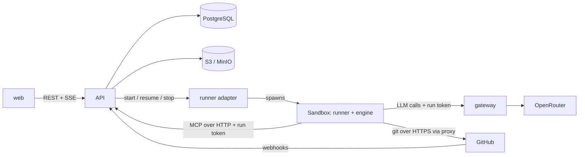
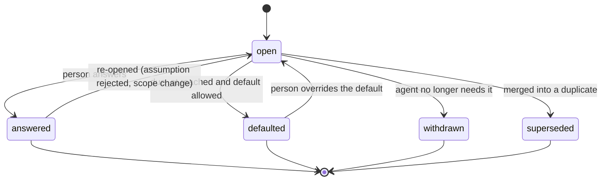
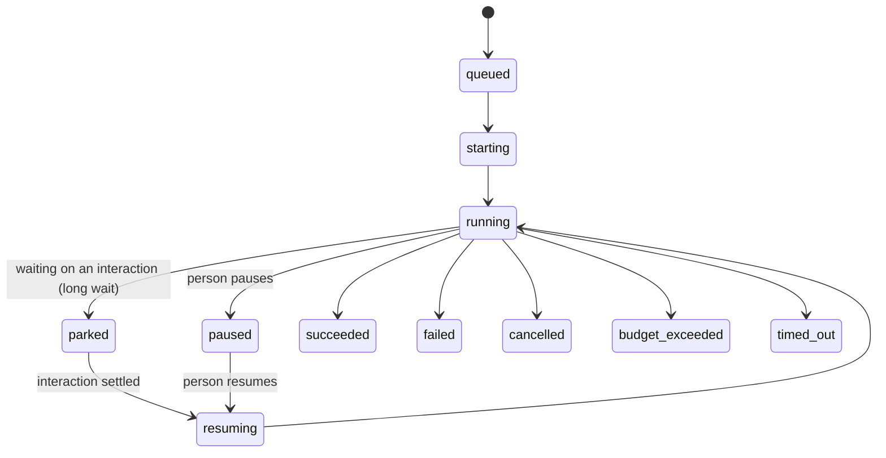

# MVP Implementation Contract

**Status:** draft 0.1, 2026-10-17. Companion to [spec.md](./spec.md) v0.6. The spec says *what and why*. This file pins down *the interfaces you code against* for build steps 0 to 2 (§17). Steps 3 to 5 are sketched only.

**References.** `§n` points to a section of [spec.md](./spec.md). "Section n" points to this file.

**How to use it.** Everything here is a proposal with a default. Change a default by editing this file in the same commit as the code. Items marked **[open]** are not decided. Evidence for the riskiest assumptions is in [spikes/README.md](./spikes/README.md).

**Conventions**
- Ids are UUIDv7 stored as `uuid`. Times are `timestamptz` in UTC. Money is integer micro-USD (`cost_micros`).
- Names in the database are `snake_case`. Names in JSON are `camelCase`. Enum values are lowercase `snake_case` strings.
- Every table has `id`, `created_at`, and `updated_at` unless it is append-only (`activity_event`, `run_event`).
- Every state change writes an `activity_event` in the same transaction.

---

## 1. Stack (proposed, change by ADR)

| Area | Choice | Why |
|---|---|---|
| Language | **TypeScript everywhere** (Node 22 LTS) | One language for API, runner, MCP server, gateway, and UI. Matches the spec's "TypeScript preferred". |
| Monorepo | pnpm workspaces | Shared types and schemas between services and UI. |
| API | Fastify + `zod`. Responses are validated with the shared `zod` schemas in `packages/schemas`. | Typed routes, schema-first, small. (The Fastify zod type provider was not used. Revisit when route count grows.) |
| Database | PostgreSQL 16, Drizzle ORM, SQL migrations checked in | Schema in TypeScript, plain SQL when needed. |
| Workflow | A **state machine in PostgreSQL** (sections 5 and 6), driven by a worker loop with `FOR UPDATE SKIP LOCKED` | Resolves the §19 "workflow engine" question for the MVP. Revisit only if timers and retries get painful. |
| Real-time UI | Server-Sent Events from the API | Simpler than WebSockets, enough for an inbox and a map. |
| UI | Vite, React, TypeScript, xyflow, TanStack Query | As in spec §12.2. |
| Auth | OIDC (Dex locally, Cognito on AWS) with the authorization-code flow, PKCE | Spec §6.6. |
| Tests | Vitest (unit, contract), Playwright (UI and e2e) | One runner for TypeScript. |
| Lint and format | ESLint, Prettier, `tsc --noEmit` in CI | |
| IaC | Terraform, one root module per environment | Spec §12.4. |
| Container images | One Dockerfile per service, multi-stage | Same images locally and on AWS. |

## 2. Repository layout

```text
autonomous-sdlc/
  apps/
    api/            Fastify API, workflow worker, platform MCP server, webhooks
    gateway/        Model Gateway (from spikes/s1)
    runner/         Container entrypoint that hosts an engine inside a sandbox
    web/            React workspace and SDLC map
  packages/
    core/           Domain types, state machines, rules evaluation (no I/O)
    schemas/        zod schemas shared by API, MCP, events, UI
    engines/        AgentEngine port and adapters (claude-code first)
    ports/          Interfaces and adapters: storage, secrets, identity, notifier, runner
    db/             Drizzle schema and migrations
  infra/
    compose/        docker-compose for local mode
    terraform/      aws-sandbox stack (VPC, ECS, RDS, S3, Cognito, endpoints, DNS firewall)
  agents/           Versioned AgentDefinitions (section 9) and prompt files
  rules/            Default triggers and pre-approved change types (YAML, section 12)
  spikes/           Throwaway experiments (not built, not deployed)
  designs/ demo/    Mockups and narrated demos
```

Rules: `packages/core` has **no I/O**. `apps/*` depend on `packages/*`, never on each other. Adapters live in `packages/ports` and are chosen by configuration.

## 3. Processes in the MVP



- **api**: REST, SSE, platform MCP at `/mcp`, GitHub webhooks, and the workflow worker (same process at first, split later).
- **gateway**: separate process from the first day, so sandboxes never share a process with the platform's secrets.
- **Runner adapters** (one port, three adapters): `process` (a child process on your machine, for the first week and for debugging), `docker` (local, §12.4), `fargate` (AWS). Docker Desktop is not running on this workstation today, so start with `process`.

## 4. Data model (core tables)

Only the columns needed for steps 0 to 2. `*` marks a required column. Add the rest when needed.

**`person`** `id*, display_name*, email*, oidc_subject*, github_user_id?, slack_user_id? (unique, set by an admin), active*`

**`hat`** `id*, person_id*, role*` (§8.1 role), `deputy_person_id?, hours? (jsonb: { tz?, days?: 1..7, start: "HH:MM", end }), out_of_office? (jsonb: { from, until, delegateTo? })`

**`repository_entry`** (registry, §6.5) `id*, full_name*, access* (read_write|read_only), write_mode* (direct|branch_pr), integration_branch* default 'main', protected_paths* (text[]), allowed_paths? (text[]), model_policy* (any|own_account), verify_command* default 'npm run verify', github_installation_id?`

**`initiative`** `id*, title*, goal*, repository_id*, autonomy_mode* (guided|balanced|autopilot) default balanced, state* (draft|active|paused|done|cancelled), created_by*, budget_micros?`

**`story`** `id*, initiative_id*, key*, title*, body*, acceptance (jsonb), state*`

**`stage_state`** `initiative_id*, stage* (product|design|implementation|testing|security|release|feedback), status* (not_started|working|waiting_human|done|blocked)`. Drives the map.

**`interaction`** (§5.1) `id*, initiative_id*, run_id?, type* (question|checkpoint|review|decision|notice), checkpoint_id? (G0..G7), state*, title*, context_card* (jsonb, fields in §5.7), options (jsonb), recommendation?, default_value?, due_at?, blocks (jsonb: list of {runId|storyId}), role_needed*, assigned_person_id?, escalation_level* default 0, level_started_at?, reminder_count* default 0, last_reminded_at?, snoozed_until?, priority* default 0, answer (jsonb: { text, decision?, choice?, source: human|default|standing }), answered_by?, answered_via? (workspace|slack|teams|email|default|standing), answered_at?, didnt_need_to_ask* default false, standing_decision_id?`

**`notification`** (the outbox of the notifier port) `id*, person_id*, interaction_id?, kind* (ask|reminder|escalation|default_applied|digest), channel* (slack|log), status* (pending|held|sent|failed|skipped), body (jsonb), external_ref? (Slack channel and ts), error?, sent_at?`

**`assumption`** `id*, initiative_id*, run_id*, text*, state* (declared|accepted|rejected), decided_by?`

**`standing_decision`** `id*, scope* (global|repository|initiative), scope_id?, topic*, text*, created_from_interaction_id?, created_by?, active*`

**`agent_run`** `id*, initiative_id*, agent_role*, agent_definition_id*, agent_definition_version*, engine*, model_alias*, state* (section 6), sponsor_person_id*, contributors (uuid[]), repository_id*, branch?, pr_number?, session_ref? (object store key), park_reason?, budget_micros*, cost_micros* default 0, started_at?, finished_at?, exit_reason?`

**`run_event`** (append-only) `id*, run_id*, seq*, ts*, type*, payload* (jsonb)`. Unique `(run_id, seq)`.

**`run_token`** `token_hash*, run_id*, scopes* (text[]), expires_at*, revoked_at?`. Tokens are random 32 bytes, stored hashed.

**`cost_record`** `id*, run_id?, initiative_id?, source* (agent|service), alias*, provider_model*, input_tokens*, output_tokens*, cached_tokens*, cost_micros*`

**`integration_entry`** (§6.7) `id*, name* (unique), kind* (second_party|third_party), owner?, initiative_id? (empty: every initiative), docs[] (links), hosts[] (hostnames), auth_type*, credential_ref? (a name in the secrets store), data_sent?, data_received?, test_strategy* (vendor_sandbox|mock|recorded|none), limits_and_cost?, terms?, failure_behavior?, status* (proposed|confirmed|rejected|retired), proposed_by?, confirmed_by?, confirmed_at?`. **`doc_snapshot`** `id*, integration_id*, url*, sha256*, content? (untrusted text, cut to 100 KB), error?, fetched_at*`.

**`artifact`** `id*, initiative_id*, run_id?, kind* (spec|adr|diagram|code|test|result|release_notes), git_ref? (repo, sha, path), object_key?`

**`activity_event`** (append-only, §10.6) `id*, ts*, actor_type* (person|agent|system), actor_id?, initiative_id?, run_id?, interaction_id?, action*, detail* (jsonb)`

Later: `integration_entry`, `doc_snapshot`, `github_link`, `pre_approved_change_type`, `trigger`, `release`, `simulated_teammate`.

## 5. Interaction state machine



Checkpoint and review interactions use a decision instead of an answer: `answered` carries `decision` of `approved`, `changes_requested`, or `rejected`. They never reach `defaulted` (§6.3 and §5.1).

Rules:
- **Default applies only when** `type` is `question` or `decision`, a `default_value` exists, `due_at` has passed, and no hard-stop flag is set. The state becomes `defaulted`, `answered_via` is `default`, and the activity log flags it.
- **Reminders and escalation are not states.** They are `activity_event`s plus a bump of `escalation_level` along the hat's fallback chain (§5.4). A reminder never approves.
- **Independent review** (§6.4): a person in the run's `sponsor` or `contributors` cannot answer a `review` or `checkpoint` for that run. The API returns 403 with reason `independent_review`.
- **"Didn't need to ask"** sets `didnt_need_to_ask` without changing state.
- **Standing decision**: answering with `makeStanding: true` creates a `standing_decision` and links it.
- **De-duplication**: before creating an interaction the API checks open interactions with the same `(initiative_id, topic_key)`. If found, it links the new ask to the existing one and returns the existing id.

## 6. Run lifecycle and the engine port



Terminal states: `succeeded`, `failed`, `cancelled`, `budget_exceeded`, `timed_out`. A run in a terminal state is never restarted. A new run is created instead.

**Blocking vs parking** (spike 2). A tool call to `ask_human` with `blocking: true` holds the call open for up to **120 seconds** (`BLOCKING_MAX_S`). After that the API tells the runner to **park**: the engine process ends, the session store is saved, and the run enters `parked` with a `park_reason` of the interaction id. When the interaction settles, the worker creates a **resume** with the answer as the first message. **[open]** whether 120 seconds is the right cut-off.

### 6.1 AgentEngine port (TypeScript)

```ts
export interface AgentEngine {
  start(spec: RunSpec): RunHandle;
  resume(spec: RunSpec, sessionRef: string, message: string): RunHandle;
}

export interface RunHandle {
  events: AsyncIterable<RunEvent>;          // engine-neutral (section 7)
  send(guidance: string): Promise<void>;    // acted on at the next step, not preemptive
  stop(reason: 'cancel' | 'park' | 'timeout'): Promise<{ sessionRef?: string }>;
  done: Promise<{ exitReason: ExitReason }>;
}

export type ExitReason = 'finished' | 'parked' | 'verify_failed' | 'budget' | 'timeout' | 'cancelled' | 'error';
```

`pause` is `stop('park')` followed by a later `resume`. **Hard stop** is `stop('cancel')`.

### 6.2 RunSpec

```ts
export interface RunSpec {
  runId: string;
  role: AgentRole;                    // product | architect | frontend | backend | tester | devops | security
  task: string;                       // the instruction, assembled from the story and context
  repo: { fullName: string; branch: string; integrationBranch: string; writeMode: 'direct' | 'branch_pr';
          protectedPaths: string[]; verifyCommand: string };
  git: { tokenRef: string };          // resolved by the runner adapter, expires in 1 hour at most
  model: { alias: string };           // gateway alias, never a provider model
  gateway: { baseUrl: string; runToken: string };
  mcp: { url: string; runToken: string };
  limits: { maxTurns: number; maxWallSeconds: number; budgetMicros: number; cpu: number; memoryMb: number };
  egress: { proxyUrl?: string; allowHosts: string[] };
  definition: { id: string; version: number };   // the AgentDefinition (section 9)
}
```

## 7. Engine-neutral run events

Every engine adapter converts its native output into this envelope. The UI, the activity log, and the cost views read only this.

```ts
export type RunEvent = {
  runId: string; seq: number; ts: string;     // seq is assigned by the API, per run, gapless
} & (
  | { type: 'run.started';       engine: string; model: string }
  | { type: 'message';           role: 'assistant' | 'user' | 'human_guidance'; text: string }
  | { type: 'tool.call';         toolCallId: string; name: string; input: unknown }
  | { type: 'tool.result';       toolCallId: string; ok: boolean; summary: string }
  | { type: 'file.changed';      path: string; change: 'create' | 'edit' | 'delete' }
  | { type: 'verify.finished';   ok: boolean; command: string; durationMs: number; summary: string }
  | { type: 'design.checked';    ok: boolean; problem: string | null }
  | { type: 'interaction.raised'; interactionId: string; blocking: boolean }
  | { type: 'interaction.settled'; interactionId: string; via: 'human' | 'default' }
  | { type: 'assumption.declared'; assumptionId: string; text: string }
  | { type: 'artifact.registered'; artifactId: string; kind: string }
  | { type: 'run.parked';        interactionId: string }
  | { type: 'run.resumed' }
  | { type: 'run.finished';      exitReason: ExitReason }
);
```

- **Cost is not an event from the engine.** The gateway writes `cost_record` rows. The API sums them per run. This keeps cost correct for engines that do not report it.
- **Claude Code mapping** (from `--output-format stream-json`): an `assistant` text block becomes `message`. A `tool_use` block becomes `tool.call`. A `user` message with a `tool_result` becomes `tool.result`. The `result` line gives `run.finished`. Writes and edits become `file.changed`. `ask_human` and `declare_assumption` calls are **not** read from the stream. The MCP server raises those events itself, so the record is the same for every engine.

## 8. Platform MCP tools (schemas)

Served at `POST /mcp` (Streamable HTTP, stateless, spike 2). Authentication is `Authorization: Bearer <runToken>`. The token fixes the run and initiative, so tools never accept a run id.

```ts
ask_human({
  question: string,                       // one sentence
  context?: string,                       // why now, what was tried, 1 to 3 sentences
  options?: { id: string; label: string; impact?: string }[],
  recommendation?: string,                // an option id or free text
  blocking?: boolean,                     // default true
  defaultAfterS?: number,                 // omit for no default
  topicKey?: string,                      // for de-duplication, for example "date-library"
  roleNeeded?: Role                       // default chosen by the platform from the run's role
}) => { interactionId: string; status: 'open' | 'answered' | 'defaulted' | 'parked';
        answer?: string; source?: 'human' | 'default' }

check_answers() => { interactionId: string; status: string; answer?: string; source?: string }[]

declare_assumption({ text: string; impact?: 'low' | 'medium' }) => { assumptionId: string }

search_standing_decisions({ query: string }) => { id: string; topic: string; text: string }[]

request_checkpoint({ checkpoint: 'G1' | 'G3' | 'G6' | 'G4' | 'G5'; summary: string; artifactIds: string[] })
  => { interactionId: string }               // always non-blocking from the agent's side; the run parks

report_progress({ message: string; percent?: number }) => { ok: true }

register_artifact({ kind: ArtifactKind; gitRef?: { path: string; sha: string }; title: string }) => { artifactId: string }

get_integration_docs({ integration: string }) => { snapshotId: string; text: string }   // step 3
```

Behavior rules:
- `ask_human` with `blocking: true` and no answer within `BLOCKING_MAX_S` returns `{ status: 'parked' }` and the runner stops the engine. The agent does not see this return. The run is resumed later with the answer in the first message.
- A `defaultAfterS` shorter than `BLOCKING_MAX_S` is applied while the call is open (spike 2, T2).
- Server-side limits per run: 20 interactions, 20 assumptions, text length caps. Over the limit the tool returns an error that tells the agent to continue with an assumption.

## 9. AgentDefinition (versioned in `agents/`)

One folder per agent. The platform stores the version it used on every run.

```yaml
# agents/backend-engineer/agent.yaml
id: backend-engineer
version: 1
role: backend
engine: claude-code
model_alias: agent-default          # agent-fast | agent-default | agent-strong
prompt_file: prompt.md              # system prompt appended to the engine's own
tools:
  platform: [ask_human, check_answers, declare_assumption, search_standing_decisions,
             list_integrations, read_integration_docs, propose_integration,
             request_checkpoint, report_progress, register_artifact]
  engine_builtin: [read, edit, write, bash, grep, glob]
  denied: [web_fetch]               # docs come from the snapshot (§6.7)
limits:
  max_turns: 60
  max_wall_seconds: 1800
  budget_usd: 2.00
asks: [peer_engineer]               # who this agent typically asks (informational)
```

`prompt.md` must include: the ask-versus-assume guidance (§5.2), "search standing decisions before asking", "declare an assumption instead of asking when the cost of being wrong is low", the verify-before-PR rule (§10.3), and the protected-path list.

## 10. Model Gateway contract

Proven in spike 1. Production requirements on top of `spikes/s1-claude-openrouter/gateway.mjs`:

| Item | Contract |
|---|---|
| Inbound | Anthropic Messages API (`POST /v1/messages`, plus `/v1/messages/count_tokens`) and `HEAD /`. Platform LLM services use `POST /v1/chat/completions` (OpenAI-compatible). |
| Auth | `Authorization: Bearer <runToken>` or `x-api-key`. Look up `run_token` by hash. Unknown, expired, or revoked gives 401. |
| Aliases | `agent-fast`, `agent-default`, `agent-strong`, `svc-default`. Mapped in configuration, per deployment. A disallowed alias gives 403. |
| Provider preferences | For agent runs always inject `provider: { order: ['anthropic'], allow_fallbacks: false, data_collection: 'deny' }` (spike 1). Platform services use their own preference set per alias. |
| Prompt caching | If a `/v1/messages` request carries no `cache_control` anywhere, add it to the end of the tools, the system prompt and the last message (at most three markers). A client that marks its own prompt is left alone. Needed for the Copilot CLI, which sends none (step 4). |
| Headers | Drop `expect`, `keep-alive`, `upgrade`, `te`, `transfer-encoding`, `connection`, `host`, `content-length`. |
| Streaming | Pass through unchanged. Meter from `message_start` (input) and `message_delta` (output) events. |
| Cost | Price table in configuration, per provider model, per million tokens. Write one `cost_record` per call. |
| Budget | Before each call, if the run's cost is at or over its budget, return 402 with `error.type = "budget_exceeded"` and set the run to `budget_exceeded`. |
| Failure | Upstream error is passed through with its status. Network failure gives 502. **No fallback to another provider.** The run is paused by the API, not retried silently. |
| Secrets | The OpenRouter keys are read from the secrets port. Two keys: agent runs and platform services. Set credit limits on both (the current development key has none). |
| Logging | Log run id, alias, provider model, status, token counts, latency. Never log prompts or completions by default. |

## 11. Runner contract

The runner is the container entrypoint that hosts an engine. It is the same image for `docker` and `fargate`.

**Inputs** (environment): `SDLC_RUN_SPEC_URL` (API URL returning the `RunSpec`, authorized by the run token), `SDLC_RUN_TOKEN`. Everything else comes from the run spec.

**Fixed paths** (spike 2 showed that resume needs the same working directory):
- Repository checkout: `/work/repo`
- Engine home and session store: `/work/home` (`HOME=/work/home`)
- Parked sessions are saved as `s3://<bucket>/runs/<runId>/session.tgz` and restored to `/work/home` before a resume.

**Engine environment for Claude Code:** `ANTHROPIC_BASE_URL=<gateway>`, `ANTHROPIC_AUTH_TOKEN=<runToken>`, `ANTHROPIC_API_KEY=` (blank), `ANTHROPIC_MODEL=<alias>`. Launch with `--setting-sources project`, `--strict-mcp-config`, and an MCP config that points to the platform MCP URL. The runner never reads the user's `~/.claude/settings.json`.

**Sequence**
1. Fetch the run spec. Clone the repository with the short-lived GitHub token (credential helper, never written to disk in the repo). Check out `agent/<runId>/<slug>` in `branch_pr` mode.
2. Start the sidecars declared for verification (section 13). Wait for health.
3. Start the engine. Stream `RunEvent`s to the API (`POST /api/runs/:id/events`, batched, ordered by `seq`).
4. Before **every push**, check the diff against `protectedPaths`. A match aborts the push and raises a trigger interaction.
5. Before opening a PR, run `verifyCommand`. On failure, give the agent the output up to N times (`maxVerifyAttempts`, default 3), then raise an interaction instead of opening the PR.
6. On finish, park, or stop, flush events, save the session if parking, and exit with a code from the table.

| Exit code | Meaning |
|---|---|
| 0 | `finished` |
| 10 | `parked` (session saved) |
| 20 | `verify_failed` after the allowed attempts |
| 30 | `budget` |
| 40 | `timeout` |
| 50 | `cancelled` |
| 1 | `error` (unexpected) |

**Sandbox properties** (spike 3, enforced by infrastructure, not by the engine):
- **No cloud credentials.** The Fargate task has no task role. The sandbox holds only the run token and the GitHub token.
- **No Docker socket.** Dependent services run as sidecar containers in the same task.
- **Network:** an isolated subnet, a security group that allows only the shared proxy and the VPC endpoints, an S3 endpoint policy limited to the ECR layer bucket, and a DNS allowlist. In `docker` mode, a user-defined network with the same proxy container and no other route out. In `process` mode there is **no isolation**. Use it only with scratch repositories and no secrets.
- `HTTPS_PROXY` points to the shared proxy. The proxy allowlist is generated from the Integration Register plus the fixed hosts (gateway, GitHub, package registries).

**The `docker` adapter as built and tested (2026-10-17)** (`apps/api/src/docker-runner.ts`, `apps/runner/Dockerfile`, `apps/runner/src/egress.ts`):
- **Image** `sdlc-runner:dev`, built with `pnpm --filter @sdlc/runner image` (826 MB: Node 22, git, Claude Code 2.1.212, and the bundled runner). It holds no secrets.
- **One container, one network, one volume per run.** The network is `--internal`: no route to the host, the internet, or another run. The checkout and the engine's session store live in the volume `sdlc-work-<runId>` at `/work`, so a parked run resumes in the same place. The volume is removed when the run reaches a terminal state.
- **Hardening.** Unprivileged user (uid 1000), read-only root file system with a 512 MB `/tmp`, all capabilities dropped, `no-new-privileges`, 3 GB memory, 2 CPUs, 1024 processes, `--init`. The run token is passed by name so it never shows in a process list.
- **The only way out is the shared egress proxy** (`sdlc-egress`), a small Node process on both the sandbox network and the normal one. It forwards **two fixed ports** to the platform API and the Model Gateway on the host, and opens **HTTPS tunnels only to an allowlist** (`github.com`, `registry.npmjs.org` by default, setting `RUNNER_EGRESS_ALLOW`) on port 443. Everything else is refused. It is replaced when its settings change and removed when the platform stops.
- **Addresses, not names.** The sandbox is given the proxy's IP address. Claude Code's DNS resolver cannot resolve container names on an internal network (`getaddrinfo ENOTIMP`), so with a name it never reached the gateway. `NO_PROXY` lists that address, because with `HTTPS_PROXY` set and no match Claude Code sends even plain HTTP requests to the proxy.
- **Tested** with real containers (`docker-runner.test.ts`): it reaches the API and gateway through the proxy and nothing else, the HTTPS tunnel to a non-listed host is refused (403), another run's container is unreachable, it cannot write outside `/work` and `/tmp`, it has no capabilities, it holds no provider or GitHub secret, the real Claude Code reaches the gateway from inside, and `reconcile()` removes sandboxes an earlier API process left behind. The suite skips itself when Docker or the image is missing.
- **Limits.** The proxy forwards to `host.docker.internal`. On Docker Desktop that reaches services bound to `127.0.0.1`. On a Linux host the API and gateway must listen on an address the Docker bridge can reach. The engine and the verify command inherit `HTTPS_PROXY`, so they can open a tunnel to an allowlisted host, with no credentials. Not isolated from the Docker host itself: a Fargate task adds the network and IAM boundaries.

## 12. Rules (YAML, minimal first version)

`rules/triggers.yaml`, loaded and versioned by the API. Evaluated in `packages/core`, with **no model involved**.

```yaml
version: 1
triggers:
  - id: auth-code
    description: Changes to authentication or authorization code
    when: { paths_any: ["**/auth/**", "**/*session*", "**/*permission*"] }
    action: require_review          # require_review | require_checkpoint | hard_stop
  - id: db-migration
    when: { paths_any: ["**/migrations/**", "**/*.sql"] }
    action: require_review
  - id: new-dependency
    when: { dependency_added: true }
    action: require_review
  - id: tests-removed
    when: { tests_deleted_or_skipped: true }
    action: require_review
  - id: large-diff
    when: { lines_changed_over: 800 }
    action: require_review
  - id: protected-path
    when: { touches_protected_path: true }
    action: hard_stop
  - id: infra-change
    when: { paths_any: ["infra/**", "**/*.tf"] }
    action: require_review
pre_approved_change_types:
  - id: docs-only
    when: { paths_all: ["**/*.md", "docs/**"] }
    owner: team-lead
    review_by: 2027-01-15
```

Evaluation input is the PR diff summary: changed paths, added dependencies, lines changed, deleted or skipped tests, protected-path matches. Output is a list of fired triggers with reasons, stored on the PR's `interaction.context_card`. `hard_stop` can never be defaulted or pre-approved.

## 13. Verification contract and sidecars (interim)

- The repository's `verify_command` runs build, tests, starts the app, health-checks it, and runs smoke or end-to-end checks. The same command runs in CI.
- **Sidecars (provisional, [open] §19):** a repository may add `.sdlc/services.yaml`. Until the format is decided, **step 1 uses repositories with no sidecar services** and the runner supports an empty list.

```yaml
# .sdlc/services.yaml (provisional)
services:
  - name: postgres
    image: public.ecr.aws/docker/library/postgres:16-alpine
    env: { POSTGRES_PASSWORD: dev }
    ports: [5432]
    healthcheck: "pg_isready -h 127.0.0.1 -U postgres"
```

This file is a protected path. Images must come from the allowed registry list.

## 14. REST API (MVP surface)

All routes are under `/api`, JSON, authenticated by the OIDC session cookie unless noted. Errors use `{ error: { code, message, details? } }`.

| Route | Purpose |
|---|---|
| `GET /me` | Person, hats, linked GitHub |
| `GET/POST /repositories` | Registry (admin) |
| `GET/POST /initiatives`, `GET /initiatives/:id` | Create and view. Includes stage states for the map |
| `POST /initiatives/:id/runs` | Start a run for a role and task (step 1: manual, later automatic) |
| `GET /runs/:id`, `GET /runs/:id/events` | Run state and events (SSE with `Accept: text/event-stream`) |
| `POST /runs/:id/guidance` | Send guidance to a live run |
| `POST /runs/:id/pause`, `/resume`, `/cancel` | Control |
| `GET /interactions?mine=true&state=open` | The attention queue, ranked by priority and due date |
| `POST /interactions/:id/answer` | `{ answer?, optionId?, decision?, makeStanding?, standingScope?, didntNeedToAsk? }`. `optionId` fills in the answer text as `<id>: <label>` and is stored as `answer.choice` |
| `POST /interactions/:id/snooze` | `{ minutes: 5..1440 }`. No reminders until then. Refused for a hard stop |
| `POST /interactions/:id/didnt-need-to-ask` | |
| `GET /assumptions?state=`, `POST /assumptions/:id/accept` or `/reject` | Needs a hat. Rejecting raises a question for the person who started the run |
| `GET /standing-decisions?active=`, `POST`, `PATCH /standing-decisions/:id` | `PATCH` sets `text` or `active`. Only the author or an admin |
| `GET /attention/profile` | "How you are reached": deputy, hours, reminder timing, chat link |
| `GET /people`, `PUT /people/:id/slack` | Admin links a Slack user to a person. One Slack user, one person |
| `POST /people/:id/hats` `{ role }`, `DELETE /people/:id/hats/:role` | Admin only. The last platform admin cannot be removed |
| `PATCH /people/:id/hats/:role` | `{ deputyPersonId?, hours?, outOfOffice? }`. Own hats, or any for an admin |
| `GET /autopilot`, `PATCH /initiatives/:id` `{ autonomyMode }` | Pre-approved rules, what merged by rule or was held and why. Changing the mode needs a Product Owner or admin |
| `GET /integrations`, `POST`, `PATCH /integrations/:id`, `POST .../retire`, `POST .../refresh-docs`, `GET .../docs` | The Integration Register. Writes need an Architect, Engineer or admin |
| `GET /initiatives/:id/map` | Stages with status and who each waits on |
| `GET /initiatives/:id/releases`, `POST` `{ version }` | List releases. Prepare one (Product Owner, DevOps, admin) |
| `GET /interactions/:id/preview` | What the repository's pipeline reported as a preview of a pull request under review |
| `GET /initiatives/:id/plan`, `POST /plans/:id/start`, `POST /plans/:id/cancel`, `POST /plans/:id/tasks/:key/retry` or `/skip` | The build plan of an approved design. The writes need a Product Owner, Architect or admin |
| `GET /activity?initiativeId=...` | Activity log (not built) |
| `GET /metrics/interruptions?days=&initiativeId=` | §5.7 measures, built in step 2 |
| `POST /slack/interactions` | **Slack only**, verified by Slack's request signature. Not under `/api` |
| `POST /runs/:id/events` | **Runner only**, run token. Batched run events |
| `POST /mcp` | **Runner only**, run token. Platform MCP |
| `POST /webhooks/github` | GitHub, verified by signature |
| `GET /healthz`, `GET /readyz` | No auth |

## 15. Configuration

One `config` module reads environment variables and validates them with `zod` at startup. The same names are used locally and on AWS.

| Variable | Example | Notes |
|---|---|---|
| `SDLC_ENV` | `local` \| `hybrid` \| `aws-sandbox` | §12.4 |
| `DATABASE_URL` | `postgres://...` | |
| `OBJECT_STORE` | `s3://bucket` or `minio://...` | Session archives, logs, artifacts |
| `PUBLIC_URL` | `http://localhost:5173` | The one origin where the browser reaches both web and API. Builds the OIDC redirect URI `<PUBLIC_URL>/auth/callback` |
| `OIDC_ISSUER`, `OIDC_CLIENT_ID`, `OIDC_CLIENT_SECRET` | | Dev IdP locally. The secret becomes a `_REF` into the secrets port on AWS |
| `SESSION_SECRET` | 32+ characters | Signs the session cookie |
| `GATEWAY_URL` | `http://gateway:8787` | |
| `OPENROUTER_KEY_AGENTS_REF`, `OPENROUTER_KEY_SERVICES_REF` | | Secrets port references, never raw keys in config files |
| `RUNNER_ADAPTER` | `process` \| `docker` \| `fargate` | |
| `BLOCKING_MAX_S` | `120` | Section 6 |
| `WEB_DIR`, `API_HOST` | `apps/web/dist`, `0.0.0.0` | The API serves the built web app, and listens on all interfaces in a container |
| `BOOTSTRAP_ADMIN_EMAIL` | | Whoever signs in with this verified email gets the admin hat |
| `SECRETS_BACKEND`, `SECRETS_PREFIX` | `aws`, `sdlc-dev/runtime/` | `file` locally, Secrets Manager on AWS |
| `DATABASE_CA_FILE` | `/etc/ssl/rds-global-bundle.pem` | Turns on verified TLS to the database |
| `RELEASE_APPROVER_ROLE` | `product_owner` | Who approves a release (checkpoint G6) |
| `INTEGRATION_DOCS_INTERVAL_H` | `24` | How often saved integration documentation is fetched again. 0 turns it off |
| `ATTENTION_FILE` | `rules/attention.yaml` | How people are reached (§5): reminder and escalation timing, working hours, the digest, what chat may settle |
| `ATTENTION_TICK_MS` | `2000` | How often the engine hands out, reminds, escalates, applies defaults and delivers |
| `BUILD_TICK_MS`, `BUILD_MAX_ACTIVE`, `BUILD_AUTOSTART_MIN` | `3000`, `4`, `120` | How often the build plan looks, how many runs one initiative may have going at once, and how long after its approval a design may still start building on its own |
| `SLACK_BOT_TOKEN`, `SLACK_SIGNING_SECRET` | | The token sends. The secret is needed to accept answers. Without the token the notifier only logs. `SLACK_API_URL` is for tests |
| `GITHUB_APP_AGENT_REF`, `GITHUB_APP_GATE_REF` | | |

Secrets come through the secrets port: a git-ignored file locally, AWS Secrets Manager on AWS.

## 16. Build step acceptance tests

**Step 0, walking skeleton (done when):**
1. **Local, done 2026-10-17.** `pnpm dev` starts `api`, `gateway`, `web`, PostgreSQL, and a dev identity provider. Sign-in works with a static persona. Docker is not required (see "Local mode without Docker" below).
2. **Done.** `GET /healthz` is green and a page in `web` shows the signed-in person and their hats.
3. **Done 2026-10-18.** `infra/aws` creates the stack in the AWS account (`deploy.ps1`) and removes it (`destroy.ps1`). Sign-in worked through Cognito in a real browser. The idle cost is an estimate from list prices, not a measurement. `docker-compose.yml` runs the same stack in containers. See "Step 0, AWS and Compose" below.
4. **Done locally, CI unproven.** `pnpm verify` runs typecheck, lint, format check, and unit and integration tests (18 tests). `pnpm test:e2e` runs one Playwright sign-in test. `.github/workflows/ci.yml` runs both on GitHub but has not run there yet.

**Step 0, AWS and Compose (2026-10-18).**

- **One image.** The `Dockerfile` at the repository root builds the web app and holds the API and the gateway (two commands, same image). TypeScript runs through `tsx`, as in local development. The image carries the RDS certificate bundle.
- **Compose** (`docker compose up --build`, then http://localhost:8080, sign in as "Dev Admin"): PostgreSQL, the API serving the web app, the gateway, and the dev identity provider, which shares the API's network namespace so that `localhost:9000` is the same address for the browser and for the API. Verified: sign-in works and the admin hat comes from `BOOTSTRAP_ADMIN_EMAIL`.
- **AWS** (`infra/aws`, Terraform, 49 resources, applied and destroyed once): a VPC with two public subnets (tasks and load balancer, no NAT gateway) and two private subnets (database), RDS PostgreSQL 16 `db.t4g.micro` with TLS verified against the RDS bundle, ECS Fargate services for the API and the gateway (the gateway is found at `gateway.<name>.local` through Cloud Map), an Application Load Balancer that accepts only CloudFront (security group on the CloudFront prefix list plus a secret header), and CloudFront for HTTPS on its own `*.cloudfront.net` certificate, with caching off. Cognito has a user pool with no self sign-up and an app client with a secret. Secrets Manager holds the database URL, session secret, Cognito client secret and the OpenRouter key, injected into the tasks. The API writes its own secrets (GitHub App keys) under `<name>/runtime/` through the `AwsSecrets` adapter, and its task role can touch only that prefix.
- **Verified live:** `/healthz` and `/readyz` through CloudFront (database over verified TLS); the load balancer refuses direct requests; sign-in through the Cognito hosted page in a real browser, ending as Platform Admin through the bootstrap rule; `AwsSecrets` writing, updating and reading a secret from a Fargate task under the API's role; `destroy.ps1` removing all 49 resources and the secrets the API wrote (checked afterwards by looking each one up).
- **Found by the live run:** Cognito reports `email_verified` as the string `"true"`, which the bootstrap rule rejected until it was fixed. The CloudFront managed policies must be looked up by name, not by a remembered id. PowerShell splits `-target=a.b` at the dot, so it must be quoted.
- **Idle cost, estimated from us-east-1 list prices, not measured** (Cost Explorer lags a day, and the stack was destroyed after the checks): load balancer about $0.68 a day, two Fargate tasks (0.25 vCPU, 0.5 GB) about $0.59, the RDS instance and 20 GB about $0.46, four public IPv4 addresses about $0.48, Secrets Manager, Cloud Map and logs about $0.10. **About $2.30 a day, or about $70 a month.** Cognito and CloudFront are free at this size. Runner tasks add cost only while they run. To measure it: deploy, leave it two days, then read Cost Explorer filtered on the tag `Stack=sdlc-dev`.
- **Not built:** `RUNNER_ADAPTER=fargate` (runs on AWS still need the isolated-subnet runner from spike 3, so the AWS stack runs with `RUNNER_ADAPTER=none`), a custom domain and certificate, a budget alarm unless `budget_email` is set, a gateway that runners can use (the Cloud Map name exists, nothing uses it yet), and a CI job that deploys. Registering the GitHub Apps on AWS (which now has a public HTTPS URL, so webhooks could work) was not tried.

**Local mode without Docker** (added 2026-10-17, because Docker Desktop does not start on the development workstation: WSL is not installed). `tools/dev-runner` starts real PostgreSQL 16 binaries through `embedded-postgres`, an `oidc-provider` identity provider with four static people, the API and gateway as Node processes, and Vite in-process. The browser sees one origin (`PUBLIC_URL`, the Vite dev server), which proxies `/api` and `/auth` to the API. This is the same shape as the load balancer on AWS. Contract tests per port (section 17) must run against this adapter set too.

**Step 1, one engine, one loop (done when):** a script does all of this against a scratch repository and passes:
1. Register a scratch repository in the registry (`branch_pr`).
2. Create an Initiative with the goal "add a `/health` endpoint with a test".
3. Start a Backend Engineer run. The run uses Claude Code through the gateway and the `process` adapter.
4. The agent calls `ask_human` once with `blocking: false`, and `declare_assumption` once.
5. A person answers through `POST /interactions/:id/answer`. The agent collects the answer.
6. The runner runs `verify_command`, and only then pushes a branch and opens a PR.
7. The Gate App merges the PR when the required check is green and no trigger fired.
8. The activity log shows every step in order. `cost_record` rows sum to the run's cost. The run ends `succeeded`.
9. A second script kills the runner while a blocking question is open, answers later, and the run **resumes with its context**.

**Step 1 result (2026-10-17): done.** `pnpm --filter @sdlc/dev-runner accept both` ran live (real Claude Code on Haiku 4.5 through the gateway and OpenRouter, real GitHub Apps, the scratch repository) and passed all 24 checks: phase A in 64 s for $0.075, phase B in 61 s for $0.038. The script is `tools/dev-runner/src/accept.ts` and it merges a small change into `sdlc-scratch` each time.

How each item was met, and where the build differs from the list above:
- **Item 6.** The agent commits locally and **never pushes**. The runner holds the GitHub token, verifies, then pushes and asks the API to open the PR. The engine's environment has no GitHub token and no credential helper (spec 6.5 said the agent pushes itself, which gave the engine a token it did not need).
- **Item 7.** The Gate merges **after a person approves** the review and the required check is green, and only if the commit is the one that was reviewed. It does not merge on a green check alone. The Gate App adds its own approving review, which is what branch protection requires (spike 4). Automatic merge for pre-approved change types is not built. The review shows the matched type and fired triggers.
- **Item 8.** The activity log order is: `run.created, interaction.raised, interaction.answered, assumption.declared, interaction.raised, pull_request.opened, run.succeeded, interaction.approved, pull_request.merged`.
- **Item 9.** The runner process was killed with a blocking question open. The worker **parked** the run on that question (it does not fail a run that was lost while a person was being asked). After the answer, the run resumed with `--resume` on the same session id and the same checkout, and the agent remembered a codename given before the kill. The session id is written to disk the moment the engine reports it, because the first attempt lost it when the runner was killed before the engine ended.
- **Found by the live run, fixed:** the embedded dev PostgreSQL was created as WIN1252 on this Windows machine and rejected the check marks that `node --test` prints. It is now created as UTF8 and refuses to start on any other encoding.
- **Also built:** the Agent App token is minted per run, limited to one repository with `contents` and `pull_requests` write. The trigger rules (`rules/triggers.yaml`) evaluate the real diff. A protected-path change is a hard stop that parks the run and asks a person. Three failed verifications ask a person.
- **Known limits:** the `process` runner has no isolation (the engine can run any command as you), so use it only with scratch repositories. The engine runs on Haiku 4.5, and a harder task has not been tried. A run that exits cleanly with no changes opens no PR.

**Step 1 again, inside the Docker sandbox (2026-10-17): done.** `pnpm --filter @sdlc/dev-runner accept both docker` passed all 27 checks with the real engine running in a container: phase A in 48 s for $0.069 and phase B in 49 s for $0.032. The extra checks confirm that the agent ran in `sdlc-run-<id>`, that a finished run left no container, network, or volume, and that the checkout volume survived a kill so the resume found the same files. Three bugs surfaced only when the engine ran in a container, and each now has a test: the engine could not resolve the proxy by name (see "Addresses, not names"), a Windows quoting problem in `docker inspect` templates (now parsed as JSON), and the runner entry point silently ignoring the sandbox gateway address (now `env.ts`, tested).
**Not in the gateway yet:** `POST /v1/chat/completions` for platform LLM services with the services key, and `GET /v1/models`. Only aliases are accepted. Raw provider model ids are refused.

**Step 2, human-injection engine (done when):** reminders and escalation follow the hat fallback chain. A default applies after its deadline and is flagged. De-duplication links two identical asks. A standing decision stops a repeated question. A Slack answer settles a simple interaction. The attention queue and the interruption metrics page match the mockups in `designs/trailmates/`.

**Step 2 result (2026-10-17): built and tested, with one part not proven live: Slack.** 344 tests pass, 6 browser tests pass, and `pnpm --filter @sdlc/dev-runner accept all docker` passed with the real agent in a Docker sandbox (phase C is new).

What was built, and how each "done when" item is met:
- **Routing, reminders, escalation.** Every ~2 s a worker (`apps/api/src/attention.ts`, pure rules in `packages/core/src/attention.ts`) hands each open ask to the holder of the role. The chain is: the holder (or, when they are away, the delegate named in the time away, else their deputy), then that holder's deputy, then the platform admins. Inactive people are skipped. For a review or checkpoint the people who started or steered the run are removed from the chain, so the ask never goes to someone who may not answer it. After `reminder_after_minutes` (default 120) the assignee is reminded, up to 3 times. After `escalate_after_minutes` (default 240) it moves to the next person and the count starts again. At the end of the chain the last person is reminded at the same pace. Each step is an activity event (`interaction.assigned`, `.reminded`, `.escalated`). A reminder never answers anything. `snooze` pauses reminders for a person, never for a hard stop.
- **Defaults.** The same worker applies the recommendation after the deadline (questions and decision requests only, never a hard stop), flags it as `defaulted`, and tells the owner what was applied. The blocking `ask_human` call also applies it while the engine waits.
- **De-duplication** (step 1) and **standing decisions**. An `ask_human` call with a `topicKey` that matches an active standing decision (its own initiative, its repository, or global, narrowest first) is answered at once with the decision's text. Nobody is asked or notified, the ask is recorded as `answered` via `standing`, and the metrics count it as an ask that was avoided. Hard stops and reviews are never answered this way. Standing decisions can be made when answering (`makeStanding`, with a scope), from Slack, or by hand (`POST /standing-decisions`). They can be retired.
- **Quiet hours and the digest.** A hat's `hours`, or the team's `working_hours`, hold messages outside working time. Hard stops always go through. With `digest_at` set, asks that block nothing and notices wait for one digest a day per person. Held messages whose ask was settled in the meantime are dropped.
- **Chat.** A notifier port with two adapters: `log` (development) and Slack (Block Kit buttons, one direct message per person). Slack replies arrive at `POST /slack/interactions`. A reply is accepted only when (1) the request is signed by Slack (HMAC, within 5 minutes), (2) the Slack user is linked to a person by an admin, (3) the ask is open, and (4) policy allows chat for that type: questions and decision requests by default, a review only if the team adds `review` to `chat_approve` and no trigger fired. Checkpoints and hard stops always open the Workspace. The same role and independent-review checks as the Workspace apply. The reply text goes to Slack only through its own `response_url`, and only to Slack's hosts. The answer is logged with `via: slack`.
- **Screens.** The attention queue, assumptions with standing decisions, and the interruption page are in `apps/web`. `pnpm dev:demo` starts a stack in a separate data directory with the demo data from the mockups. Differences from the mockups: no "Apply" button on the interruption suggestions, because pre-approved change types do not auto-merge yet and nothing should change on its own; the review card shows the summary, triggers, checks and a link to the pull request, not the full review pack (n2-2); the Slack view is real Slack, not a page.
- **Interruption measures** (`GET /metrics/interruptions`): questions per merged PR (by week and by agent), recommendation taken unchanged, marked "didn't need to ask", median time to answer, time agents spent blocked as a share of run time, answered by a default, and avoided by a standing decision. Reviews and checkpoints are not counted as interruptions. Suggestions per situation: covered by a standing decision, make one (three or more asks all answered with the recommendation), ask less (half or more marked "didn't need to ask"), or keep asking.

Live proof (real agent, Docker sandbox, real GitHub): the ask is handed to Bob's hat and he is notified once; a standing decision saved by Bob answered a later agent's `ask_human` with nobody asked, nobody notified, the file in the merged PR holds the decision's text, and the metrics counted it.

Not proven, or not built:
- **Slack has never talked to a real Slack workspace.** Everything is tested against a fake Slack server and signed requests built the way Slack documents them. Real Slack needs a public HTTPS URL for `/slack/interactions` (like GitHub webhooks, it cannot be localhost) and an app made from `integrations/slack/app-manifest.yaml`. Expect small differences in the real payloads.
- Slack accounts are linked by an admin through the API (`PUT /api/people/:id/slack`), not by a self-service sign-in with Slack. There is no screen for it, nor for hats (deputy, hours, time away). The API exists and is tested.
- Free-text answers cannot be given in chat, only option buttons. Teams and email notifiers are not built.
- The digest is built but was proven only with tests and a fixed clock, not over a real day.
- Escalation timing is shared by every ask. There are no per-type or per-hard-stop timings yet.
- Rejecting an assumption raises a question for the person who started the run. It does not restart the run or edit a story.
- The assumptions list has no "risk" column (the agent does not rate it) and no story link, since stories are not built.
- A single worker process does all of this. Running two API processes would double notifications (the updates are guarded, so asks are not handed out twice, but a message could be sent twice).
**Step 3, map and checkpoints (2026-10-18): built in part.** The spec says "G1, G3, G6, pre-approved change types, Integration Register, previews". Built and proven live (real agent, Docker sandbox, real GitHub) except where noted:

- **Autonomy modes and pre-approved change types (G3).** `decideMerge` (packages/core) decides per pull request: a fired trigger always goes to a person; guided mode reviews everything; balanced merges the pre-approved types (`rules/triggers.yaml`, with an owner and a review date, and an expired rule no longer applies); autopilot merges anything no trigger fired on. A change the rules allow is approved by the platform (`answered_via: auto`, `answer.source: policy`, with the rule and the reason), and the Gate then does what it does for a person's approval: waits for the required check, and merges only the commit it looked at. The Gate App's approving review says it was by rule and not by a person. Every review records why it merges or why a person is asked (`contextCard.autoMerge`). The Autopilot page lists the rules, how each initiative runs (a Product Owner or admin can change it), and what merged by rule or was held. Live: a docs-only change merged with nobody asked, and the same change was held in guided mode.
- **Integration Register** (`integration_entry`, `doc_snapshot`, `/api/integrations`). An Architect, Engineer or admin adds an entry (that is the confirmation), or an agent proposes one with `propose_integration`, which raises a **hard stop** for the Architect. Only the hosts of confirmed entries are added to the sandbox's egress allowlist (the shared proxy is restarted when the list changes, tested with real Docker). Documentation links are fetched by the platform, never by a sandbox, with an SSRF guard (https only, no private, loopback or link-local address, checked on the connected address and on literal addresses, 512 KB, 10 s, 3 redirects), hashed, and saved. A changed document asks the Architect to check the impact. Agents read the saved copy with `read_integration_docs`, which marks it untrusted. A test found that literal IP addresses bypassed the lookup guard; fixed.
- **G1, spec and design.** `agents/product-agent` drafts `docs/spec/<slug>.md` and opens a pull request. A pull request from a spec agent is always checkpoint G1 for a person, in every mode (live: an autopilot initiative did not auto-approve it).
- **The map** (`GET /api/initiatives/:id/map`, the Map page). Three stages drawn from the active checkpoints (spec and design, build and review, release), each with a status, who it waits on, and links to the asks. It is derived from runs and asks, with no stored stage state. Starting an initiative and runs is on the same page.
- **G6, release** (`POST /api/initiatives/:id/releases`). A Product Owner, DevOps or admin prepares a version. The platform lists what merged since the last release, pins the tip of the integration branch, and requires the required check to be green on it. The checkpoint is a hard stop for `RELEASE_APPROVER_ROLE` (default Product Owner), never defaulted, never answered in chat. On approval the **Gate App** creates the tag and the release with the notes, but only if the branch has not moved. Live: published on `sdlc-scratch`, then removed.

Not built, or only partly:
- **A platform-run preview** (the repository's pipeline provides previews today, see "Previews" below). **Stories as records**: they live inside the spec document.
- **Only the build stage starts on its own** (see "The build plan" below). A person still starts the spec run, the design run, and the release.
- The map is boxes and arrows, not xyflow, and there is no portfolio view, release calendar or freeze, hotfix path, or scope-change re-opening.
- A new external host in a code diff is not detected (agents are told to propose it, and the sandbox cannot reach it anyway). A `none` test strategy is shown as a warning, not enforced as a trigger. Credentials from the register are not put into sandboxes.
- The egress proxy is shared, so the allowlist is the union across initiatives, and a change restarts it (tunnels in other running sandboxes drop).
- A pull request from an agent takes its title from the task text, which makes long release notes. The pre-approved rules are edited by hand in `rules/triggers.yaml`, with no editor screen.
- The release publishes a tag and notes. It does not deploy anything. The repository's own CI does that on the tag, as the spec says.

**Step 4, a second engine: the GitHub Copilot CLI (2026-10-18). Built and proven live in the Docker sandbox.**

- **How an agent picks its engine.** `engine:` in its `agent.yaml` (`claude-code` or `copilot-cli`). The run spec carries it, and the runner starts the matching adapter. An engine the runner does not know ends the run with an error that names it. Nothing else in the platform changes: same gateway, same MCP tools, same events, same park and resume.
- **Adapter** (`apps/runner/src/copilot.ts`). Runs `copilot -p ... --output-format json` in its bring-your-own-key mode against the Model Gateway, with the run token as the bearer token and no GitHub sign-in. It reads the CLI's JSON lines into the same platform events (message, tool call, tool result, file changed, result), counts model calls to enforce `max_turns` (the CLI has no limit of its own), puts the system prompt in front of the first message, loads the platform tools through `--additional-mcp-config`, and turns off the CLI's own question tool, the built-in GitHub tools, telemetry and updates. Web tools are excluded and `git push` is denied. The session id is chosen by the runner (`--session-id`) and resumed with `--resume`.
- **Image.** `@github/copilot@1.0.100-1` is installed next to Claude Code. The image grew from 826 MB to 1.15 GB.
- **Proven live** (`ACCEPT_ENGINE=copilot-cli node --import tsx src/accept.ts <phase> docker`): the full loop to a merged pull request (A: question, assumption, verify, review, Gate merge, cost records add up); a runner killed during a question, then resumed with the same session and the codename remembered (B); a standing decision answering the agent with nobody asked (C); a docs-only change merged by rule and the same change held in guided mode (D); the Product agent's spec held as checkpoint G1 and a release approved and published (E). Claude Code was re-run on phase A after the refactor of the shared process code and passed.
- **One real task, both engines** (`ACCEPT_ENGINE=<engine> node --import tsx src/accept.ts compare docker`: a bookmarks API with validation, five routes and tests, in the scratch repository, never merged). One run each, so this is a sample and not a benchmark:

  | | Claude Code | Copilot CLI |
  |---|---|---|
  | Result | succeeded, verify passed first time | succeeded, verify passed first time |
  | Time | 65 s | 59 s |
  | Model calls | 12 | 11 |
  | Uncached input tokens | 16 k | 234 k |
  | Cost | $0.148 | $0.266 |
  | Diff | 3 files, about 370 lines added | 3 files, about 350 lines added |

  I read both diffs. Both did what was asked, with similar validation and tests. The Copilot run cost about 1.8 times as much, and the reason was found: the Copilot CLI sends no prompt-cache markers (a capture of its requests showed none on the tools, the system prompt or the messages), so every call paid full price for the same 13 k-token prefix. **The gateway now adds the markers** when a request has none (`apps/gateway/src/cache.ts`: the end of the tools, of the system prompt and of the last message; a client that marks its own prompt, like Claude Code, is left alone). Per call, the cost went from about $0.014 to about $0.002 after the first. The same task re-run on the same day:

  | | Claude Code | Copilot CLI, before | Copilot CLI, after |
  |---|---|---|---|
  | Cost | $0.113 (earlier run $0.148) | $0.266 | $0.091 |
  | Model calls | 10 | 11 | 13 |
  | Time | 52 s | 59 s | 51 s |

  Claude Code's cost varied by about 30% between two identical runs, so the two engines are now level on cost for this task. That is two runs each at most, not a benchmark.
- **Not proven or not done.**
  - Only the default alias (`agent-default`) was used, on small tasks and one medium one. Larger tasks, other models and the cost of long runs were not measured.
  - The CLI is a pre-release version (1.0.100-1 is the build the spike used; the stable tag is 1.0.98). GitHub's terms for automated use of the CLI against a self-chosen model endpoint were not checked.
  - Local (non-Docker) runs on Windows need `COPILOT_BIN` to point at something `spawn` can run, because the npm shim is a `.ps1` file.
  - The phase B and C scripts had drifted since Step 3: balanced mode merged their docs-only change by rule, so they waited for a review that never came. They now start their initiatives in guided mode.

**The Architect agent and the design checkpoint (2026-10-18): built and proven live (real agent, Docker sandbox, real GitHub).**

- **What it does.** `agents/architect-agent` reads an approved spec in `docs/spec/` and writes `docs/design/<slug>.md` with ten sections in a fixed order (the spec it covers, the approach and the alternatives rejected, the changes per file, the interfaces, external systems, risks and the review triggers that will fire, the test strategy, assumptions, open questions, and the tasks). It never edits the spec. A new external system goes through `propose_integration`, which is a hard stop for the Architect, as before.
- **The checkpoint.** A pull request from an Architect run is always checkpoint G1 for a person, in every mode, like the spec. It is decided by the Architect role, not the Product Owner. An engineer who tries to decide it gets a 403 (live). The map's "Spec and design" stage waits on the Architect while the design is open. The Map page can start an Architect run.
- **The task list.** The last section is one fenced block named `sdlc-tasks`: a YAML list of tasks with `id` (`T1`...), `title`, `role` (`backend_engineer` or `frontend_engineer`), `stories` (`US-1`...), `depends_on`, `paths`, and `done_when` lines. `packages/core/src/design.ts` reads and validates it: unique ids, known roles, dependencies that exist, no circles, at most 20 tasks, and a build order. Each task is meant to be one engineer run of about 300 changed lines at most.
- **A design that does not read is sent back.** Before verification, the runner checks the task list in every `docs/design/*.md` the branch changes (`apps/runner/src/design-check.ts`). If it is missing or invalid, the engine gets the errors in the same session and tries again, using the same attempts as verification; after the last one the run blocks and a person is asked. The run records a `design.checked` event. This came from the first live run: the agent wrote a `done_when` line with braces and a colon without quotes, which is not valid YAML. The prompt's own example had the same fault. Both are fixed, and a test keeps the prompt's example valid.
- **Proven live** (`node --import tsx src/accept.ts design docker`, on the spec the Product agent wrote earlier in `sdlc-scratch`): the pull request is checkpoint G1 for the Architect and was not auto-approved in an autopilot initiative; it changes only the design file; an engineer cannot decide it; all ten sections are present; the task list validates and every story in the spec is served by a task; the map shows the stage waiting on the Architect; after the Architect approved it, the Gate merged it. The run cost about $0.08 to $0.13.
- **Not proven or not built.**
  - **The task list is consumed by the build plan** (next section).
  - The spec used was a one-endpoint spec, so the design had one task. A larger spec, and how well the agent splits and orders work, were not tested.
  - Whether a design is good was not measured. A person reads it at G1, which is the point of the checkpoint.
  - It was run with Claude Code only. The map does not tell a spec that was approved from one that was never drafted: a design can be started before any spec is merged. The prompt tells the agent to ask in that case, but I did not test it.
  - The runner checks the shape of the list, not that the files in `paths` exist or that the stories exist in the spec.
  - The design from the live check was merged into `sdlc-scratch` (`docs/design/`).

**The build plan: an approved design starts its own tasks (2026-10-18). Built and proven live (real agents, Docker sandbox, real GitHub).**

Decided with the owner: in guided mode a person clicks "Start the build"; in balanced and autopilot it starts by itself. Up to 4 runs per initiative at once. A failed task waits and a person chooses retry, skip, or cancel the plan.

- **A plan appears when a design is merged.** A worker (`apps/api/src/build.ts`, every `BUILD_TICK_MS`) finds each architect G1 review that the Gate merged and has no plan, reads the design file at the commit the Gate merged (so it is the one a person approved), and validates its `sdlc-tasks` list. The plan is `invalid`, with the reasons shown, if the file or list is missing or wrong, or if a task's role has no agent (only `backend_engineer` has one today). Otherwise it is `active` (balanced, autopilot) or `awaiting_start` (guided). A design approved more than `BUILD_AUTOSTART_MIN` minutes ago also waits for a person, whatever the mode, so turning the feature on does not start old designs. Tables `build_plan` and `build_task` (migration 0008).
- **Order.** A task starts only when everything it depends on has been **merged by the Gate** (or skipped), so it builds on real code. A task in review does not count against the limit of running tasks. Each run is an ordinary Backend Engineer run with the agent's own budget, and nothing starts if the initiative's budget would be exceeded. The first line of the task is `T1: <title>`, so the pull request takes that title (this also fixes the long titles noted earlier for these runs). The prompt names the design to read, the files, the `done_when` lines, what was merged before, and the tasks other runs build.
- **Who sponsors the runs.** The person who approved the design (or who clicked start). The independent-review rule then stops that person from approving the resulting pull requests; other engineers do.
- **Task states** are `waiting`, `running`, `review`, `merged`, `failed`, `skipped`, `cancelled`, kept up to date from the run and its review. A task fails if its run fails, finishes without a pull request, the reviewer asks for changes or rejects it, or the Gate stops the merge. Tasks behind a failed one keep waiting and the Map page says which. A person (Product Owner, Architect, admin) can retry (a new run), skip (what waits for it can start), or cancel the plan (unfinished tasks are cancelled, and so are runs still going).
- **The map.** The build stage waits on a person when a plan awaits its start, shows blocked for an invalid plan or a failed task, and shows how many tasks are merged. The Map page has a Build plan panel with the buttons.
- **A fix the plan needed: the Gate catches a branch up.** The first live run stopped because main moved while the design's pull request waited (repository protection requires branches to be up to date), and the Gate failed on the refused merge. With parallel tasks that happens all the time. Now, when the merge is refused and the pull request is behind, the Gate has GitHub merge the base branch into the pull request's branch, checks that the only new commit is that merge (a commit with the reviewed commit and the base as parents; anything else is "commits pushed after the review", as before), waits for the check on the new commit, approves again, and merges. It gives up after 5 catch-ups. A conflict makes the review `failed`, with the reason. Proven live with two pull requests approved at once (`accept.ts catchup docker`): the second was brought up to date and both merged.
- **Proven live** (`accept.ts build docker`, balanced initiative, the design had two tasks, T2 after T1): approving the design made a plan with two tasks and started T1 with nobody clicking; T2 waited while T1 was in review; after the Gate merged T1, T2 started; T2 (a README change) merged by rule; the plan was done; the map showed build done; main served the new route; both runs were sponsored by the Architect who approved; the design and both builds cost about $0.25. API tests cover plan creation (once per design, none for an unmerged one, guided, old, invalid, unstaffed), ordering, the limit, the budget, each way a task fails, retry, skip, cancel, and the routes and their roles. A browser test covers the panel and the start button.
- **A five-task plan with parallel tasks, on both engines** (`ACCEPT_ENGINE=<engine> accept.ts bigbuild docker`; the Architect was told the exact five tasks: three independent modules with tests, a route that uses all three, then a README note; balanced mode; every pull request approved by a person except the README one, which merged by rule). Both engines did the whole chain unattended, once each:

  | | Claude Code | Copilot CLI |
  |---|---|---|
  | Plan | T1, T2, T3, T4 after all three, T5 after T4 | the same |
  | Most tasks running at once | 3 | 3 |
  | Gate catch-ups | 2 | 2 |
  | Time from design approval to done | 246 s | 227 s |
  | Cost: design | $0.164 | $0.079 |
  | Cost: five builds | $0.497 | $0.262 |
  | Total | $0.660 | $0.341 |

  T4 started only after T1, T2 and T3 were merged, and T5 only after T4. Every task merged and main served the new route. This is one run each, on small tasks. On the single task compared earlier the two were level ($0.113 for Claude Code, $0.091 for Copilot after the caching fix), and Claude Code's cost moved by about 30% between identical runs, so the gap here may be noise. I would not read it as one engine being cheaper.
- **Not proven or not built.**
  - Plans larger than five tasks, tasks that touch the same files in parallel (they would conflict when the second one is brought up to date, and the Gate would report that as a failure), and a run that fails midway in a live plan were not tried. Failure paths are covered by API tests.
  - Guided start was tested in the API and the browser, not live.
  - Only the Backend Engineer has an agent, so a design with frontend tasks is `invalid`. No frontend agent exists.
  - The plan does not check that a finished task did what its `done_when` said; the pull request review and the repository's checks do that.
  - A task that fails needs a person. Nothing diagnoses it or reworks the design. A change to the design after approval means a new design run and a new plan; the old plan is not updated or cancelled for you.
  - One worker process does this. Two API processes would race on starting tasks (a task could start twice).
  - The build plan does not start the design, spec, or release steps. A person still starts them.

**Previews (2026-10-18): the review pack shows the preview the repository's pipeline reported. Built and proven live against GitHub for commit statuses; Deployments are proven against a fake GitHub only.**

Decided with the owner: show the link now (option 1), and have the platform build and serve previews itself (a `.sdlc/preview.yaml` run in Docker, option 2) later, when a repository with a UI needs it. Nothing the platform runs executes the previewed code.

- **How a repository reports a preview.** Either a GitHub **Deployment** whose status has an `environment_url` (or `target_url`), or a **commit status** whose name contains "preview" and whose `target_url` is the address. Any host works (Vercel, Netlify, Amplify, a Terraform stack, a self-hosted box).
- **What the review pack says** (`GET /api/interactions/:id/preview`, the "Preview" line on a pull request review). Rules are in `packages/core/src/preview.ts`: `ready` for a success on the pull request's current commit; `building`; `failed` (with the log link, if any); `stale` for a Deployment built from an older commit, never shown as ready, since the reviewer would approve code they did not look at; `none`; and `not_permitted` when GitHub refuses to list Deployments and no status was reported. Only `http` and `https` addresses become links. The answer is cached for 15 seconds per pull request, and the page looks again every 20 seconds while it is building, none or stale.
- **Permission.** The Gate App manifest now asks for `deployments: read`. An App registered before this change does not have it, so GitHub answers 403 and the pack says `not_permitted` unless a status was reported. To turn Deployments on, open the Gate App's settings on GitHub, add "Deployments: Read-only" under repository permissions, then accept the new permission on the installation. I have not done this for the development App.
- **Proven live** (`node --import tsx src/accept.ts preview docker`, real agent, Docker sandbox, real GitHub, `sdlc-scratch`): with nothing reported the pack says so (`not_permitted`, since the development App lacks the new permission); a pending `ci/preview` status shows as building; a success shows as ready with the right link and commit; after a second commit on the branch the old preview no longer reads as ready. Unit tests cover the rules and the route against a fake GitHub (Deployments, a Deployment for an older commit, a 403, a status, an unsafe address, the cache), and a browser test covers the stale and ready display.
- **Not proven or not built.** Deployments against real GitHub (needs the permission above). A commit-status preview for an older commit reads as `none`, not `stale` (only Deployments are looked up by branch). The platform does not start, stop or pay for previews, does not expire them, and does not check that the preview address is one the repository owns. The review does not wait for a preview: a person can approve before one exists. The Gate does not require one.

**CI (2026-10-18).** GitHub Actions now builds the sandbox image, so the six Docker sandbox tests run there (they used to be skipped) and pass on Ubuntu 24.04. The four actions are pinned to commit SHAs and are on versions that run on Node 24, which removes the Node 20 warning. The runner image is the pinned `ubuntu-24.04`. Two things the Linux run found:

- Public ECR throttled GitHub's shared addresses (HTTP 429), so CI builds from Docker Hub (`--build-arg NODE_IMAGE=node:22-bookworm-slim`). The Dockerfile still defaults to ECR.
- **On Linux the platform must listen on a non-loopback address for the Docker adapter to work.** `host.docker.internal` is the docker0 bridge address there, not the host's loopback as in Docker Desktop. A dev stack with the API and gateway on `127.0.0.1` (the local default) cannot be reached by a sandbox on Linux. Set `API_HOST` and `GATEWAY_HOST` to `0.0.0.0` (the container image already does). I fixed the tests, not the default, and I did not run the full live acceptance on Linux.

## 17. Test strategy

- **Unit** (`packages/core`): state machines, rules evaluation, ranking, routing. No I/O.
- **Contract tests per port** (§12.4): each adapter set (storage, secrets, identity, notifier, runner) passes the same suite. The gateway also has a contract suite that runs against a fake upstream.
- **Engine adapter tests:** replay recorded Claude Code `stream-json` transcripts and assert the resulting `RunEvent`s. Keep a few real transcripts from the spikes as fixtures.
- **Integration:** the API with a real PostgreSQL (container). Runner tests use the `process` adapter and a scripted fake engine so they are fast and free.
- **End to end:** the step 1 script, run by hand or on demand, since it spends real model credit. Use `agent-fast` and a budget cap.
- **Security checks as tests:** protected-path push is blocked, a run token cannot read another run's data, a disallowed alias gives 403, a runner cannot reach a host outside the allowlist (AWS only).

## 18. Not decided (carry into the build)

| Item | Needed by |
|---|---|
| Sidecar manifest format | When a repository with services is first used |
| Preview environments | The review pack shows what the repository's pipeline reports (built, section 16). A platform-run preview (`.sdlc/preview.yaml` in Docker, then Fargate) waits until a repository with a UI needs it |
| Cut-off between blocking and parking (120 s) | Step 1, tune with real use |
| ~~Where Slack and Teams replies are authenticated~~ | Done in step 2 for Slack: signed request plus an admin-made link between a Slack user and a person. Teams is not built |
| ~~Copilot adapter~~ | Done in step 4 (see section 16). The Codex adapter is not started |
| Cognito versus IAM Identity Center | Step 0, AWS part |
| GitHub plan for protected branches | Before step 1 acceptance item 7 (the Gate merge) |
| ~~Credit limits on the OpenRouter keys~~ | Done 2026-10-17: two keys in the `autonomous-sdlc` workspace, $85 per day each, verified |
| Stateless session cookie has no server-side revocation | Before real users (step 2) |
| Dev IdP keeps its state in memory, so a restart signs everyone out | Fine for development |
