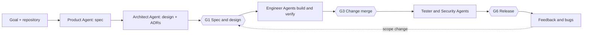

# Semi-Autonomous, Human-in-the-Loop SDLC Platform
**Product & Technical Specification**

**Version:** 0.6 (returns to the original idea. Supersedes the regulated 0.5.x direction)  
**Date:** October 2026  
**Status:** Draft for a tool built for the author's own team and projects. Items marked **[H]** are hypotheses to test by using the tool.

> History: v0.4 ([spec.v0.4.md](./spec.v0.4.md)) was the original idea. v0.5.x ([spec.v0.5.3-regulated.md](./spec.v0.5.3-regulated.md)) pivoted to regulated, compliance-grade delivery. v0.6 drops that direction and keeps the useful non-regulated parts. Regulated features are parked in Appendix A, not deleted.  
> Clickable screen designs: [designs/index.html](./designs/index.html). The Trailmates and Kestrel Market examples match this spec. The medical-device and Harbor Retirement examples show the parked compliance pack. Narrated videos: [demo/README.md](./demo/README.md).

---

## 1. Vision & Goal

Build a platform where **AI agents and people build software together**. Agents do most of the drafting, coding, and testing, in roles that mirror a real team. People are pulled in **at the moments where human judgment adds value**, and left alone the rest of the time. Everyone can see where work stands and where they are needed.

**Core promise:**
> "State a goal. Specialized agents (product, architecture, frontend, backend, QA, DevOps, security) do the work and ask the right person, at the right time, in the right way. You are interrupted when your judgment matters, not for everything else."

**Purpose.** A tool for the author's own team and projects. Success is measured by whether the team ships faster, and with fewer and better interruptions, than by using the coding agents directly. It is not designed to be sold, certified, or audited by outsiders.

---

## 2. What This Platform Should **Not** Be

- **Not a better coding agent.** It uses existing engines (Claude Code, Copilot, Codex) for the coding work and does not build its own agent loop.
- **Not a regulated or compliance product.** No regulatory profiles, e-signatures, or audit-grade evidence in the core (parked in Appendix A).
- **Not a pure "ticket to PR" machine** that minimizes human involvement. Human collaboration is the point.
- **Not a generic multi-agent framework or agent playground.**
- **Not a replacement for Jira, Linear, or GitHub Projects**, and not an in-IDE assistant.
- **Not a low-code or no-code app builder.**

**Positioning rule:** if a feature does not make human-and-agent collaboration better, or help people see and steer the work, question whether it belongs.

---

## 3. What It Should Be Best At

Honest framing: semi-autonomous agent platforms are the most crowded part of the market (GitHub Agent HQ, GitLab Duo Agent Platform, Factory, Devin, Kiro, and others), and the basic "approval gate" is now a do-it-yourself pattern (for example, hooks that block an agent until a person approves). So the platform competes on **how well humans are brought into the loop**, not on the fact that they are. Four hypotheses **[H]**:

1. **Human-injection engine.** Well-timed questions, checkpoints, and approvals, with routing to the right person, reminders, batching, safe defaults, standing decisions, and answers from Slack or Teams (§5).
2. **Agent-engine-agnostic.** One workflow, roles, and human-in-the-loop layer over several coding engines, so a team is not locked to one (§11).
3. **Role-mirrored agents across the whole lifecycle**, not just code: product, architecture, implementation, QA, security, DevOps, each with a human counterpart (§8, §13).
4. **Living SDLC map as the control surface.** One picture of the stages, who is blocked on whom, and exactly where a person's interaction belongs (§10.2).

Idea parked for later: **earned autonomy**, where the autonomy dial rises per change type as agents prove themselves. The MVP shows the data to tune this by hand (§5.7, §17).

---

## 4. Core Concepts

- **Initiative**: a significant body of work with its own SDLC pipeline instance and one registered repository.
- **Stage**: Product → Architecture & Design → Implementation → Testing → Security → Release → Feedback.
- **Agent**: a specialized AI worker bound to a role as its preparer. Agents never approve.
- **Role and hat**: a role is a kind of responsibility (§8). A **hat** is a role held by a person. One person can wear several hats, and a hat can have a deputy.
- **Interaction**: anything an agent asks of a person (§5.1): question, checkpoint, review, decision request, or notice.
- **Checkpoint**: a planned decision point where a person approves before work continues (§8).
- **Assumption**: something an agent decided without asking, declared visibly, that a person can accept or reject later.
- **Standing decision**: an answer a person marks as reusable, so agents stop asking the same thing (§5.6).
- **Autonomy mode**: how often agents involve people: Guided, Balanced, or Autopilot (§6.1).
- **Artifact**: spec, ADR, diagram, code, tests, results, release notes.
- **Workspace**: the role-aware web app for inbox, review, and steering.
- **SDLC Map**: the xyflow visualization of stages, status, and the current human interaction point.
- **Standards Pack**: replaceable engineering rules the agents follow (§7).
- **Repository Registry** and **Integration Register**: allowlists of the repositories and external systems agents may touch (§6.5, §6.7).
- **Model Gateway**: the one service that carries every LLM call (§12.3).

---

## 5. How Humans Are Brought In (Human-Injection Engine)

This section is the heart of the product.

### 5.1 Interaction types
| Type | Purpose | Blocks the agent? | Default response |
|---|---|---|---|
| **Question** | The agent is unsure and needs information | Only if the work depends on it | A recommended answer, applied after a timeout if the work can safely continue |
| **Checkpoint** | A planned approval (spec, design, merge, release) | Yes, for the gated step | None. Waits |
| **Review** | Look at an output (PR, test results, preview) | Yes for merge, otherwise no | Waits, with reminders |
| **Decision request** | Choose between options, with the agent's recommendation | Usually no | The recommendation, after a timeout, unless it is a hard stop (§6.3) |
| **Notice** | Informational. Something was done or assumed | No | None |

### 5.2 When to involve a human
Three layers. Agents may escalate **more** than the policy says, never less on layers 1 and 2.
1. **Checkpoints**: set by the workflow and autonomy mode (§6.1, §8). Default: spec and design, change merge, release.
2. **Deterministic triggers**: rules, not model judgment. Examples: authentication or security code, payment paths, database migrations, infrastructure or cost changes, new dependencies, new external hosts, large diffs, deleted or skipped tests, lowered coverage thresholds, repeated failures after N attempts, security scan findings above a threshold, changes to protected paths. Editable by the team (§6.4).
3. **Agent judgment**: ambiguity, conflicting requirements, trade-offs the agent cannot settle, or a gut feeling that something is risky.

### 5.3 Blocking, assumptions, and defaults
- **Do not stop the world.** An agent asks, then continues with other work that does not depend on the answer. Dependencies are tracked, so only the dependent step waits.
- **Declare assumptions** instead of asking, when the cost of being wrong is low. Each is visible on the map and in a daily list, and can be accepted, rejected, or turned into a requirement. Rejecting one re-opens the affected work.
- **Defaults after timeout.** A question or decision request may carry a recommended answer and a deadline. At the deadline the recommendation is applied and flagged. Hard stops never default (§6.3).

### 5.4 Routing, reminders, and availability
- A role maps to a **person** through hats, availability, working hours, and a fallback chain (deputy, then team lead).
- **Reminders and SLAs** escalate along that chain. A reminder never approves on someone's behalf.
- **Out of office** and delegation with dates.

### 5.5 Channels
- **Workspace**: the full context, always available.
- **Slack, Teams, and email**: notifications with a deep link, and **direct answers for simple interactions** (pick an option, approve a low-risk review, snooze). Checkpoints that need real reading (spec, design, release) open the Workspace by default. The team can allow chat approval per interaction type.
- A person can **join or observe a live run**, **pause** it, and **steer** it with guidance. Steering is recorded.

### 5.6 Reducing interruption fatigue
- **Batching and digests**: low-priority items go into a digest at set times. Quiet hours are respected, except for hard stops.
- **De-duplication**: the same question from several agents is asked once.
- **Standing decisions**: a person can mark an answer "use this from now on" (for example, "always use the existing date library"). Agents search standing decisions before asking and cite them.
- **Priority**: asks are ranked by what they block and by deadline, so the inbox shows what to answer first.
- **"Didn't need to ask"**: one click on any interaction. It feeds the tuning data in §5.7.

### 5.7 What a good ask contains
Every interaction carries a **context card**: what the agent was doing, what it needs, why now, the options with a **recommendation**, the impact of each, links to artifacts, what is waiting on this, and the default and deadline. The goal is a one-minute answer.

Measured per Initiative and per agent: time to answer, questions per merged PR, share answered with the recommended option unchanged, share marked "didn't need to ask", and time agents spent blocked. These are shown in the Workspace so the team can tune triggers by hand. (Automatic tuning, "earned autonomy", is post-MVP.)

---

## 6. Autonomy, Trust, and Access

### 6.1 Autonomy modes
Set per Initiative, overridable per change type (§6.2). Default: **Balanced**.

| | Guided | Balanced (default) | Autopilot |
|---|---|---|---|
| Spec and design approval | Human approves each stage (spec, architecture, test plan) | Human approves spec and design together | Human approves, or objects within a review window |
| Pull requests | Human reviews every PR | One human review per PR. Pre-approved change types merge on green CI | Auto-merge on green CI when no trigger fired. Triggered PRs go to a human |
| Questions | Ask when unsure | Ask on triggers and blocking ambiguity. Otherwise assume and declare | Assume and declare. Ask only on triggers and hard stops |
| Release to staging | Human approves | Automatic after CI | Automatic after CI |
| Release to production | Human approves | Human approves | Human approves (hard stop) |

### 6.2 Pre-approved change types ("autopilot rules")
A person with the right hat defines change types that merge without review when CI is green and no trigger fires: for example documentation, UI copy, patch-level dependency updates, feature flags in staging, and test-only changes. Each rule has an owner and a review date. The Workspace shows what auto-merged and what was held, with reasons.

### 6.3 Hard stops (every mode)
Never automatic, never defaulted: production deploys, changes to protected paths, a new external host or credential (§6.7), exceeding a cost budget, destructive data migrations, and anything the agent flags as irreversible.

**Release calendar and change freeze.** A team can mark freeze windows (for example the weeks around a peak sales event). Normal production releases are held inside a freeze. Only security fixes and the **hotfix path** (§8.2) may ship, and a hotfix opens a follow-up review.

### 6.4 Rules and the independent-review rule
- Triggers and pre-approved types are written as simple versioned rules (YAML first, a policy engine later).
- **Independent review rule** (recommended, on by default): the person who started a run does not review its PR. A person who steers a run becomes a contributor and is also excluded.
- **Solo mode**: a single developer can hold every hat. The independent-review rule is off, and **simulated teammates** can stand in for roles to exercise multi-person flows. Simulated teammates are flagged on everything they touch and can never approve a production release.

### 6.5 Repository Registry and agent git access
- **Predetermined repositories only.** Agents read or write only repositories in the registry, maintained by an admin. An Initiative selects a registered repository instead of typing a URL.
- **Registry entry:** `repo`, `access` (`read-write` | `read-only`), `write_mode` (`direct` | `branch_pr`), `integration_branch` (default `main`), `protected_paths`, `model_policy` (`any` | `own-account`, §12.3), optional `allowed_paths`. Default protected paths: `.github/workflows/**`, `CODEOWNERS`, agent configuration (for example `.claude/**`), verification scripts, platform rules.
- **Write modes.** `direct`: agents commit to the integration branch (fine for scratch repositories). `branch_pr`: agents push only to `agent/<run-id>/**` and open PRs. Merges are done by the Gate identity.
- **Direct access from the sandbox.** Each run gets a short-lived GitHub App installation token (1 hour at most) scoped to one repository and the minimum permissions. The agent clones, commits, and pushes itself.
- **Integration branch.** PRs target only the registry entry's `integration_branch`. Baselines are plain tags (`spec-approved-N`, `release-X.Y.Z`) on that branch. Release branches are post-MVP.
- **Protected paths** are checked by the runner before every push, and by branch protection where the repository's GitHub plan supports it.

### 6.6 GitHub connection
- **Registering the Apps (admin, once).** Use GitHub's **App manifest flow**: the admin is redirected to GitHub once to approve, and GitHub returns the App ID, private key, and webhook secret to the platform, which stores them in the secrets manager. The Apps are installed with **Only select repositories** set to the registry. The platform compares installations with the registry on GitHub's installation events and blocks runs on any mismatch.
- **Two Apps** (decided 2026-10-16). An **Agent App** (contents and pull-request write) and a **Gate App** (checks, merge, branch protection). The Gate App's private key lives only in the Git Integration service, never in a sandbox.
- **Sign-in is OIDC SSO. GitHub is linked, not used to log in** (decided 2026-10-16). Each person can link their GitHub account once (identity only, stored as the numeric GitHub user ID) so the platform can tell who wrote or reviewed a commit. The link is required only when the independent-review rule is on. A PR with an unlinked human's commit is held for the team lead to map the identity.
- **Webhooks.** A public HTTPS endpoint on AWS. For local development, use a webhook proxy such as smee.io, or polling.
- **GitHub plan limits** (checked against GitHub's documentation). Protected branches and required reviewers in **private** repositories need GitHub Pro (personal account) or GitHub Team (organization). On a personal account, the Gate App cannot be added to a bypass list, so it merges only when its own required check passes. With free private repositories, use `direct` mode on scratch repositories, or use public test repositories, or upgrade, to try protected branches.

### 6.7 Integration Register (second- and third-party APIs)
- **Purpose.** Tells the platform and agents which external systems an Initiative may call, where to learn them, and how to test them. *Second-party* means another system the team owns. *Third-party* means a vendor or public API.
- **Who and when** (decided 2026-10-16). The Architect or an Engineer confirms entries at the spec-and-design checkpoint. The Architect Agent proposes entries from the stories and any links the Product Owner gave at intake. Later additions are reviewed changes (a trigger).
- **Entry.** `name`, `kind`, `owner`, `docs` (links, OpenAPI preferred), `hosts` (egress allowlist), `auth` (type and a `credential_ref` into the secrets manager), `data_sent` and `data_received` (data sensitivity), `environments` (does the vendor offer a sandbox?), `test_strategy` (`vendor_sandbox` | `mock` | `recorded` | `none`), `limits_and_cost`, `terms`, `failure_behavior`, `status`.
- **Docs snapshot.** The platform fetches registered doc links outside the sandbox and stores a hashed snapshot. Agents read the snapshot. Fetched content is **untrusted input**: it is never instructions and cannot change rules or approvals. A changed snapshot opens an impact check.
- **Network access** (decided 2026-10-16). Sandbox egress is **deny by default**. The allowlist is the model gateway, GitHub, admin-maintained package registries, and the hosts of approved entries. It is enforced by an egress proxy outside the agent's reach.
- **Credentials.** Only test or sandbox credentials may enter a sandbox, scoped per run. Production credentials never do, and nothing is written to a repository.
- **Verification.** The verification contract (§7) uses each entry's `test_strategy`. A `none` strategy is a trigger.

### 6.8 Cost and run limits
Per-run and per-Initiative budgets, a monthly budget, a limit on concurrent runs, and alerts at set thresholds (default 80%). Exceeding a budget is a hard stop. Costs are recorded per run, agent, and model (§12.3).

---

## 7. Engineering Standards Pack

The v0.4 rules are the **default pack**. They are replaceable per team and enforced by agents and checkpoints.

- One repository per Initiative, chosen from the Repository Registry before the Product Agent goes beyond intake. Monorepo preferred.
- Backend: Node.js (TypeScript preferred) or Python. Frontend: React + TypeScript. Database: PostgreSQL (deviation needs an ADR). IaC: Terraform.
- Backend services follow Hexagonal Architecture (domain, application, infrastructure separation).
- ADRs before implementation for significant decisions.
- Standard layout: `apps/ packages/ docs/ adrs/ infra/ ARCHITECTURE.md README.md`.
- Stories have stable IDs (`US-###`) and acceptance criteria. Tests and PRs reference the story they serve. This gives the map a light story-to-PR-to-test trace. It is not an audit trace.
- Unit tests for backend domain and application layers. Tests for non-trivial frontend logic.
- **Verification contract**: one repository-defined entry point (for example `npm run verify`) that builds, runs tests, starts the app in an ephemeral environment, health-checks it, and runs smoke or end-to-end checks. Agents and CI run the **same** entry point. Verification scripts and CI configuration are protected paths. Deleting or skipping tests, or lowering thresholds, is a trigger.
- Agents declare assumptions (§5.3).

---

## 8. Roles and Checkpoints

### 8.1 Roles
| Role | Responsibility | Typical asks |
|---|---|---|
| Product Owner | Goals, scope, priorities, acceptance | Specs, scope questions, acceptance |
| Architect | System design, ADRs, major technical decisions | Design proposals, risk flags |
| Frontend Engineer | UI implementation and review | UI logic, design trade-offs, PR review |
| Backend Engineer | Services, APIs, data, and review | Complex logic, data modeling, PR review |
| QA / Tester | Quality strategy and triage | Persistent failures, test strategy |
| DevOps / Release | Pipelines, infrastructure, releases | Deploy plans, infrastructure and cost decisions |
| Security | Risk review | High-risk findings, exceptions |
| Platform Admin | Registry, Apps, budgets, rules | Configuration only. No approvals |

A person can wear several hats. The **release approver** is a hat held by the Product Owner or DevOps (configurable).

### 8.2 Checkpoints
The IDs `G0`–`G7` are kept from earlier drafts and the demos. They name checkpoint types and are not regulatory gates. By default only G1, G3, and G6 are active.

| ID | Checkpoint | Prepared by | Decided by | Default |
|---|---|---|---|---|
| G0 | Intake | Product Agent | Product Owner | Skipped (a form) |
| G1 | Spec and design | Product + Architect Agents | Product Owner (spec), Architect (design) | **Active** |
| G2 | Architecture baseline | Architect Agent | Architect | Merged into G1 |
| G3 | Change merge (per PR) | Engineer Agents | One peer engineer, or automatic for pre-approved types | **Active** |
| G4 | Verification | Tester Agent | QA | Optional per Initiative |
| G5 | Security review | Security Agent | Security | On triggers only |
| G6 | Release | DevOps Agent | Release approver | **Active** |
| G7 | Retrospective | Product Agent | Product Owner | Optional |

A **scope change** after G1 re-opens G1 for the affected stories only. A **hotfix** path lets a person ship an urgent fix with a single approval, followed by a review task within a set time.

---

## 9. High-Level Flow

1. A person creates an Initiative with a goal and selects a registered repository. Autonomy mode defaults to Balanced.
2. The Product Agent drafts stories. The Architect Agent drafts the design and ADRs. People answer questions as they arise, and approve at G1.
3. Engineer Agents implement in parallel sandboxes, **run the app and the verification contract**, and only then open PRs. CI re-runs verification independently.
4. G3: a peer reviews each PR, or it merges automatically if it is a pre-approved type. Triggered PRs always go to a human.
5. Tester and Security Agents add test and security results. QA or Security are asked only when optional checkpoints or triggers call for it.
6. The DevOps Agent prepares the release. A person approves production. The pipeline, not an agent, deploys.
7. Feedback and bug reports become new work. A rule can start a Bug Agent run automatically.

---

## 10. Functional Requirements

### 10.1 Workspace
- **Attention queue**: all asks for this person, ranked by what they block and by deadline, with the context card inline.
- **Review pack** per checkpoint: diff-focused view, story links, declared assumptions, test results, preview environment link, the trigger reasons, and the independent-review check.
- Join or observe a live run, pause it, steer it (§5.5).
- Hats, deputies, working hours, quiet hours, and out-of-office.
- Standing decisions and the assumptions list.
- Autonomy mode and rules editor, pre-approved change types, budgets, and interruption metrics (§5.7).
- Admin settings: Repository Registry, GitHub connection, Integration Register, Model Gateway status.

### 10.2 SDLC Map (React + xyflow)
- Pipeline per Initiative with status: Not started / In progress / Waiting on human / Blocked / Done.
- Shows who each waiting item is waiting on, and the exact point of **your** interaction.
- Clickable nodes open artifacts, PRs, previews, or live sessions.
- Portfolio view across Initiatives, with the release calendar.

### 10.3 Agent Behavior
- Agents work in the Initiative's registered repository and update platform state after significant actions.
- **Verify before proposing.** Before a PR, an Engineer Agent runs the verification contract in its sandbox, including starting the app. A PR opens only on a pass. After repeated failure the agent escalates to its sponsor with the report instead of opening a failing PR.
- **Verification report.** Commands, results, and commit SHA are attached to the PR. This is the agent's own report and is advisory. CI re-runs the contract on the PR head and that result is what gates the merge.
- **Verification environment.** In the sandbox, dependent services (for example PostgreSQL) run as sidecars. CI runs the same contract in a fuller ephemeral environment. Agents run targeted browser tests. CI runs the full suite.
- Agents attach story links to every change, declare assumptions, and never claim verification they did not perform.
- **Preview environments** per PR where the stack allows.

### 10.4 Artifacts
Git is the source of truth for code and text artifacts. The platform database holds workflow, interactions, and run state, and indexes artifacts for linking.

### 10.5 Notifications and Integrations
Slack, Teams, and email with deep links and in-chat answers (§5.5). GitHub through the Apps. Later: GitLab, Jira link-out.

### 10.6 Activity log
An append-only log of agent actions, interactions, answers, and approvals, with who and when. It is for the team's own debugging and accountability, not external audit.

---

## 11. Agent Engines (Engine-Agnostic Design)

The platform owns the workflow, roles, interactions, routing, gates, and visibility. **Engines** do the coding work.

### 11.1 AgentEngine port
`start(run spec) → event stream`, `send(guidance)`, `pause`, `resume`, `stop`, and `collect(artifacts)`. A run spec contains the role, task, repository token, sandbox limits, model alias, and the platform tools. Events share one schema: messages, tool calls, file changes, interactions raised, cost.

### 11.2 Platform tools exposed to every engine (MCP)
The platform runs an MCP server that each run connects to, so any engine that supports MCP can collaborate the same way:
- `ask_human` (question or decision request, with options, recommendation, default, deadline)
- `request_checkpoint`, `declare_assumption`, `search_standing_decisions`
- `report_progress`, `register_artifact`, `get_integration_docs`

### 11.3 Adapters
- **Claude Code** (headless): primary. Connects to the Model Gateway through its Anthropic-compatible settings. Its hooks can add in-engine guards (for example, block edits to protected paths), but the platform does not rely on them.
- **GitHub Copilot** and **OpenAI Codex**: planned adapters. Both are expected to support MCP and to run headless **[H]**, to be confirmed in a spike. An engine that cannot be pointed at the Model Gateway (for example, Copilot's hosted models) runs outside the platform's cost controls, and the run record says so.
- **Gates are enforced outside the engine**: at the git boundary (protected paths, `branch_pr`, required CI), at merge (Gate identity), and at deploy (pipeline). That is what keeps behavior the same across engines.

---

## 12. Technical Architecture

### 12.1 Deployment
- **Single-tenant, deployable into your own AWS account** with Terraform. The same containers also run locally (§12.4).
- SPA served by the platform behind OIDC sign-in. No GitHub Pages hosting.

### 12.2 Components
- **Orchestrator**: workflow state, role routing, dependency tracking, timers.
- **Interaction Service**: creates and routes interactions, reminders, digests, defaults, standing decisions.
- **Rules**: triggers and pre-approved change types as versioned YAML.
- **Agent Runner**: ephemeral sandboxed containers that host an engine through its adapter.
- **Platform MCP server** (§11.2).
- **Model Gateway** (§12.3).
- **Git Integration**: Agent App and Gate App (§6.6).
- **Repository Registry**, **Integration Register**, **Docs fetcher**.
- **Identity**: OIDC (Dex locally, Amazon Cognito on AWS), hats, GitHub link.
- **Notification Service**: Slack, Teams, email, with reply handling.
- **Workspace and Map UI**: React, TypeScript, xyflow.
- **Data**: PostgreSQL for workflow, interactions, and the activity log. Object storage for run logs and artifacts.

### 12.3 Model Gateway
**One gateway for all LLM traffic** (decided 2026-10-16). Nothing in the platform calls a provider directly.
- **Callers.** Agent runs (through the engine) and **platform LLM services** (context-card drafting, summaries, spec drafts, bug triage, doc-snapshot summaries, impact checks). Their output is advisory.
- **Design.** A thin service. A sandbox gets a **per-run gateway token** and the gateway URL, never a provider key. The gateway checks the token, enforces the run's budget and model allowlist, maps **model aliases** to provider models, forwards the request with the real key from the secrets manager, and records tokens and cost.
- **Aliases.** Agent definitions use aliases (`agent-strong`, `agent-default`, `agent-fast`, `svc-default`). Each deployment maps them to models, so changing provider is a configuration change.
- **No silent fallback across providers.** If the provider is down, the run pauses and can resume.
- **OpenRouter is the default** in development (local, hybrid, and AWS-sandbox). Use two API keys with credit limits (agent runs, platform services). Claude Code uses OpenRouter's Anthropic-compatible endpoint with `ANTHROPIC_AUTH_TOKEN` set and `ANTHROPIC_API_KEY` blank, and Anthropic first-party as the top provider, because OpenRouter documents Claude Code as guaranteed only with it. Platform LLM services may use any OpenRouter model per alias, through its OpenAI-compatible endpoint. Environment variables for Claude Code must be real process environment or its settings file, because it does not read a project `.env`.
- **Bedrock and Vertex** are optional adapters for repositories with `model_policy: own-account`, which never use a third-party gateway such as OpenRouter.
- **Spike questions** are in §19.

### 12.4 Environments: local and AWS
One codebase and one set of container images. Infrastructure dependencies sit behind ports with two adapter sets, chosen by configuration.

| Port | Local (Docker Compose) | AWS |
|---|---|---|
| Services | Containers | ECS Fargate behind an Application Load Balancer |
| Database | PostgreSQL | Amazon RDS for PostgreSQL |
| Object storage | MinIO (S3 API) | Amazon S3 |
| Identity | Dex with static personas | Amazon Cognito |
| Secrets | Git-ignored local file | AWS Secrets Manager |
| Agent runner | Docker container per run, with sidecars and an egress proxy | ECS Fargate task per run, with sidecar containers, a task role, and an egress proxy |
| Model Gateway | Container. OpenRouter by default, Bedrock through the AWS profile as an opt-in | Fargate service. OpenRouter by default in dev, Bedrock through the task role where needed |
| Notifications | Log sink and mail catcher | SES, Slack, Teams |
| GitHub webhooks | Webhook proxy or polling | Public HTTPS endpoint |

- **Modes:** `local`, `hybrid` (local app with real Bedrock through your AWS profile), `aws-sandbox` (Terraform stack in your AWS account).
- **Parity.** Each port has contract tests that run against both adapter sets.
- **Fargate constraints** (checked against AWS documentation). No privileged containers and no Docker-in-Docker. A task can hold sidecar containers that share localhost, so the runner uses sidecars and never needs a Docker socket.
- **One AWS account.** Use a single-AZ development stack, an account budget alert, and destroy or stop it when idle. The always-on parts (NAT gateway, load balancer, database) dominate idle cost.
- **Windows** development uses Docker Desktop with WSL 2.

---

## 13. Agent Roster

| Agent | Main outputs | Asks | MVP |
|---|---|---|---|
| Product Agent | Stories, acceptance criteria, scope-change impact | Product Owner | Yes |
| Architect Agent | ADRs, diagrams, scaffolding, integration entries | Architect | Yes |
| Frontend / Backend Engineer Agents | Code, tests, PRs | Peer engineer | Yes |
| Tester Agent | Test plans, test code, results | QA | Yes |
| DevOps Agent | CI/CD, Terraform, release notes, canary plan | Release approver | Thin |
| Security Agent | Threat notes, scan results | Security | Thin |
| Bug Agent | Reproduces a reported bug, finds the cause, proposes a fix | Engineer | Later |

Agents never approve. Each agent definition (prompt, tools, model alias) is versioned in the repository.

---

## 14. Data Model (Sketch)

`Initiative`, `Story`, `Checkpoint`, `Interaction(type, state, due, default)`, `Assumption`, `StandingDecision`, `Person`, `Hat(role, deputy, hours)`, `AgentDefinition(version)`, `AgentRun(sponsor, contributors, engine, alias, cost)`, `Artifact(git_ref)`, `RepositoryEntry`, `IntegrationEntry`, `DocSnapshot(url, sha256)`, `GitHubLink`, `PreApprovedChangeType`, `Trigger`, `Release`, `CostRecord`, `ActivityEvent`, `SimulatedTeammate`.

---

## 15. Non-Functional Requirements (MVP)

- Least-privilege GitHub access, per-run tokens, protected paths.
- Secrets in a secrets manager, never in repositories, never in sandboxes (except per-run tokens).
- Full activity log of agent actions and human decisions.
- Any human can pause an agent and inject guidance.
- Cost and concurrency controls.
- Everything runs locally, and deploys to AWS from the same images.

---

## 16. Explicitly Out of Scope (MVP)

- Competing with other coding agents on raw coding performance, or building an agent loop from scratch.
- Regulated or audit-grade features: e-signatures, WORM or KMS evidence ledgers, compliance profiles (Appendix A).
- Backend languages other than Node.js and Python, and deviation from Hexagonal Architecture without an ADR.
- Multi-tenancy, enterprise SSO federation, SCIM.
- Release branches. GitLab, Jira sync, and an eQMS or ALM.
- Automatic autonomy tuning ("earned autonomy").

---

## 17. Build Plan and Success Measures

**Build order (cheapest feedback first):**
0. **Walking skeleton on both targets (first week or two).** The empty web, API, and database stack runs under Docker Compose and deploys to your AWS account with Terraform, behind OIDC sign-in.
1. **One engine, one loop.** Model Gateway with OpenRouter, Claude Code adapter, platform MCP server with `ask_human`, GitHub App, Repository Registry, one Initiative from goal to merged PR with verify-before-PR.
2. **Human-injection engine.** Interaction types, routing and hats, reminders, defaults after timeout, assumptions, standing decisions, Slack answers, attention queue, interruption metrics.
3. **SDLC map and checkpoints.** G1, G3, G6, pre-approved change types, Integration Register, previews.
4. **Second engine.** Copilot or Codex adapter, to prove the port.
5. **Portfolio, Bug Agent, cost views, autonomy modes polish.**

**Success measures (own use):**
- Time from goal to first reviewable PR, compared with using the engine directly.
- Questions per merged PR, share answered with the recommendation unchanged, share marked "didn't need to ask", and median time to answer. Targets to set after the first month.
- PR rework rate and cost per merged PR.
- A new teammate can open the map and see where they are needed in under 10 seconds.
- A second engine runs a full Initiative without workflow changes.

**Re-evaluate if:** after a few real Initiatives the team prefers using the engines directly, or interruptions per merged PR do not fall as standing decisions and rules accumulate.

---

## 18. Risks

| Risk | Mitigation |
|---|---|
| Interruption fatigue: the product becomes a notification firehose | Non-blocking asks, batching, standing decisions, defaults, "didn't need to ask" feedback, metrics (§5) |
| Too few interruptions: agents guess wrong | Triggers on risky areas, declared assumptions with a visible list, hard stops |
| Crowded market: GitHub, GitLab, and engine vendors add the same features | Built for own use. Compete on human-injection quality and engine neutrality. Re-evaluate rule above |
| Engine differences (tools, MCP support, headless modes, hosted models) | AgentEngine port, gates enforced outside the engine, adapter contract tests, spike per engine |
| Agents with repository write access (prompt injection, hostile content) | Registry allowlist, per-run single-repo tokens, protected paths, `branch_pr`, separate Gate identity, egress deny by default, docs treated as untrusted |
| Cost runaway | Per-run and monthly budgets, hard stop on overrun, gateway metering |
| OpenRouter is a third-party data hop and a leaked key drains credit | Per-run gateway tokens (sandboxes never hold the key), two keys with credit limits, `model_policy: own-account` for sensitive repositories |
| Developing on OpenRouter hides Bedrock differences | Gateway contract tests on both providers, aliases, hybrid mode |
| Scope creep back to compliance features | The positioning rule (§2). Parked in Appendix A |
| Solo-developer build size | Walking skeleton first, one engine first, defer second engine and portfolio features |

---

## 19. Open Decisions

- **Engines:** can Copilot and Codex run headless with MCP and a configurable model endpoint? Which to add second? Is a Copilot adapter possible without the Model Gateway?
- **Model Gateway spike:** (a) whether Claude Code's Anthropic-compatible endpoint accepts per-request provider preferences, or they must be set in the OpenRouter account. (b) whether Anthropic first-party stays eligible with `data_collection: "deny"`. (c) whether a thin proxy passes streaming and tool use through unchanged. (d) per-run OpenRouter keys, or gateway-side budget metering.
- **Workflow engine:** a small state machine on PostgreSQL vs Temporal or AWS Step Functions.
- **Rules format:** plain YAML first. When does a policy engine become worth it?
- **Chat answers:** which interaction types may be approved from Slack or Teams, and how are replies authenticated?
- **Default-after-timeout:** per-team defaults for deadlines and quiet hours.
- **GitHub plan:** test repositories are private repositories on a personal account (decided 2026-10-16). Trying protected branches needs GitHub Pro, a free organization with public test repositories, or a paid organization.
- **Egress enforcement on Fargate:** a proxy sidecar in each runner task vs a shared network firewall. Decide after the runner spike.
- **Cognito vs IAM Identity Center** as the AWS identity default.
- **Registry:** one active Initiative per repository vs several in a monorepo. Whether `direct` mode may target non-integration branches.
- **Earned autonomy:** when to try automatic tuning, and on what signals.

### Decided
| Date | Decision |
|---|---|
| 2026-10-15 | **Verification environment:** agents run dependent services as ephemeral sidecars. CI runs the same contract in a fuller environment and is authoritative (§10.3). |
| 2026-10-15 | **Frontend browser tests:** agents run targeted tests. CI runs the full suite (§10.3). |
| 2026-10-15 | **Release model (MVP):** release candidates are tags on the integration branch. Release branches are post-MVP (§6.5). |
| 2026-10-15 | **Integration branch:** configurable per registered repository, default `main` (§6.5). |
| 2026-10-16 | **Sign-in and GitHub link:** OIDC SSO only. People do not sign in with GitHub. They link their account for identity (§6.6). |
| 2026-10-16 | **GitHub Apps:** two Apps, Agent and Gate, registered by manifest flow and installed on registry repositories only (§6.6). |
| 2026-10-16 | **Test repositories:** private repositories on a personal GitHub account (§6.6, §19). |
| 2026-10-16 | **Integration Register:** Architect or Engineer confirms entries at the spec-and-design checkpoint, with the Architect Agent proposing. Later additions are reviewed (§6.7). |
| 2026-10-16 | **Sandbox network access:** deny by default, allowlist from the gateway, GitHub, registries, and approved hosts (§6.7). |
| 2026-10-16 | **AWS shape:** ECS Fargate, RDS PostgreSQL, S3, Cognito, Terraform, one AWS account (§12.4). |
| 2026-10-16 | **Local development:** Docker Compose with fakes, plus an opt-in hybrid mode with Bedrock through an AWS profile (§12.4). |
| 2026-10-16 | **OpenRouter is the default model provider in development** for all agents and all platform LLM processes, through one Model Gateway. Sandboxes get per-run tokens, never provider keys (§12.3). |
| 2026-10-16 | **Direction:** return to the original idea, a semi-autonomous, human-in-the-loop SDLC platform. Regulated features are parked (Appendix A). Purpose: a tool for the author's own team and projects. |
| 2026-10-16 | **Differentiators to pursue:** human-injection engine, engine-agnostic design, role-mirrored agents across the lifecycle, and the visual SDLC map. Earned autonomy is post-MVP (§3). |
| 2026-10-16 | **Agent models:** Claude Code uses Claude models through OpenRouter's Anthropic-compatible endpoint. Other engines use their own model families through the gateway (§11.3, §12.3). |

---

## Appendix A: Parked Compliance Pack

Not part of the product direction. Kept for reference in [spec.v0.5.3-regulated.md](./spec.v0.5.3-regulated.md), and could return later as an optional pack on top of the core:
- Strictness levels (Sandbox, Controlled, Regulated), deployment floor, and promotion by fork.
- Gates G0–G7 as regulatory gates, QRA and Release Approver roles with effective-dated authority, strict separation of duties with exceptions.
- E-signatures with step-up re-authentication, a KMS-signed hash-chained evidence ledger, WORM export, trusted time, audit mode, and evidence bundles.
- Baselines and change requests with formal impact analysis, deviations, SOUP records, SBOM per release, and requalification of agent models.
- IEC 62304 and SOX/SOC 2 overlays and the control mapping.
- A competitive scan (October 2026) concluded that the regulated wedge was unvalidated and had no verified regulatory pull, which is one more reason it is parked.

The core is designed so such a pack could attach later: checkpoints can be added, the activity log can be made tamper-evident, and the registry can carry a data class.

## Appendix B: Changes from v0.5.3

| Area | v0.5.3 | v0.6 | Reason |
|---|---|---|---|
| Direction | Regulated, compliance-grade | Semi-autonomous, human-in-the-loop, no regulation | Original idea |
| Purpose | Product for regulated buyers, design partners | Tool for the author's own team | Author's goal |
| Strictness | Sandbox, Controlled, Regulated | **Autonomy modes**: Guided, Balanced, Autopilot (§6.1) | Controls how often people are involved, not how audit-grade evidence is |
| Gates | G0–G7 with legal-style authority | Checkpoints, mostly G1, G3, G6 (§8.2) | Lightweight profile becomes the default |
| Human involvement | Escalation policy inside a compliance model | **Human-injection engine** as the core (§5) | The main differentiator |
| Evidence | Signed, hash-chained ledger | Plain activity log (§10.6) | No external audit |
| Agents | Claude Code primary | **AgentEngine port** with MCP tools (§11) | Engine-agnostic differentiator |
| Data class `regulated` | Controls model gateway | `model_policy: own-account` (§6.5) | Keeps the useful data-boundary idea without compliance |
| Kept unchanged | | Repository Registry, GitHub Apps and link, Integration Register, egress deny, Model Gateway, OpenRouter default, local and AWS environments, verify-before-PR, sidecars | Not regulatory |

Screens and videos (updated 2026-10-16):
- **Trailmates** is the main example and matches this spec: autonomy modes, three checkpoints, and a new journey 5 with the attention queue and context cards, Slack answers, assumptions and standing decisions, and interruption metrics. Journey 6 covers the GitHub connection, Integration Register, model gateway, and engine per role.
- **Kestrel Market** matches this spec: Balanced autonomy, payment-scope triggers, a QA checkpoint, a release calendar with a freeze, and a hotfix path.
- **Parked:** the medical-device story (screens 01 to 16), Harbor Retirement, and their videos (`demo/videos/_parked-compliance-pack/`) illustrate the compliance pack. Screens 02 and 16 still use compliance and strictness language.
- **Not designed yet:** Teams and email notification templates, a Trailmates hotfix follow-up screen, editing triggers as YAML, and empty and error states.
