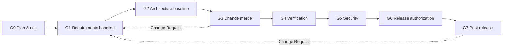

> **Backup.** This is the 0.5.3 regulated-direction spec (strictness levels, e-signatures, evidence ledger, IEC 62304 overlay). It is superseded by [spec.md](./spec.md) v0.6, which returns to the original semi-autonomous, human-in-the-loop idea. The regulated features are parked in that file's Appendix A.

# Compliance-Grade Role-Mirrored SDLC Platform
**Detailed Product & Technical Specification**

**Version:** 0.5.3 (pivot from 0.4; adds strictness levels, repository registry, GitHub connection, integration register, local/AWS environments, and an OpenRouter-default development gateway)  
**Date:** October 2026  
**Status:** Pivot draft. Target market: regulated / compliance-driven software delivery. Hypotheses marked **[H]** must be validated before build (see §16).

> v0.4 (general-purpose autonomous SDLC) is preserved in `spec.v0.4.md`. See Appendix B for what changed and why.  
> Clickable screen designs for this spec are in [designs/index.html](./designs/index.html).

---

## 1. Vision & Goal

Build a platform that runs the software development lifecycle with specialized AI agents under **human authority that is role-based, separated, and provable**. Agents prepare the work. Named humans holding the required role approve it. Every approval produces tamper-evident evidence linked to the exact artifacts reviewed.

**Core promise:**
> "AI agents do the drafting, coding, and testing. Only people with the right role can approve. Every decision is signed, separated from the author, and traceable from requirement to release, so the audit evidence is a by-product of the work, not a project after it."

**Positioning:** *compliance by construction.* The platform enforces controls while work happens (preventive and generative). Continuous-compliance tools (Vanta, Drata, Secureframe) mostly observe afterward. AI coding agents (Devin, Copilot, Factory, Claude Code) mostly lack role authority and evidence.

**Why role-mirroring now matters:** in v0.4 the roles were a UX idea. In regulated delivery, roles carry **authority and legal accountability** (who may approve requirements, accept risk, verify, release). Role-mirroring is therefore a control requirement, not a metaphor.

---

## 2. What This Platform Should **Not** Be

**It should NOT be:**
- A better autonomous coding agent (Devin, Cursor, Factory Droids, Claude Code, Copilot coding agent). It consumes one as the coding engine.
- A system that minimizes or removes human approval. Agents never approve.
- A generic multi-agent orchestration framework or agent playground.
- An eQMS, ALM, or requirements-management replacement (Veeva, MasterControl, Greenlight Guru, Jama, Polarion, Codebeamer). It integrates and exports to them.
- A replacement for Jira, Linear, or GitHub Projects.
- A continuous-compliance dashboard that only observes (Vanta/Drata category).
- A low-code / no-code app builder.
- A **certifier**. The platform produces evidence and enforces configured controls. It does not make a customer compliant. The customer's quality system owns compliance.

**Positioning rule:** if a feature does not strengthen authority, separation of duties, evidence, or traceability, question whether it belongs.

---

## 3. Unique Differentiator

Three things together, each weak alone:

1. **Authority model for agents.** Agents author. Humans in specific roles approve. Author-of-record ≠ approver, enforced by the platform and by the git host (§5.1–5.2, §5.6).
2. **Evidence by construction.** Each gate emits a signed, hash-chained evidence record bound to artifact hashes and git SHAs, with an auto-generated requirement-to-release traceability matrix (§5.3, §10.3).
3. **Controlled agents.** Agent definitions, prompts, and model versions are themselves change-controlled and requalified before use (§5.5). This is what makes AI-authored work defensible to an auditor.

The graphical SDLC map (React + xyflow) is the **visibility layer** for these controls (gate status, SoD status, evidence completeness). It is not the differentiator.

---

## 4. Core Concepts

- **Initiative**: significant body of work with its own pipeline instance, governed by one **Compliance Profile**.
- **Compliance Profile**: versioned policy pack defining required gates, role authority, SoD rules, evidence fields, and retention (§6).
- **Gate**: a decision point requiring evidence and a human signature by an authorized role.
- **Stage**: Plan & Risk → Requirements → Architecture & Design → Implementation → Verification → Security → Release → Post-release.
- **Agent**: AI worker bound to a role as *preparer*. Never an approver.
- **Human Role**: authority-bearing role (§8).
- **Author-of-record**: the human who initiated or directed the agent run(s) that produced a change. Treated as the author for SoD.
- **Evidence Record**: signed, append-only record of a gate decision (§5.3).
- **Baseline**: approved, frozen set of artifacts (git tag + signed record).
- **Change Request (CR)**: controlled modification to a baseline, with impact analysis.
- **Escalation / Task**: system-created request directed to a role or person.
- **Workspace**: role-aware web UI for tasks, review packs, and signing.
- **SDLC Map**: xyflow visualization of stages, gates, and evidence status.
- **Standards Pack**: customer-selectable engineering rules (v0.4 §5 prescriptive rules become the default pack, §7).
- **Strictness Level**: how strictly the controls in §5 are enforced for an Initiative: **Sandbox**, **Controlled**, or **Regulated** (§5.8). Separate from the Compliance Profile.
- **Repository Registry**: platform allowlist of the only repositories agents may read or write, with data class, write mode, and protected paths (§5.9).

---

## 5. Compliance Control Model (Non-Negotiable at Regulated Strictness)

Enforced by the orchestrator and policy engine at **Regulated** strictness. Profiles may add controls but may not weaken these. Lower **strictness levels** (§5.8) deliberately relax enforcement for testing and pilots. Work done below Regulated is labelled as such and is not audit-grade evidence.

### 5.1 Humans approve, agents author
- No agent identity may hold, receive, or exercise approval authority at any gate.
- Agent review output (for example AI code review) is **advisory evidence** attached to a gate. It never satisfies a required human approval.
- Approval timeouts **never** auto-approve. They escalate to deputies and then block.

### 5.2 Author-of-record and separation of duties (SoD)
- Every agent run is attributed to a human **sponsor** (the person who explicitly started it). Anyone who injects guidance becomes a **contributor** to that run. Runs started by the workflow itself (for example Product Agent after G0) have no sponsor. A goal, an answer to an agent's question, or an assumption disposition is recorded as an **input**, not authorship. Unsolicited mid-run steering makes the human a contributor.
- **Independence gates (G2–G6):** approver ≠ sponsor and ≠ any contributor for the change being approved (strict mode, default). A profile may relax to sponsor-only.
- **Ownership gates (G0, G1, G7):** the accountable owner (Product Owner) may approve work they commissioned or whose inputs they provided, unless they are the sponsor or a contributor of the run. These gates always require an additional **independent** co-signer (QRA) who is not a sponsor or contributor.
- Approver must hold the gate's required role **at signing time** (effective-dated role assignments).
- Deployer ≠ code approver for the same change. Release approver ≠ deployer.
- Configurable minimum number of distinct humans per Initiative. Single-person role overlap is allowed only where the profile permits it, with a documented exception approved by a second authorizer.
- Platform admins have **no approval authority** and cannot edit evidence.

### 5.3 Evidence by construction
Each gate decision writes an **Evidence Record**:

| Field | Purpose |
|---|---|
| gate, initiative, policy/profile version | what rule set was evaluated |
| subject refs | git commit SHA, tree hash, SHA-256 of each reviewed artifact |
| decision | approve / reject / approve-with-conditions |
| signer identity, role, role-assignment version | who, with what authority |
| signature meaning | authored / reviewed / verified / approved / released |
| re-authentication method + trusted timestamp | signing integrity |
| rationale / checklist attestations | why, and what was actually checked |
| contributing agent runs | links to run records (§5.5) |
| prior record hash, platform signature | tamper evidence |

- Ledger is **append-only** and hash-chained. Records are signed with a KMS-backed key. Corrections are new records that reference the old.
- Periodic export to WORM storage (for example S3 Object Lock in compliance mode).
- Signing happens **only in the Workspace**, on the exact content hash shown to the signer. Slack/Teams/email are notification-only.

### 5.4 Baselines and risk-tiered change control
- Approved artifacts are frozen into a **baseline**. Changes after baseline require a **Change Request** with an agent-drafted, human-approved impact analysis.
- Change paths, selected by deterministic risk rules:
  - **Standard**: pre-approved low-risk change types (for example docs, non-safety refactors). Lightweight gate. The list of types is itself a **standing approval**: a signed decision by an authorized role, with path rules, conditions and a review date. The Gate identity merges a matching change when CI is green. Any §10.4 trigger forces the Normal path. Agents never approve.
  - **Normal**: full gates for the profile.
  - **Emergency (break-glass)**: named emergency approver, mandatory post-hoc review within a profile-set window, auto-opened deviation record, counted in metrics.
- This replaces v0.4's single linear waterfall. Work iterates inside a baseline and re-gates through CRs.

### 5.5 Agent configuration is a controlled item
- Each agent definition (system prompt, tools, permissions, standards pack refs) is versioned and requires approval before use.
- Models are **pinned** by exact ID. A model change creates a **Model Change Record** and requires passing a requalification eval suite (per-role golden tasks: constraint compliance, refusal to self-approve, output format, traceability links), then QA approval.
- Every **Agent Run** is recorded: agent definition version, model ID/params, input refs, tool calls, outputs, cost, sponsor, contributors.
- Agents run in ephemeral, sandboxed containers with short-lived, least-privilege credentials, egress allow-listed to the git host, model gateway, and approved package mirrors.
- The sandbox must be able to **run the application under test** (§10.5): dependent services (for example PostgreSQL) as ephemeral sidecars, no production secrets, no real data, no privileged containers, and CPU, memory, and time limits. Running agent-authored code makes sandbox isolation more important, not less.

### 5.6 Defence in depth at the git host
*Enforced at Controlled and Regulated. At Sandbox these controls are advisory and `direct` write mode is allowed (§5.8, §5.9).*
- The platform publishes a required status check (for example `sdlc/gate`) on protected branches. Merge is blocked until required evidence records exist.
- Agent identities cannot merge to protected branches or alter branch protection.
- Direct pushes or protection changes outside the platform are detected and recorded as deviations.

### 5.7 Data boundary
- No customer code, artifacts, or prompts leave the customer's boundary except to the **model gateway the customer configures**.
- Default deployment is single-tenant in the customer's cloud account (§11).
- Exception, **development and Sandbox use only**: the gateway may be OpenRouter, and only for repositories with data class `test`, in the cases listed in §5.8 rule 7 (§5.9, §11.3).

### 5.8 Strictness levels
Strictness controls **how much of §5.1–5.7 is enforced**. It lets teams exercise the full workflow cheaply, for example with an OpenRouter subscription, without weakening what a regulated release means. It is **orthogonal to the Compliance Profile**: the profile defines *which* gates and evidence apply, strictness defines *how strictly* they are enforced.

| Control | Sandbox | Controlled | Regulated |
|---|---|---|---|
| Intended use | Testing and development on test data | Real work with controls enforced (pilots, internal tools) | Production delivery with audit-grade evidence |
| Repository data class allowed (§5.9) | `test` | `test`, `internal` | `test`, `internal`, `regulated` |
| Model gateway (§11.3) | Customer gateways **and OpenRouter** | Customer-account gateways only. **OpenRouter also, in a non-audit-capable development deployment with `test` repositories** (rule 7) | Customer-account gateways only |
| Agent git write mode (§5.9) | `direct` or `branch_pr` | `branch_pr` only | `branch_pr` only, required `sdlc/gate` check, bypass detection |
| Separation of duties (§5.2) | Warn only | Enforced (sponsor-only) | Enforced (sponsor + contributors, exceptions need a second authorizer) |
| Approvals (§5.1, §5.3) | Real humans, or **simulated approvers** (test-harness identities) | Real humans, session authentication | Real humans, step-up re-authentication |
| Evidence ledger (§5.3) | Append-only log, unsigned, watermarked | Hash-chained, KMS-signed | Hash-chained, KMS-signed, WORM export, trusted time, retention lock |
| Agent config and models (§5.5) | Editable, unpinned | Versioned, approved, pinned | Plus requalification suite on every model change |
| Agent sandbox egress (§5.5, §5.10) | Allow-listed (model gateway, GitHub, package registries, approved integrations) | Allow-listed | Allow-listed, enforced by network policy |
| Production deploy / G6 release | **Blocked** | Allowed if the profile's minimum release level permits | Allowed |
| Valid as compliance evidence | **No** | Internal-grade (**No** in a non-audit-capable deployment) | Yes |
| Exports | Watermarked "NOT COMPLIANCE EVIDENCE" | Marked with level | Audit bundle |

Rules:
1. **Where it is set.** (a) **Deployment floor**: a Terraform variable (`min_strictness`), not editable from the UI. Initiatives cannot be created below it. (b) **Initiative level** (≥ floor), chosen at creation. Recommended topology: a **separate sandbox deployment** (own cloud account, ledger, keys, GitHub repos) with floor `sandbox`, and production deployments with floor `regulated`.
2. **Always visible and recorded.** A persistent banner in the UI, a label on the `sdlc/gate` check, and a `strictness_level` and `compliance_valid` stamp on every Evidence Record, Agent Run, Task, and export.
3. **One-way ratchet.** A level can be raised at any time. **Promotion** re-attests: gates are re-signed for the current artifact hashes at the new level, producing new valid records. Earlier records remain as non-compliant history. Lowering is not allowed once an Initiative has any Controlled-or-higher evidence. Instead, **fork to sandbox**: copy content into a sandbox repository as a new Initiative with no evidence carried over.
4. **Controlled change.** Changing a level is recorded. At Controlled and above it needs a second authorizer (QRA).
5. **Hard stops at every level.** Sandbox Initiatives cannot deploy to production or use `internal` or `regulated` repositories. Agents never approve: simulated approvers are test fixtures, not agents, and are flagged in every record they touch. OpenRouter never receives data from repositories above data class `test`.
6. **Profile minimum.** Each profile declares `min_release_strictness` (proposed: IEC 62304 overlay = Regulated, SOX/SOC 2 overlay = Controlled). G6 refuses to authorize a release below it.
7. **Development deployments and OpenRouter** (decided 2026-10-16). A deployment is **audit-capable** only if it signs with KMS, uses locked evidence storage, and has a customer-account model gateway configured (§11.6). Every local, hybrid, and `aws-sandbox` development deployment is **non-audit-capable**. Where OpenRouter may be used:
   - **Non-audit-capable development deployment:** Initiatives at **Sandbox or Controlled**, `test` repositories only, so the Controlled controls can be exercised end to end. **Regulated cannot be selected.** Every record is stamped `compliance_valid=false`, the UI shows the development banner, and no export can be marked as compliance evidence.
   - **Audit-capable deployment with floor `sandbox`:** Sandbox-level Initiatives only, as in 0.5.1. Promotion to Controlled switches the gateway to the customer account.
   - **Deployment with floor Controlled or above:** OpenRouter is disabled.
   
   In any deployment, an Initiative that used OpenRouter, a local signer, or unpinned model IDs is stamped `compliance_valid=false`. Moving a development Initiative to an audit-capable deployment is by **fork** (rule 3), never by carrying evidence across.

### 5.9 Repository Registry and agent git access
- **Predetermined repositories only.** Agents can read or write only repositories listed in the **Repository Registry**, an allowlist maintained by the Platform Admin. An Initiative selects a registered repository instead of supplying a URL. Unregistered repositories are rejected.
- **Registry entry:** `repo` (owner/name), `data_class` (`test` | `internal` | `regulated`), `allowed_levels`, `access` (`read-write` | `read-only` for reference repositories), `write_mode` (`direct` | `branch_pr`), `integration_branch`, `protected_paths`, optional `allowed_paths`. Default `protected_paths`: `.github/workflows/**`, `CODEOWNERS`, agent configuration (for example `.claude/**`), verification scripts (§7), and platform policy files.
- **Integration branch.** `integration_branch` is the only branch agent PRs may target. Default `main` (trunk-based). In the MVP, baselines and release candidates are **signed tags on the integration branch**, cut by the Gate identity. Release branches for patching released versions are post-MVP. A repository that already uses a `develop` flow can set `develop`. Agents never target, push to, or tag release branches.
- **Direct access from the sandbox.** Each agent run receives a short-lived GitHub App installation token (≤ 1 hour, expiring with the run) scoped to the single repository and the minimum permissions for its `write_mode`. The agent clones, commits, and pushes itself, with no platform proxy. The GitHub App is installed only on registered repositories, so GitHub enforces the allowlist as well.
- **Write modes.**
  - `direct`: the agent may commit to the integration branch. Valid at **Sandbox only**.
  - `branch_pr`: the agent may push only to `agent/<run-id>/**` branches and open pull requests. At Controlled and above a git host ruleset enforces this. Merges are performed by the Gate identity after the required evidence exists (§5.6).
- **Two GitHub identities.** The **Agent identity** (contents and pull-request write, per write mode) is used inside sandboxes. The **Gate identity** (checks, merge, ruleset administration) is never available inside a sandbox.
- **Protected paths** are checked by the runner before every push at all levels, and by rulesets at Controlled and above, so an agent cannot alter CI, ownership rules, or its own configuration.
- **Controlled changes.** Registry changes produce an evidence record. Entries usable at Controlled or Regulated need QRA approval. Every Evidence Record and Agent Run references the registry entry version used.
- **Connecting GitHub (Platform Admin, once).** The two Apps below are registered with GitHub's **App manifest flow**: the admin is redirected to GitHub once to approve the registration, and GitHub returns the App ID, private key, client secret, and webhook secret to the platform, which stores them in the secrets manager. The admin then installs each App on the personal account or organization with **Only select repositories** set to the registry. The platform reconciles installations against the registry from GitHub's installation webhooks and blocks runs on any repository where they differ.
- **Two GitHub Apps** (decided 2026-10-16). The **Agent App** has contents and pull-request write only, within the registry entry's `write_mode`. The **Gate App** has checks, merge, and ruleset administration. Using two Apps lets a ruleset name the Gate App alone as the required-check source, and the Gate App's private key exists only inside the Git Integration service. Sandboxes receive only the short-lived token minted for the single repository, never an App key.
- **People do not sign in with GitHub** (decided 2026-10-16). Sign-in is OIDC SSO (§11.1). At Controlled and above, each user **links their GitHub account once** through a GitHub App user authorization, used for identity only. The platform stores the numeric GitHub user ID, not the login name, which can change. This lets SoD recognize a human's commits and reviews made directly on GitHub as that person. A pull request containing a commit or review by an unlinked human identity is **held at G3** until the identity is mapped or the commit is excluded. The link is optional at Sandbox.
- **Webhooks.** The platform needs a public HTTPS endpoint for GitHub events. For local development use a webhook proxy such as smee.io, or polling as a fallback (§11.6).
- **GitHub plan constraints** (verified against GitHub's documentation, 2026-10-16). Required reviewers and protected branches in **private** repositories need GitHub Pro (personal account) or GitHub Team (organization). Bypass lists can only name actors when the repository belongs to an organization, so on a personal account the Gate App cannot be a bypass actor. The Gate design does not rely on bypass: it merges only when its own required check passes. Sandbox `direct` mode works on free private repositories. Testing `branch_pr` enforcement at Controlled needs a plan that supports protected branches, or public repositories (§18).

### 5.10 Integration Register (second- and third-party APIs)
- **Purpose.** Tells the platform and the agents which external systems an Initiative may call, where to learn them, and how to test them. It mirrors the Repository Registry (§5.9). *Second-party* means another system in the same company. *Third-party* means a vendor or public API.
- **Who and when** (decided 2026-10-16). The Architect or an Engineer confirms entries at **G1**. The Architect Agent proposes entries from the approved stories and any links the Product Owner gave at intake. Later additions or changes are changes: they raise a deterministic escalation (§10.4) and need Architect approval, plus Security approval when the integration carries credentials or any data class other than `none`.
- **Entry.** `name`, `kind` (`second-party` | `third-party`), `owner` (a named human), `docs` (links, with an OpenAPI or similar machine-readable spec preferred), `hosts` (the egress allowlist for this integration), `auth` (type and a `credential_ref` into the secrets manager), `data_sent` and `data_received` (data classes), `environments` (whether the vendor offers a sandbox or test account), `test_strategy` (`vendor_sandbox` | `mock` | `recorded` | `none`), `limits_and_cost` (rate limits and per-call cost), `terms` (license or terms link), `failure_behavior` (timeouts, retries, fallback), `status`.
- **Docs snapshot.** The platform fetches registered doc links outside the sandbox and stores a hashed snapshot as an Artifact. Agents receive the snapshot, and runs and evidence cite the snapshot hash and the entry version. Fetched content is **untrusted input**: it is never treated as instructions and cannot change policy, scope, or approvals. A changed snapshot hash opens an impact analysis against the requirements that use the integration.
- **Network access** (decided 2026-10-16). Sandbox egress is **deny by default at every level, including Sandbox**. The allowlist is the model gateway, GitHub, admin-maintained package registries, and the `hosts` of the Initiative's approved entries. It is enforced by an egress proxy and network controls outside the agent's reach. A request for a new host is an escalation.
- **Credentials.** Only test or sandbox credentials may enter an agent sandbox, scoped per run from the secrets manager. Production credentials never do. Credentials are never written to a repository (secret scanning applies).
- **Verification.** The verification contract (§7) uses each entry's `test_strategy` when it starts the app. A `none` strategy at Controlled and above is escalated to the Architect.
- **Compliance linkage.** At Controlled and above, each entry creates a supplier record in the trace graph (requirement ↔ integration ↔ test), like a SOUP record for a service. At Regulated, a third-party data hop also needs Security approval and a data-class check against §5.7.

---

## 6. Compliance Profiles (Policy Packs)

Profile-as-code, versioned, with changes themselves under change control.

- **Regulated Baseline** (MVP): common control set: change authorization, independent approval, SoD, e-signature with re-auth, immutable audit trail, traceability, SOUP/dependency control, retention.
- **IEC 62304 overlay (Class B first)** (MVP vertical **[H]**): requirement → architecture → implementation/unit verification → integration/system test → release gates. Links to risk-control items (ISO 14971 linkage by reference), SOUP records, and problem-resolution flow.
- **SOX ITGC / SOC 2 CC8.1 change-management overlay** (post-MVP): lighter profile for fintech and SaaS.
- **Lightweight Team** (non-regulated, preview): for products with no regulated data. Three decisions instead of eight: combined spec-and-design approval (G1), change merge (G3), release (G6). Roles may overlap if at least two distinct humans take part in every change and nobody approves an agent run they started. Runs at Sandbox or Controlled, not Regulated. Deploys run from the pipeline, so approver and deployer are separate. Uses pre-approved change types (§5.4). Shown in the third demo example (Trailmates). Optional gates such as G4 (verification) can be enabled per Initiative, and path-based risk rules from a standards pack can apply to part of the codebase (for example payment-scope paths that need Architect and Security co-review and never auto-merge). Shown in the fourth demo example (Kestrel Market, e-commerce).
- Later: PCI DSS change control, NIST 800-53 families (AC-5, CM-3/4/5, AU-9/10, SA-11/15), ISO 27001 Annex A, ISO 26262 / DO-178C research.

A profile defines: gates and required evidence, role authority per gate, SoD rules, mandatory escalation triggers (§10.4), retention, export formats, and the **minimum strictness level** at which a release may be authorized (§5.8).

See Appendix A for an informative control mapping. It is not a compliance claim.

---

## 7. Engineering Standards Pack

The v0.4 prescriptive rules are retained as the **default pack**. They are customer-replaceable, versioned, and enforced by agents and gates.

**Default pack (from v0.4):**
- Repository per Initiative, selected from the Repository Registry (§5.9) before the Product Agent proceeds past intake. Monorepo preferred.
- Backend: Node.js (TypeScript preferred) or Python. Frontend: React + TypeScript. Database: PostgreSQL (deviation needs an ADR). IaC: Terraform.
- Backend services follow Hexagonal Architecture (domain/application/infrastructure separation).
- ADRs before implementation for significant decisions.
- Standard repo layout: `apps/ packages/ docs/ adrs/ infra/ ARCHITECTURE.md README.md`, plus `docs/requirements/` and `docs/trace/`.
- Unit tests for backend domain/application layers. Tests for non-trivial frontend logic.
- **Verification contract**: one repository-defined entry point (for example `npm run verify` or `make verify`) that builds, runs tests, starts the app in an ephemeral environment, health-checks it, and runs smoke or end-to-end tests. Agents and CI run the **same** entry point. Verification scripts and CI configuration are protected paths. Agents may add tests, but deleting or skipping tests or lowering thresholds triggers escalation (§10.4).
- Agents declare assumptions explicitly. Each assumption is entered in an **Assumptions Register** and needs a human disposition (accept / reject / convert to requirement) before the next baseline.

**Compliance additions (mandatory in all profiles):**
- Every requirement has a stable ID (`REQ-###`). Tests reference the requirement they verify (`@covers REQ-###`). PRs reference requirement or CR IDs.
- Adding or upgrading a dependency creates a **SOUP/dependency record** and triggers a gate. An SBOM is generated per release.
- No implementation starts until the Requirements baseline (G1) and Architecture baseline (G2) are signed.

---

## 8. User Roles and Authority Matrix

| Role | Authority |
|---|---|
| Product Owner (PO) | Approves requirements and acceptance criteria |
| Architect | Approves architecture, ADRs, design changes |
| Frontend / Backend Engineer | Peer-reviews and approves code changes (not as author-of-record) |
| QA / Tester | Approves verification results |
| Quality & Regulatory (QRA) **new** | Process compliance, deviation and CR oversight, co-signs release |
| Security | Approves security review, accepts or rejects security risk |
| Release Approver **new** | Authorizes production release |
| DevOps | Executes deployment. Cannot approve what they deploy |
| Auditor (read-only) **new** | View, filter, export evidence. No write access |
| Platform Admin | Configures the platform. No approval authority |

**Gates:**

| Gate | Prepared by (agent) | Approved by (human role) | Key constraints |
|---|---|---|---|
| G0 Plan & risk intake | Product Agent | PO + QRA | Repo provided, profile selected, roles assigned |
| G1 Requirements baseline | Product Agent | PO (+ QRA in regulated profiles) | Requirement IDs, acceptance criteria, assumptions dispositioned |
| G2 Architecture & risk baseline | Architect Agent | Architect + Security | ADRs, scaffolding, risk-control links |
| G3 Change merge (per PR) | FE / BE Agents | Engineer ≠ sponsor/contributors | Required reviewers by path rules (§10.4), trace links present |
| G4 Verification complete | Tester Agent | QA | Coverage of requirements, results bound to commit SHA |
| G5 Security review | Security Agent | Security | Scan results, threat-model notes, risk acceptance |
| G6 Release authorization | DevOps Agent (release package) | Release Approver + QRA | Deployer ≠ approver. SBOM, trace matrix, open-deviation check |
| G7 Post-release review | Product Agent | PO + QRA | Feedback and incidents become CRs or problem reports |

---

## 9. High-Level Flow

1. PO or Technical Lead creates an Initiative and selects a Compliance Profile. The system requests the repository and role assignments (G0).
2. Product Agent drafts requirements. PO (and QRA where required) signs G1.
3. Architect Agent drafts ADRs and scaffolding. Architect and Security sign G2.
4. After G1 and G2, Engineer Agents implement, **verify the change by running the app in their sandbox**, and only then open a PR against the integration branch. CI re-runs verification independently on the PR. Each PR needs a G3 approval by a qualified, separated human.
5. Tester and Security Agents produce verification and security evidence for G4 and G5.
6. DevOps Agent assembles the release package. Release Approver and QRA sign G6. A different human deploys.
7. Feedback and incidents create CRs that re-enter the flow at the appropriate gate.
8. Auditors can open any release and see the full chain.

---

## 10. Functional Requirements

### 10.1 Human Workspace
- Role-scoped inbox of tasks, approvals, and CR reviews.
- **Review Pack** per gate: diff-focused view, requirement links, agent assumptions, test and scan results, checklist attestations, and the SoD check result.
- **Signing flow**: re-authentication, content-hash confirmation, signature meaning, rationale. No signing from chat apps.
- Ability to join or observe live agent sessions. Any human may pause an agent and inject guidance (recorded, makes them a contributor).
- Deputies and out-of-office delegation with effective dates.
- **Strictness indicator**: the Initiative's level is always visible. Sandbox Initiatives show a banner ("Sandbox: not compliance evidence"). Level changes and promotion follow §5.8.
- **Admin settings**: Platform Admins manage the Repository Registry (§5.9) and the deployment floor is shown read-only.

### 10.2 Graphical SDLC Map (React + xyflow)
- Pipeline of stages and gates with status: Not started / In progress / Waiting on human / Blocked / Done / Deviation open.
- Per-gate **evidence completeness** and **SoD satisfied** indicators.
- Baselines shown as milestones. CRs shown as loops.
- Clickable nodes open the Review Pack or evidence record.
- **Audit mode** (read-only, filterable). **As-of view** to show state at a past date (SHOULD, uses the append-only ledger).

### 10.3 Traceability and Evidence Export
- Trace graph: requirement ↔ ADR/design ↔ commit/PR ↔ test ↔ result ↔ risk control ↔ release.
- Gap detection: requirement without test, test without requirement, change without requirement or CR, release with open deviation.
- Exports: PDF, JSON, CSV evidence bundle per release. OSCAL is post-MVP.
- Evidence bundle for a release is generated in one action.
- Exports from Sandbox Initiatives are watermarked and are never included in audit bundles (§5.8).

### 10.4 Escalation Policy (resolves v0.4 open decision)
Three layers. Agents may escalate **more** than policy, never less.
1. **Mandatory gates**: defined by the profile. Non-bypassable.
2. **Deterministic triggers** (path/risk rules, CODEOWNERS-style): safety- or security-relevant paths, auth/crypto/PII code, schema migrations, IaC changes, dependency add/upgrade (SOUP), new or changed integration (host, credential, or data class; §5.10), coverage drop below threshold, deleted or skipped tests, changes to coverage thresholds or the verification contract, security finding ≥ severity threshold, baseline-touching changes.
3. **Discretionary**: agent-judged ambiguity questions and decision requests.

Routing: role → person via assignment, availability, and fallback chain. Reminders and SLA timers escalate to deputies. Never auto-approve.

### 10.5 Agent Behavior
- Agents read and write primary artifacts directly in the Initiative's registered repository (§5.9) and update platform state after significant actions.
- Agents declare assumptions (Assumptions Register). Agents never claim verification they did not perform and cannot sign.
- Agents must attach requirement/CR links to every change.
- **Verify before proposing.** Before opening a PR, an Engineer Agent runs the repository's **verification contract** (§7) in its sandbox: build, unit tests, lint and type checks, **start the app with the change in an isolated environment**, health check, and the smoke or end-to-end checks for the requirements it touched. A PR is opened only on a pass.
- **When verification fails.** The agent iterates within its run budget (attempts, time, cost). If it still fails, it escalates to the sponsor with the failing report. It does not open a PR for work it knows is failing, except as a clearly labelled draft when a human asks for one.
- **Verification Report.** Commands, results, environment digest, and commit SHA are attached to the PR and stored in the run record. This is **agent-reported evidence and is advisory only**. It never replaces independent verification: CI re-runs the same contract on the PR head SHA, and that result, bound to the SHA, is the evidence used at G3 and G4.
- **Verification environment.** In the agent sandbox, dependent services run as ephemeral **sidecars**. CI runs the same contract in a **fuller ephemeral environment**, and that result is authoritative.
- **Frontend tests.** Agents run **targeted browser end-to-end tests** for the requirements they touched. CI runs the **full browser suite**.
- **Target branch.** PRs target the registry entry's `integration_branch` only (§5.9).
- Autonomy applies to **drafting and iteration**, never to approval.

### 10.6 Notifications and Integrations
- **MVP**: GitHub (via GitHub App). Slack, Teams, and email notifications with deep links to the Workspace.
- **Post-MVP**: GitHub Enterprise Server, GitLab, Jira link-out and sync, requirements ALM (Jama, Polarion, Codebeamer), eQMS export, SCIM provisioning.

### 10.7 Artifact Management
- Git is the source of truth for code and text artifacts.
- Platform DB holds workflow, tasks, sessions, and the evidence ledger. It indexes artifacts for UI and linking.
- Evidence references content by hash and git SHA, never by mutable path alone.

---

## 11. Technical Architecture (MVP)

### 11.1 Deployment Model (changed from v0.4)
- **Single-tenant, deployable into the customer's cloud account** (AWS first) via Terraform modules. No GitHub Pages hosting.
- SPA served by the platform behind SSO (OIDC/SAML). **SSO moves into MVP.** The platform speaks OIDC only. GitHub is not a sign-in option. It is linked per user for identity (§5.9).
- One codebase and one set of container images run **locally** (Docker Compose), in a **hybrid** mode, and on **AWS** (§11.6).
- Cloud-hosted single-tenant option for design partners that allow it **[H]**.

### 11.2 Components
- **Orchestrator**: workflow state, role routing, escalation, SLA timers.
- **Policy Engine**: evaluates profiles, gate rules, and the effective strictness level (deployment floor and Initiative level). Policy-as-code, for example OPA/Rego or Cedar, decision open.
- **Repository Registry**: allowlist of repositories with data class, allowed levels, write mode, and protected paths (§5.9).
- **Evidence Ledger**: append-only, hash-chained, KMS-signed, WORM export.
- **Identity & Roles**: OIDC SSO (Dex locally, Amazon Cognito on AWS, federating to a company IdP later), effective-dated role assignments, per-user GitHub link, re-authentication for signatures.
- **Integration Register**: second- and third-party API entries, docs snapshots, egress allowlist (§5.10).
- **Agent Runner**: ephemeral sandboxed containers running headless Claude Code (primary engine).
- **Model Gateway**: a platform service that carries **every LLM call**, from agent runs and from platform services (§11.3). Adapters: OpenRouter (the default in development deployments), Amazon Bedrock, and Vertex AI. The adapter is chosen by deployment configuration and then checked by policy against the deployment's audit capability, the strictness level, and the repository's data class. It is never a per-user setting. Model IDs are pinned at Controlled and above in audit-capable deployments.
- **Git Integration**: GitHub App with an **Agent identity** (per-run, single-repository, short-lived tokens) and a **Gate identity** (required status check, merges, rulesets) (§5.9).
- **Notification Service**: Slack, Teams, email.
- **Workspace and Map UI**: React + TypeScript + xyflow.

### 11.3 Model Gateway (changed from v0.4)

**One gateway for all LLM traffic** (decided 2026-10-16). Nothing in the platform calls a model provider directly. There are two kinds of caller:
- **Agent runs.** Headless Claude Code in a sandbox, speaking the Anthropic Messages API to the gateway.
- **Platform LLM services.** Drafts and summaries for review packs, change-request impact analysis, traceability gap suggestions, bug triage, docs-snapshot summaries, and requalification scoring. These use an OpenAI-compatible chat API to the gateway. Their output is advisory, and no LLM process can approve or sign anything (§5.1). Deterministic escalation layers 1 and 2 (§10.4) never call a model.

**Gateway design.**
- The gateway is a thin service in every environment (§11.6). A sandbox receives only a **per-run gateway token** and the gateway URL. It never receives a provider key, so a prompt-injected agent cannot exfiltrate one. The sandbox egress allowlist (§5.10) therefore names the gateway, not the provider.
- The gateway authenticates the run token, enforces the run's **budget and model allowlist**, rewrites **model aliases** to provider model IDs, forwards the request with the real key held in the secrets manager, and records alias, resolved model, token counts, and cost against the Agent Run or service call.
- Aliases keep agent definitions provider-independent. Agent definitions reference an alias, and each deployment maps it to a model. Claude Code's model classes are set from the alias map through the variables it reads (for example `ANTHROPIC_DEFAULT_OPUS_MODEL`, `ANTHROPIC_DEFAULT_SONNET_MODEL`, `ANTHROPIC_DEFAULT_HAIKU_MODEL`, and `CLAUDE_CODE_SUBAGENT_MODEL`). Switching provider is a configuration change.
- **No silent fallback across gateways.** If the configured provider is unavailable, the run pauses and can resume. Falling back from OpenRouter to Bedrock would change the data boundary, so it needs an explicit configuration change.
- Environment variables for Claude Code must be real process environment or its settings file. Its native installer does not read a project `.env` file.

**Adapters and where each is allowed.**

| Adapter | Development deployments (non-audit-capable: `local`, `hybrid`, `aws-sandbox`) | Audit-capable deployments |
|---|---|---|
| **OpenRouter** | **Default** for all agents and all platform LLM services. Levels Sandbox and Controlled, `test` repositories only | Allowed for Sandbox-level Initiatives only when the floor is `sandbox`. **Disabled** when the floor is Controlled or above: the gateway refuses to start with it. Always refuses a request for a repository above data class `test` |
| Amazon Bedrock | Opt-in (hybrid mode), used for parity checks | Default. Through the task role, data stays in the customer's account |
| Vertex AI | Optional | Allowed, customer's project |

**OpenRouter settings (development default).**
- **Two API keys with credit limits**, both in the secrets manager and never in a repository: one for **agent runs**, one for **platform services**. Spend on each is visible separately in OpenRouter's activity dashboard and in the platform's cost view.
- **Agents use Claude models only**, through OpenRouter's Anthropic-compatible endpoint (`https://openrouter.ai/api`), with `ANTHROPIC_AUTH_TOKEN` set and `ANTHROPIC_API_KEY` explicitly blank. OpenRouter documents Claude Code as guaranteed only with the Anthropic first-party provider, and as optimized for Anthropic models. Non-Anthropic models for agents need a second agent engine (post-MVP, §18).
- **Platform LLM services may use any OpenRouter model**, chosen per alias, through the OpenAI-compatible endpoint (`https://openrouter.ai/api/v1/chat/completions`).
- **Provider routing.** Set Anthropic first-party as the top-priority provider for agent traffic. For platform services, send a `provider` preference per alias (for example `data_collection: "deny"`, and `order` or `only` where an alias needs a specific provider). Whether the Anthropic-compatible endpoint accepts per-request provider preferences, and whether Anthropic first-party stays eligible under `data_collection: "deny"`, are to be checked in the gateway spike (§18). Until then, set the preference in the OpenRouter account.
- **Model IDs** may use OpenRouter's moving "latest" aliases in development. Pinned IDs are required in audit-capable deployments (§5.5), and the pinning mechanics can still be exercised in development by using pinned IDs.
- It adds a third-party data hop, so it is never used for `internal` or `regulated` repositories, and never at Regulated.

**Default for audit-capable deployments.** Claude via a customer-account provider (for example Amazon Bedrock, or Vertex AI). Data stays in the customer's cloud boundary. Model IDs are pinned per agent definition at Controlled and above (§5.5).

### 11.4 Data Stores
- PostgreSQL for workflow, identity, and ledger tables. Append-only enforced with revoked UPDATE/DELETE and triggers, plus periodic WORM export.
- Object storage for evidence bundles and run logs (immutable retention).

### 11.5 Platform Self-Governance
- The platform is developed **on itself** under its own Regulated Baseline profile (dogfooding is a credibility requirement).
- Customer-facing **supplier package**: requirements, test evidence, SBOM, vulnerability management, validation guidance (risk-based software assurance approach).

### 11.6 Environments: local and AWS
One codebase and the same container images run in every environment. Infrastructure dependencies sit behind **ports** (interfaces) with two adapter sets, selected by configuration and never by code branches.

| Port | Local adapter (Docker Compose) | AWS adapter |
|---|---|---|
| Web, API, orchestrator | Containers | ECS Fargate services behind an Application Load Balancer |
| Database | PostgreSQL container | Amazon RDS for PostgreSQL |
| Object storage | MinIO (S3 API) | Amazon S3, with Object Lock for evidence at Regulated |
| Identity (OIDC) | Dex with static personas, so one developer can test SoD with several people. GitHub is optional | Amazon Cognito user pool, federating to a company OIDC or SAML IdP later |
| Signer | Local software key, reported as not audit-capable | AWS KMS asymmetric key |
| Secrets | Git-ignored local file or `.env` | AWS Secrets Manager |
| Agent runner | One Docker container per run on the developer machine, with sidecars, resource limits, and an egress proxy | One ECS Fargate task per run, with the agent container plus sidecar containers (for example PostgreSQL), a task role, and an egress proxy |
| Model Gateway service | Container in Compose. **OpenRouter by default** for agents and platform LLM services, with Bedrock through the developer's AWS profile as an opt-in | ECS Fargate service. **OpenRouter by default in an `aws-sandbox` deployment.** In an audit-capable deployment, Amazon Bedrock through the task role, with OpenRouter disabled when the floor is Controlled or above |
| Notifications | Log sink and a local mail catcher | SES, Slack, and Teams |
| GitHub webhooks | Webhook proxy (such as smee.io) or polling | Public HTTPS endpoint on the load balancer |

**Modes.**
- `local`: all adapters local. Needs the internet only for GitHub and OpenRouter.
- `hybrid` (opt-in): the app runs locally, and real Bedrock and KMS are used through the developer's AWS profile, to test those paths without a full deployment. OpenRouter stays the default gateway, and Bedrock is selected per alias or per run for parity checks.
- `aws-sandbox`: a Terraform-deployed stack in the developer's AWS account, deployment floor `sandbox`, with the development banner (§5.8). OpenRouter is the default gateway.
- **Development default** (decided 2026-10-16): in all three modes, **OpenRouter is the default gateway for every agent and every platform LLM process** (§11.3). The default is a deployment variable (`model_gateway_default`), not a user setting.

**Rules.**
- **Audit capability.** A deployment that uses the local signer, a non-locked evidence bucket, or has no customer-account model gateway configured reports itself as **not audit-capable**. It cannot raise its floor above `sandbox`, cannot run Initiatives at Regulated, and stamps every record `compliance_valid=false`. Separately, any Initiative that used OpenRouter or unpinned model IDs is stamped false even in an audit-capable deployment. This keeps local and development evidence out of compliance exports (§5.8 rule 7).
- **Parity.** Every port has a contract-test suite. CI runs it against both adapter sets.
- **Terraform modules:** network, data (RDS, S3, KMS), identity (Cognito), compute (ECS services), runner (task definition and egress), and observability. Two entry points: bring up the local stack, and deploy a named environment.
- **Fargate constraints** (verified against AWS documentation, 2026-10-16). Fargate has no privileged containers, so no Docker-in-Docker. The runner therefore never needs a Docker socket. Sandboxes use sidecar containers in one task, which share localhost. The local runner uses the same shape, so behavior matches.
- **One AWS account for the MVP.** The sandbox deployment lives in the developer's account. A production deployment later goes into a separate account, as §5.8 recommends.
- **Cost control.** Use a single-AZ development stack with an account budget alert, and destroy or stop it when idle. The always-on parts (NAT gateway, load balancer, database) dominate idle cost.
- **Developer machine.** Windows is supported through Docker Desktop with WSL 2.

---

## 12. Agent Roster

| Agent | Main outputs | Prepares for | MVP |
|---|---|---|---|
| Product Agent | Requirements with IDs, acceptance criteria, assumptions, CR impact analyses | PO / QRA | Yes |
| Architect Agent | ADRs, diagrams, hexagonal scaffolding, risk-control links | Architect / Security | Yes |
| Frontend / Backend Engineer Agents | Code, tests, PRs with trace links | Engineer reviewer | Yes |
| Tester Agent | Test plans, test code, results bound to commit SHA | QA | Yes |
| DevOps Agent | CI/CD, Terraform, release package, SBOM | Release Approver / QRA | Thin (release package) |
| Security Agent | Threat-model notes, ingestion of scanner results | Security | Thin (ingest + summarize) |

No agent holds approval rights (§5.1).

---

## 13. Data Model (Sketch)

`Initiative`, `Profile(version)`, `Gate`, `Role`, `RoleAssignment(effective_from/to)`, `User`, `Task/Escalation`, `ReviewPack`, `EvidenceRecord`, `Artifact(git_ref, sha256)`, `Baseline`, `ChangeRequest`, `Deviation`, `Assumption`, `SoupItem`, `TraceLink`, `AgentDefinition(version)`, `ModelChangeRecord`, `AgentRun`, `Exception/Waiver`, `RepositoryEntry(version)`, `IntegrationEntry(version)`, `DocSnapshot(url, sha256)`, `GitHubLink(user, github_user_id)`, `StrictnessChange`, `SimulatedApprover` (Sandbox only), `VerificationReport(source: agent | ci, commit_sha)`.

---

## 14. Non-Functional Requirements (MVP)

- Tamper-evident audit trail. Evidence ledger is append-only and exportable.
- Trusted time source for signatures.
- Confidentiality: encryption in transit/at rest, no third-party data egress beyond the configured model gateway and the hosts of approved Integration Register entries (§5.10), secrets in KMS/secret manager.
- Retention configurable per profile, with legal hold.
- Least-privilege, short-lived git credentials.
- Backup/restore procedures tested and documented.
- Cost and concurrency controls per Initiative and per agent.
- Reproducibility: any agent run can be reconstructed from its run record.
- Review-quality telemetry (review time, approve-without-edit rate, checklist completion) to detect rubber-stamping.

---

## 15. Explicitly Out of Scope (MVP)

- Claiming or certifying customer compliance.
- More than one reference profile (Regulated Baseline + one overlay).
- GitLab, Bitbucket, GitHub Enterprise Server. Jira/ALM/eQMS sync.
- Release branches for maintaining several released versions in parallel (MVP uses signed tags on the integration branch).
- Multi-tenant SaaS and billing.
- Autonomous production deployment without human release authorization.
- Building a proprietary coding agent loop.
- Platform's own third-party attestations (SOC 2 / ISO 27001). Required for sales, so planned in Phase 2 (§16).

---

## 16. Validation Plan, Success Metrics, Kill Criteria

### Phase 0: Validate before building (about 8 weeks)
- 10–15 interviews: QA/RA leads, engineering leads, and auditors in medical-device software (primary **[H]**) and fintech (fallback).
- Produce a **mock Evidence Bundle and Review Pack** and have QA/RA reviewers critique whether they would accept it in their quality system.
- Recruit **2–3 design partners** for a pilot.
- Engage a regulatory/QA subject-matter expert (advisor or hire).

### Phase 1: MVP vertical slice
G0–G4 and G6 for one profile, with signing, the evidence ledger, the traceability matrix, SoD enforcement, the required git status check, Bedrock gateway, SSO, Slack/Teams notifications, the map, the Repository Registry, and the three strictness levels.

**Suggested build order (cheapest feedback first):**
0. **Walking skeleton on both targets (first week or two)**: the empty web, API, and database stack runs under Docker Compose and deploys to the developer's AWS account with Terraform, behind OIDC sign-in, with the port contract tests passing on both adapter sets (§11.6). This surfaces deployment surprises early.
1. **Sandbox**: workflow, registry, Integration Register, the Model Gateway with the OpenRouter adapter (carrying agent runs and platform LLM services from the start), agents committing directly to a test repository, simulated approvers. Lets you test the agents end to end on your own OpenRouter account.
2. **Controlled**: `branch_pr` mode with rulesets and the Gate identity, SoD enforcement, human approvals, signed hash-chained ledger. Built and exercised first on OpenRouter in the development deployment (§5.8 rule 7), then the customer-account gateway adapter (Bedrock) is added, and the golden-task suite must pass on both before the first Controlled pilot.
3. **Regulated**: step-up re-authentication, WORM export and trusted time, requalification suite, bypass detection, audit bundle.

### Phase 2: Pilot hardening
Second overlay, ALM/eQMS export, SCIM, platform SOC 2 preparation, supplier package.

### MVP success metrics
- **Evidence completeness**: 100% of gate decisions have complete signed records.
- **Control integrity**: no known bypass of SoD or the git status check in an adversarial test.
- **Strictness integrity**: in an adversarial test, no Sandbox evidence appears as compliance-valid in any export, no path deploys a Sandbox Initiative to production, and no run below Regulated can reach a `regulated` repository or a non-customer model gateway.
- **Auditability**: for a released change, full requirement-to-deployment trace plus evidence bundle in one action, in under 5 minutes.
- **Pilot outcome**: 2–3 design-partner teams push one real change through the pipeline, and their QA/RA lead states the bundle would be acceptable in an audit.
- **Efficiency** (targets to calibrate with partners): median time-to-decision per gate, approve-without-edit rate, rework rate, cost per accepted change, documentation-effort reduction (initial target ≥ 30%).

### Kill / re-evaluate criteria
- Fewer than 3 design partners commit to a pilot after Phase 0 interviews.
- QA/RA reviewers consistently reject AI-authored, human-approved artifacts as unacceptable regardless of evidence quality.
- No regulatory SME can be engaged.
- Pilot shows no meaningful reduction in cycle time or documentation effort.

---

## 17. Risks

| Risk | Mitigation |
|---|---|
| Regulators/auditors resist AI-authored artifacts | Human verification at every gate, controlled agent config, requalification, full run records, design-partner validation |
| Domain-credibility gap | Regulatory/QA SME is a prerequisite (Phase 0) |
| Long sales cycles, and buyers expect the vendor's own SOC 2 / ISO 27001 | Design-partner pilots, single-tenant/self-hosted option, Phase 2 attestations, dogfooding |
| Incumbents respond (GitHub/GitLab governance, Vanta/Drata moving to enforcement, eQMS vendors adding AI) | Depth in lifecycle gates, agent authority/SoD, and traceability. Integrate rather than compete with eQMS/ALM |
| Rubber-stamp approvals | Diff-focused review packs, structured attestations for high-risk gates, review-quality telemetry |
| Model non-determinism and drift | Model pinning, requalification suite, run records |
| Tool-validation burden on customers | Supplier package, risk-based assurance guidance |
| Token cost per initiative | Cost controls, thin MVP roster, per-agent budgets |
| Strictness dial gives false assurance or becomes a bypass | Deployment floor set in Terraform, one-way ratchet, visible banners and watermarks, Sandbox evidence excluded from audit bundles, release blocked below the profile minimum, separate sandbox deployment recommended |
| Developing on OpenRouter hides Bedrock-specific behavior until late (model IDs, features, quotas, latency) | Gateway adapter contract tests on both providers, aliases instead of provider model IDs in agent definitions, hybrid mode for parity runs, and a rule that the golden-task suite passes on Bedrock before the first Controlled pilot (§16) |
| OpenRouter is a third-party data hop, and a leaked key drains credit | Development deployments only, `test` repositories only, sandboxes never hold the key (per-run gateway token), separate agent and platform keys with credit limits, gateway refuses to start with OpenRouter when the deployment floor is Controlled or above |
| Agents with direct repository write access (prompt injection, hostile repo content) | Registry allowlist, per-run single-repo tokens, protected paths, `branch_pr` plus rulesets at Controlled and above, separate Gate identity, egress limits |

---

## 18. Open Decisions

- Primary vertical: medical-device software (IEC 62304) vs fintech SOX/SOC 2. Recommendation: IEC 62304 Class B, because it exercises the full gated lifecycle and traceability.
- Policy engine (OPA/Rego vs Cedar vs custom).
- Ledger anchoring and WORM approach beyond S3 Object Lock.
- Whether **sponsor + contributors** as author-of-record satisfies QA/RA expectations. Needs SME review.
- Signature legal posture (21 CFR Part 11-style vs organization-defined).
- GitHub Enterprise Server timing and git-host abstraction.
- Cloud-hosted single-tenant option vs customer-account-only deployment.
- Pricing and packaging (per Initiative, per signer, or platform fee).
- Partner strategy with eQMS/ALM vendors.
- Exact container runtime and scaling strategy for headless Claude Code in customer accounts.
- Agent engine: headless Claude Code (current default) vs the GitHub Copilot SDK. Run the same golden-task suite on both before locking. Consider an `AgentEngine` port so either can be used. (Restores the v0.4 open question.)
- Strictness model: whether three levels are right, whether Controlled needs an audit-grade option, and the scope of simulated approvers.
- Registry: one active Initiative per repository vs several in a monorepo. Whether `direct` mode should also be allowed on non-integration branches.
- OpenRouter and the Model Gateway (spike): (a) whether the Anthropic-compatible endpoint used by Claude Code accepts per-request provider preferences, or they must be set in the OpenRouter account. (b) Whether Anthropic first-party stays eligible with `data_collection: "deny"`. (c) Whether a thin gateway proxy passes streaming and tool use through Claude Code unchanged. (d) Whether per-run OpenRouter keys with small limits are practical, or the gateway meters per-run budgets itself. (e) Non-Anthropic models for agents need a second agent engine (post-MVP, with the `AgentEngine` port above).
- Post-MVP: release branches (`release/x.y`) for patching released versions while developing the next, and how they map to baselines.
- GitHub plan for testing Controlled: the test repositories are private repositories on a personal account (decided 2026-10-16). Protected branches there need GitHub Pro, and a personal account cannot add the Gate App to a bypass list. Choose one: upgrade to GitHub Pro, use a free organization with public test repositories (full feature set, `test` data class only), or use a paid organization. Sandbox `direct` mode is unaffected.
- Egress enforcement on Fargate: a proxy sidecar in each runner task vs a shared network firewall. Decide after the runner spike.
- Cognito vs IAM Identity Center as the AWS identity default, and how step-up re-authentication for signatures is done with each.
- Non-regulated products: whether to support them at all in the first release (the market is more crowded there), and whether a deployment policy may allow a vendor API or OpenRouter in a production deployment when a repository holds no regulated data. Resolved for development: §5.8 rule 7 allows OpenRouter at Sandbox and Controlled in non-audit-capable development deployments. Still closed for deployments with floor Controlled or above.
- Mixed-risk products (for example e-commerce): whether the Lightweight profile plus path-based rule packs is enough, or whether such products need their own profile. Payment-card rules (such as PCI DSS) are treated as an industry standard that a rule pack can reference, never as legal advice. Open questions: how a rule pack declares protected paths, whether a single Initiative may mix `Controlled` paths with lighter ones, and whether business-metric rollback signals (conversion, payment failure rate) belong in the platform or in the customer's pipeline.
### Decided
| Date | Decision |
|---|---|
| 2026-10-15 | **Verification environment:** agents run dependent services as ephemeral sidecars in their sandbox. CI runs the same verification contract in a fuller ephemeral environment, and that result is authoritative (§10.5). |
| 2026-10-15 | **Frontend browser tests:** agents run targeted end-to-end tests for the requirements they touched. CI runs the full browser suite (§10.5). |
| 2026-10-15 | **Release model (MVP):** baselines and release candidates are signed tags on the integration branch, cut by the Gate identity. Release branches are post-MVP (§5.9, §15). |
| 2026-10-15 | **Integration branch:** configurable per registered repository, default `main` (§5.9). |
| 2026-10-16 | **Sign-in and GitHub link:** the platform uses OIDC SSO only. People do not sign in with GitHub. At Controlled and above each user links their GitHub account once for identity, and unlinked human identities on a PR hold G3 (§5.9, §11.1). |
| 2026-10-16 | **GitHub Apps:** two Apps, an Agent App and a Gate App, registered with the manifest flow and installed on registry repositories only (§5.9). |
| 2026-10-16 | **Test repositories:** private repositories on a personal GitHub account. Constraints recorded in §5.9 and an open decision in this section. |
| 2026-10-16 | **Integration Register:** the Architect or an Engineer confirms entries at G1, with the Architect Agent proposing them. Later additions are reviewed changes (§5.10). |
| 2026-10-16 | **Sandbox network access:** deny by default at every level. The allowlist comes from the model gateway, GitHub, package registries, and approved Integration Register hosts (§5.10). |
| 2026-10-16 | **AWS shape:** ECS Fargate for services and agent runs, RDS PostgreSQL, S3, KMS, Cognito, and Terraform. One AWS account for the MVP sandbox deployment (§11.6). |
| 2026-10-16 | **Local development:** Docker Compose with fakes (Dex, MinIO, local signer), plus an opt-in hybrid mode using real Bedrock and KMS through an AWS profile (§11.6). |
| 2026-10-16 | **OpenRouter is the default gateway in development** for every agent and every platform LLM process, through one Model Gateway. Sandboxes get a per-run gateway token, never the provider key (§11.3, §11.6). |
| 2026-10-16 | **OpenRouter at Controlled, in development only:** allowed for Sandbox and Controlled Initiatives in a non-audit-capable deployment with `test` repositories. Records are watermarked and `compliance_valid=false`. Regulated cannot be selected there (§5.8 rule 7). |
| 2026-10-16 | **Agent models in development:** Claude models only, through OpenRouter's Anthropic-compatible endpoint. Platform LLM services may use any OpenRouter model per alias (§11.3). |

---

## Appendix A: Informative Control Mapping

*Informative only. Not legal or regulatory advice, and not a compliance claim. Validate with QA/RA.*

| Control concept | Platform mechanism | Examples of related frameworks |
|---|---|---|
| Change authorization and independent approval | Gates G3/G6, CR flow, git status check | SOC 2 CC8.1, SOX ITGC change management, NIST 800-53 CM-3, ISO 27001 A.8.32 |
| Separation of duties | Author-of-record rule, role authority matrix, deployer ≠ approver | NIST 800-53 AC-5, ISO 27001 A.5.3 / A.8.31, PCI DSS v4 Req. 6.5 |
| Electronic signatures and audit trail | Re-auth signing, hash-chained ledger | 21 CFR Part 11 (§11.10(e), §11.50, §11.70, §11.200), NIST 800-53 AU-9/AU-10 |
| Lifecycle planning, requirements, design, verification, release | Stages and gates G0–G7 | IEC 62304 (§5 lifecycle processes), ISO 13485 design and development |
| Risk management linkage | Risk-control links, Security/QRA gates | ISO 14971 (by reference), IEC 62304 §7 |
| Configuration and change management | Baselines, CRs, SBOM, SOUP records | IEC 62304 §8, NIST 800-53 CM family |
| Problem resolution | Post-release → CR / problem report | IEC 62304 §9 |
| Secure development practices | Standards pack, Security gate, dependency control | NIST SP 800-218 (SSDF), ISO 27001 A.8.25–A.8.29 |
| Tool validation | Supplier package, risk-based assurance | ISO 13485 software validation, FDA computer software assurance approach |

---

## Appendix B: Changes from v0.4

| Area | v0.4 | v0.5 | Reason |
|---|---|---|---|
| Market | General autonomous SDLC | Regulated / compliance-driven delivery | v0.4 differentiators were thin against GitHub, GitLab, Factory, Devin |
| Role-mirroring | UX concept | Authority and accountability requirement | Roles carry legal authority in regulated delivery |
| Human interaction | Agent-initiated escalation for judgment | Plus mandatory gates, SoD, and signed evidence | Escalation alone is a feature, not a product |
| Escalation policy | Open decision (confidence-based) | Three-layer deterministic policy (§10.4) | LLM confidence is poorly calibrated, and compliance needs determinism |
| Process | Linear gated pipeline | Baselines + risk-tiered change paths | Avoid waterfall rigidity |
| Prescriptive rules | Non-negotiable platform rules | Default Standards Pack, customer-replaceable | Rules were configuration, not a moat. Customers have their own standards |
| Hosting | GitHub Pages SPA + SaaS AWS | Single-tenant, customer-account deployable, SSO in MVP | Data boundary and identity requirements |
| Model access | OpenRouter | One Model Gateway for all LLM traffic. Customer-account gateway (Bedrock/Vertex) default in audit-capable deployments. OpenRouter is the **development default** in non-audit-capable deployments, `test` repos only (0.5.3, §11.3) | Data egress, key safety, and cross-model Claude Code limitations |
| Compliance enforcement | Fixed | Three strictness levels: Sandbox, Controlled, Regulated (0.5.1, §5.8) | Test the workflow cheaply without weakening what a regulated release means |
| Agent verification | Tests run by the Tester Agent | Engineer Agents run the app and a shared verification contract before opening a PR. CI re-runs it as the authoritative result (0.5.1) | Fewer failing PRs for humans to review, without trusting agent self-reports |
| Repositories | Any URL supplied per Initiative | Repository Registry allowlist, per-run scoped tokens, `direct` or `branch_pr` write modes (0.5.1, §5.9) | Least privilege, direct agent access, and protection against agents editing CI or their own config |
| GitHub connection | Not specified | Two GitHub Apps registered by manifest flow, per-user GitHub link for identity only, OIDC for sign-in (0.5.2, §5.9) | Keeps signing identity strong and lets SoD recognize human git activity |
| External APIs | Not specified | Integration Register with docs snapshots, egress allowlist, and test strategy (0.5.2, §5.10) | Agents need the right docs and test credentials, and data leaving the boundary must be known |
| Environments | AWS SaaS only | Same containers locally and on AWS behind ports, with a not-audit-capable rule for local adapters (0.5.2, §11.6) | Develop and test cheaply without weakening what a signed record means |
| Roles | 7 | 10 (adds QRA, Release Approver, Auditor, Admin w/o authority) | Separation and audit needs |
| Agent governance | Pause/inject only | Controlled agent definitions, pinned models, requalification, run records | Defensibility of AI-authored work |
| Success metrics | Process metrics | Evidence, control-integrity, auditability, and pilot-outcome metrics + kill criteria | Outcome-based validation |
| Human surface | Workspace only | Workspace for signing, Slack/Teams/email for notification | Meet humans where they are without weakening signatures |
